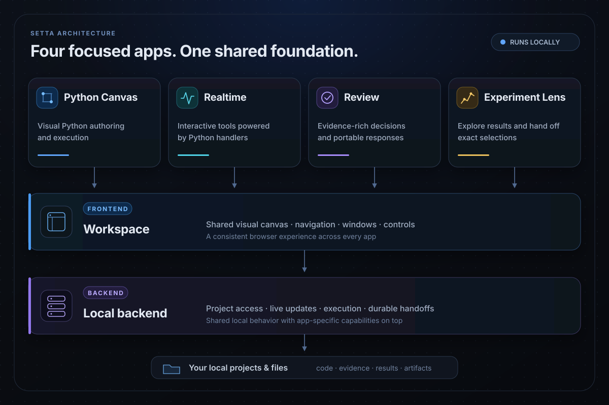

# Setta

**Visual tools for local Python projects, reviews, and experiments.**

Setta turns work on your computer into focused browser workspaces. Your project files and Python
environment stay local while Setta gives you a visual interface for building, exploring, reviewing,
and handing work off. The same projects are available from the command line when you want to
automate a workflow.

## Four ways to work

| App                                               | What it helps you do                                                                                     |
| ------------------------------------------------- | -------------------------------------------------------------------------------------------------------- |
| [Python Canvas](apps/python-canvas/README.md)     | Compose and run Python visually, with generated code and diagnostics close at hand.                      |
| [Realtime](apps/realtime/README.md)               | Build responsive local interfaces powered by ordinary Python handlers.                                   |
| [Review](apps/review/README.md)                   | Compare claims and choices against exact evidence, then record a portable decision.                      |
| [Experiment Lens](apps/experiment-lens/README.md) | Find patterns in recorded results, inspect the observations behind them, and export a precise selection. |

## One shared foundation

The four apps use the same visual workspace and local backend foundation. Each app can stay focused
on its job while navigation, project access, live updates, and local execution feel consistent.



## Why Setta

- **Local by design.** Work directly with your own files and Python environments; no hosted account
  is required.
- **Visual where it helps.** Move between canvases, code, evidence, plots, and artifacts without
  flattening the work into a text-only flow.
- **Ready for automation.** Use the browser for hands-on work and the command line for scripts and
  agents.
- **Portable handoffs.** Keep results, decisions, and selections in explicit project files that
  another person or tool can continue from.

## Get started

Setta is currently a source preview. A usable PyPI release is not available yet. Start with the
[contributor setup](CONTRIBUTING.md#source-setup), then launch one of the included examples from
the repository root:

```sh
pnpm experiment-lens:playground
```

The first launch builds the four apps and installs them into an ignored local environment; allow a
few minutes. Later launches reuse that build until its inputs change. The browser opens a battery
study you can filter, annotate, and explore. Press Ctrl-C in the terminal to stop the app. Your
changes stay in `tmp/experiment-lens-playground/experiment-project` for the next launch.

Try the other examples or create a Python Canvas project:

```sh
pnpm realtime:playground
pnpm review:playground
python3 packages/setta-runtime/scripts/run_local_setta.py python-canvas open \
  --project .local/python-canvas/project.json --create
```

Learn how to [contribute](CONTRIBUTING.md), [get support](SUPPORT.md), or
[report a security issue](SECURITY.md). Setta is licensed under
[Apache 2.0](LICENSE), copyright Kevin Musgrave and Jeff Musgrave.
