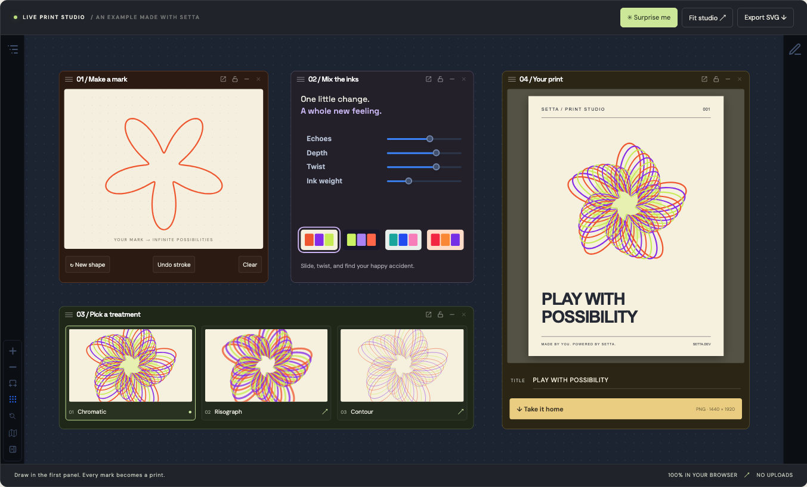

# Setta

**Building blocks for interactive tools.**

Compose React workspaces with typed controls, nested sections, editors, graphs, saved views,
and floating windows. Run live computations in browser workers, or connect a local Go backend
when your tool needs files, Python, or native processes.

[**Play with the print studio →**](https://setta.dev) ·
[Frontend API](packages/workspace/README.md) ·
[Browser pipelines](packages/workspace/BROWSER.md) ·
[Go library](packages/local-backend/README.md)

[](https://setta.dev)

## The libraries

| Library                                                                                    | What it provides                                                                                                                |
| ------------------------------------------------------------------------------------------ | ------------------------------------------------------------------------------------------------------------------------------- |
| [`@riteofstring/setta`](packages/workspace/README.md)                                      | A composable React workspace: controls, sections, navigation, editors, graph presentation, and managed windows.                 |
| [`@riteofstring/setta/browser`](packages/workspace/BROWSER.md)                             | Worker pipelines with dependent stages, latest-input queuing, progress, cancellation, and failure recovery. No server required. |
| [`github.com/riteofstring/setta/packages/local-backend`](packages/local-backend/README.md) | Go packages for loopback hosting, confined project files, live updates, strict JSON, and process lifecycle.                     |

Use them together or independently. Your application owns its data, computations, persistence,
and routes. Setta supplies the workspace and execution building blocks.

The [print studio](https://setta.dev) turns a scribble into a poster: adjust the inks, choose a
treatment, and take home an SVG or PNG. It uses the public frontend and browser pipeline APIs
and runs on static hosting, entirely in your browser. Its [source](https://github.com/riteofstring/setta-site)
is a complete consumer example.

## Start building

The frontend requires React 19 and an ESM bundler such as Vite:

```sh
npm install @riteofstring/setta@0.1.0 react@19.1.1 react-dom@19.1.1
```

```tsx
import {
  createWorkspaceHost,
  WorkspaceProvider,
  WorkspaceShell,
} from "@riteofstring/setta";
import "@riteofstring/setta/styles.css";
```

Follow the [frontend getting started guide](packages/workspace/README.md#getting-started) for a
complete component, or start with a [browser worker pipeline](packages/workspace/BROWSER.md).
For a checkout before registry publication, build and pack the library using the
[contributor setup](CONTRIBUTING.md#source-setup), then install the resulting local tarball.

The [Go guide](packages/local-backend/README.md) covers local hosting and project files.
Neither the React workspace nor the browser pipeline requires Go or Python.

## Four examples to borrow from

These applications demonstrate the libraries in larger local tools. The `setta` Python package
bundles their native servers and browser interfaces.

| Example                                           | Idea                                                     | Run from a checkout                                                         |
| ------------------------------------------------- | -------------------------------------------------------- | --------------------------------------------------------------------------- |
| [Python Canvas](apps/python-canvas/README.md)     | Compose and execute Python visually.                     | [Create a project](apps/python-canvas/README.md#install-and-open-a-project) |
| [Realtime](apps/realtime/README.md)               | Connect live controls and drawings to Python handlers.   | `pnpm realtime:playground`                                                  |
| [Review](apps/review/README.md)                   | Compare evidence and record a portable decision.         | `pnpm review:playground`                                                    |
| [Experiment Lens](apps/experiment-lens/README.md) | Explore recorded results and export a precise selection. | `pnpm experiment-lens:playground`                                           |

Complete [source setup](CONTRIBUTING.md#source-setup) first. The first playground launch builds
the examples; later launches reuse the build. Each opens with an interactive **Start here** guide
and keeps running after the command returns. Add `--stop` to stop it, `--fresh` for a new copy,
or `--no-open` to print its URL. Edits stay in ignored `tmp/` working copies.

## Development

The [workspace component gallery](examples/workspace-playground/) is available with
`pnpm workspace:playground`. It is a development reference; the public playground is the print
studio at [setta.dev](https://setta.dev).

See [contributing](CONTRIBUTING.md), [support](SUPPORT.md), [security](SECURITY.md), and the
[release procedure](docs/releasing.md). Setta is alpha software; APIs may change before 1.0.
Licensed under [Apache 2.0](LICENSE), copyright Kevin Musgrave and Jeff Musgrave.
