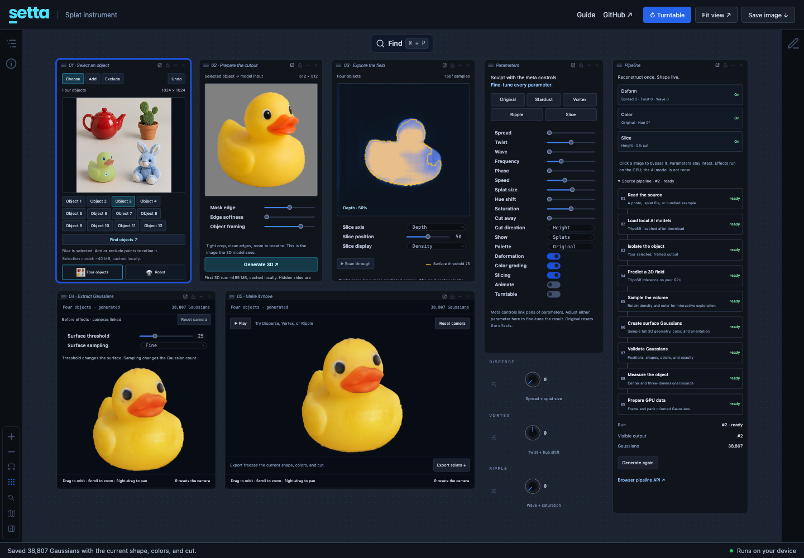

# Setta

**Building blocks for interactive tools.**

Compose React workspaces with typed controls, nested sections, editors, graphs, saved views,
and floating windows. Run live computations in browser workers, or connect a local Go backend
when your tool needs files, Python, or native processes.

[**Turn a photo into 3D →**](https://setta.dev) ·
[Frontend API](packages/workspace/README.md) ·
[Browser pipelines](packages/workspace/BROWSER.md) ·
[Go library](packages/local-backend/README.md)

[](https://setta.dev)

## The libraries

| Library                                                                                    | What it provides                                                                                                                |
| ------------------------------------------------------------------------------------------ | ------------------------------------------------------------------------------------------------------------------------------- |
| [`@riteofstring/setta`](packages/workspace/README.md)                                      | A composable React workspace: controls, sections, navigation, editors, graph presentation, and managed windows.                 |
| [`@riteofstring/setta/browser`](packages/workspace/BROWSER.md)                             | Worker pipelines with dependent stages, latest-input queuing, progress, cancellation, and failure recovery. No server required. |
| [`github.com/riteofstring/setta/packages/local-backend`](packages/local-backend/README.md) | Go packages for loopback hosting, confined project files, live updates, strict JSON, and process lifecycle.                     |

Use them together or independently. Your application owns its data, computations, persistence,
and routes. Setta supplies the workspace and execution building blocks.

The [Gaussian splat playground](https://setta.dev) turns a photo of one object into an inferred 3D
surface and exports it as Gaussian splats. Select an object with interactive segmentation, refine
its cutout, scan through the predicted density field, and adjust the extracted surface without
rerunning AI. Linked raw and final cameras expose what each stage changes. Setta worker pipelines
provide live progress, cancellation, and recovery; native controls reshape, recolor, animate, and
slice the result. Meta controls drive multiple parameters, and export bakes the appearance into a
reusable .splat file. The independent site owns its models and renderer; the libraries acquire no
ML dependencies. Everything runs on static hosting, with no photo upload.

## Start building

The frontend requires React 19 and an ESM bundler such as Vite:

```sh
npm install @riteofstring/setta@0.1.0 react@19.1.1 react-dom@19.1.1
```

```tsx
import {
  createWorkspaceHost,
  WorkspaceProvider,
  WorkspaceShell,
} from "@riteofstring/setta";
import "@riteofstring/setta/styles.css";
```

Follow the [frontend getting started guide](packages/workspace/README.md#getting-started) for a
complete component, or start with a [browser worker pipeline](packages/workspace/BROWSER.md).
For a checkout before registry publication, build and pack the library using the
[contributor setup](CONTRIBUTING.md#source-setup), then install the resulting local tarball.

The [Go guide](packages/local-backend/README.md) covers local hosting and project files.
Neither the React workspace nor the browser pipeline requires Go.

## Development

The [workspace component gallery](examples/workspace-playground/) is available with
`pnpm workspace:playground`. It is a development reference; the public Gaussian splat playground is at [setta.dev](https://setta.dev).

See [contributing](CONTRIBUTING.md), [support](SUPPORT.md), [security](SECURITY.md), and the
[release procedure](docs/releasing.md). Setta is alpha software; APIs may change before 1.0.
Licensed under [Apache 2.0](LICENSE), copyright Kevin Musgrave and Jeff Musgrave.
