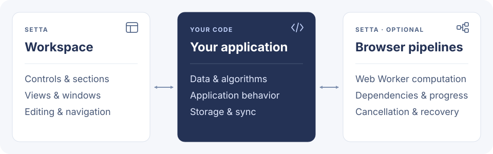
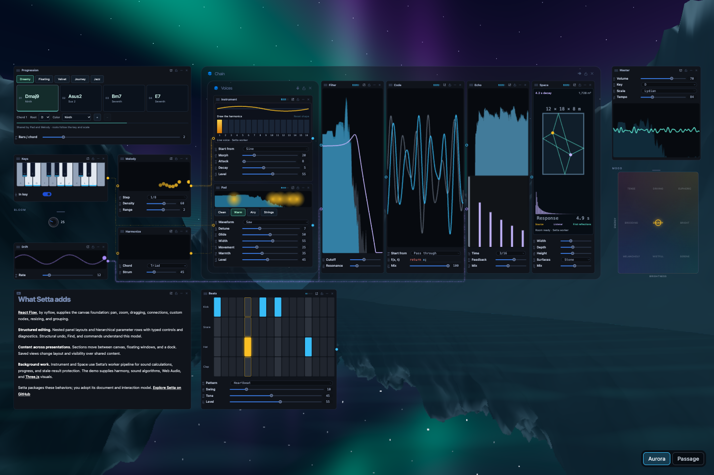

# Setta

**Build interactive tools around your own data and code.**

Setta is a TypeScript/React toolkit for configurable workspaces. Combine typed controls,
nested panels, editors, graphs, saved views and floating windows around your application.
You supply the data and algorithms; Setta supplies the workspace interactions.

[**Get started**](#get-started) ·
[Live example: ambient instrument](https://setta.dev) · [Explore the history](docs/history/highlights.md)

## Why Setta?

| What you want to do                           | What Setta provides                                                                      |
| --------------------------------------------- | ---------------------------------------------------------------------------------------- |
| Organize a complex tool                       | Nested sections, horizontal/vertical groups, and drag-and-drop composition               |
| Let users configure their work                | Typed controls, validation, diagnostics and custom React content                         |
| Present the same content in different ways    | Saved views, canvas layouts, floating windows and focused section surfaces               |
| Navigate and edit large workspaces            | Find, commands and optional structural undo/redo                                         |
| Keep expensive computations off the UI thread | Optional browser worker pipelines with dependencies, progress, cancellation and recovery |

These building blocks suit simulation tools, data explorers, configuration editors and creative
applications. Your application decides what a value means, what a connection does, and where
data is stored.

## How it fits into your application



The workspace and browser pipelines can be used together or independently. Browser pipelines
run trusted application computations in Web Workers on static hosting. Applications can also
connect the workspace to their own backend.

Setta builds on [React Flow](https://reactflow.dev/) by xyflow for its canvas foundation.
React Flow already supplies pan/zoom, draggable nodes, connections and custom React content.
Setta adds a workspace document model and coordinated section layouts, parameter editing,
saved presentations, window handoff and editing operations. Adopting Setta means using those
document and interaction conventions; application logic, storage and sync remain yours.

## Example application: the ambient instrument

[](https://setta.dev)

**The instrument is an example application built with Setta.** Its audio engine, musical rules
and 3D visuals are application code. Setta supplies the workspace, controls, graph interactions and
worker orchestration. The library has no audio or 3D-engine dependency.

[Try the instrument](https://setta.dev) · [See which parts come from Setta](docs/examples/instrument.md)

## Get started

The package is `@riteofstring/setta`, under the
[riteofstring npm organization](https://www.npmjs.com/org/riteofstring). Install it in your React application:

```sh
npm install --save-exact @riteofstring/setta@0.1.0 react@19.1.1 react-dom@19.1.1
```

Import `@riteofstring/setta/styles.css` once, then follow the
[complete component setup](packages/workspace/README.md#getting-started).
The workspace and browser pipelines are entry points of the same package.

| Entry point                      | Guide                                                                                        |
| -------------------------------- | -------------------------------------------------------------------------------------------- |
| `@riteofstring/setta`            | [React workspace and complete component setup](packages/workspace/README.md#getting-started) |
| `@riteofstring/setta/browser`    | [Independent browser worker pipelines](packages/workspace/BROWSER.md)                        |
| `@riteofstring/setta/styles.css` | Import once in your application                                                              |

The frontend requires React 19 and an ESM bundler such as Vite. Setta is alpha software;
APIs may change before 1.0.

### Run from source

You can also build this checkout and install its local tarball.
Use Node 26.10.0 and pnpm 10.23.0. Follow the [contributor setup](CONTRIBUTING.md#source-setup)
to install this checkout's pinned dependencies, then run:

```sh
pnpm --filter @riteofstring/setta build
```

From your consuming application:

```sh
npm install /path/to/setta/packages/workspace/setta.tgz react@19.1.1 react-dom@19.1.1
```

## Six years of experiments

Setta began in 2020 as **ABCDE**, turning Python metadata into interfaces. It became
**ioVuu**, then **Runcoder**, then **Setta**: an experiment tool, a programmable workbench,
and finally a reusable library.

[Explore the interactive history](https://setta.dev/history/). The tour includes
the separate Setta 3 and Setta 4 experiments alongside the workbench and library.

The [illustrated highlights](docs/history/highlights.md) bring together sketch-to-image
experiments, live Python, executable AI workflows, a print studio and browser 3D tools.
The [visual history guide](docs/history/README.md) follows those ideas through screenshots,
feature explanations and implementation links. Historical Python execution, AI integrations
and workbench applications are preserved in Git; the current checkout contains the library.
The project histories are collected in one lineage.

## Development

See [contributing](CONTRIBUTING.md), [support](SUPPORT.md), and [security](SECURITY.md).
The independently maintained instrument is at
[setta.dev](https://setta.dev). Browser regression fixtures live under `fixtures/`.

Licensed under [Apache 2.0](LICENSE), copyright Kevin Musgrave and Jeff Musgrave.
