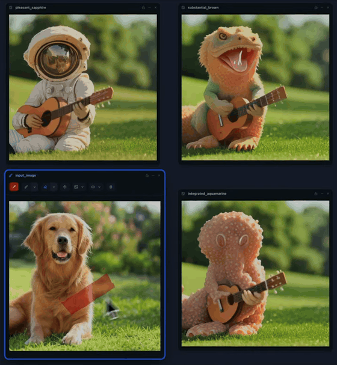

# Setta

**Six years of experiments in how we work with code, data and AI.**

Setta began in 2020 by turning Python arguments into forms. Over six years those
forms spread onto a canvas, ran experiments, stayed connected to live Python and
eventually shared a project with files, tools and AI agents.

This repository keeps that history: the interfaces, the ideas, the detours and the
source behind them. Today it ships a React workspace library.

**[Story](https://setta.dev/)** · **[Features](https://setta.dev/features/)** ·
**[How it worked](https://setta.dev/how-it-worked/)** · **[Audio demo](https://setta.dev/demo/)**

<p align="center">
  <a href="https://setta.dev/features/#f-historical-python-integrations"></a>
</p>

<p align="center"><em>StreamDiffusion in 2025: paint on the input and every generated image follows.</em></p>

## Timeline

| When          | Chapter                                                                              |
| ------------- | ------------------------------------------------------------------------------------ |
| 2020–2021     | [A Python function became a form.](https://setta.dev/#chapter-1)                     |
| 2022–2023     | [The form spread out onto a canvas.](https://setta.dev/#chapter-2)                   |
| 2023–2024     | [Runs gained logs, charts and sweeps.](https://setta.dev/#chapter-3)                 |
| 2024–2025     | [The program stayed alive.](https://setta.dev/#chapter-4)                            |
| 2025–May 2026 | [The whole project moved in, including AI assistants.](https://setta.dev/#chapter-5) |
| Summer 2026   | [Agent work took two detours.](https://setta.dev/#chapter-6)                         |
| Aug–Nov 2026  | [The core got smaller and easier to reuse.](https://setta.dev/#chapter-7)            |

The [history docs](docs/history/README.md) cover the same ground in depth, with sources:
every feature by date, the technology behind each period, screenshots and the original videos.

## Explore the source history

Sixteen related project histories are collected in this repository. Earlier applications
live in earlier commits; the current checkout contains the extracted library. Setta 3
and Setta 4 were separate experiments, while the library came from the Setta 2 workbench.
The [reconstruction guide](docs/history/methodology.md) explains the lineage and how to
browse each version's source through `source/*` and `milestone/*` tags without building it.

## The library

`@riteofstring/setta` provides React workspaces: a canvas of movable sections, typed
controls, panes and commands, plus optional browser worker pipelines. Applications supply
their own data, algorithms and persistence. It requires React 19 and an ESM bundler, and
its APIs are still alpha.

```sh
npm install --save-exact @riteofstring/setta@0.1.0 react@19.1.1 react-dom@19.1.1
```

[](https://setta.dev/demo/)

_The [audio demo](https://setta.dev/demo/) wraps an application-owned audio engine in
Setta panels and controls._

[Getting started](packages/workspace/README.md#getting-started) ·
[Workspace API](packages/workspace/README.md) · [Browser pipelines](packages/workspace/BROWSER.md)

[Contributing and building from source](CONTRIBUTING.md) · [Support](SUPPORT.md) ·
[Security](SECURITY.md)

Licensed under [Apache 2.0](LICENSE), copyright Kevin Musgrave and Jeff Musgrave.
