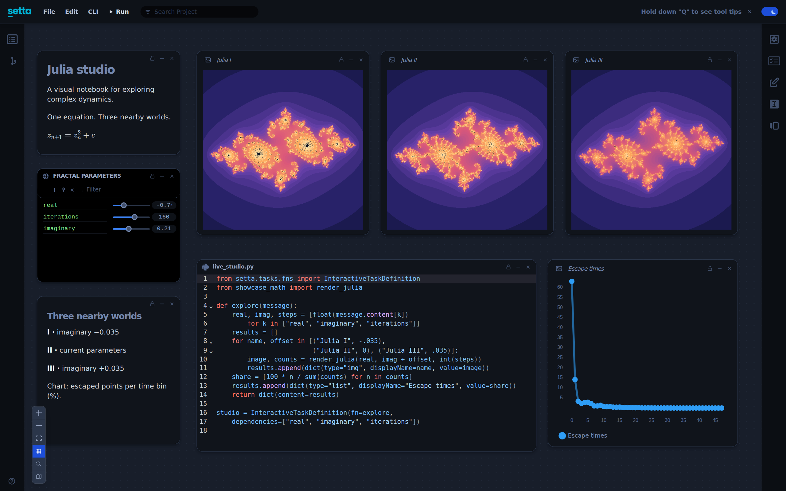

# Setta

**Six years of experiments in how we work with code, data and AI.**

Setta began in 2020 as **ABCDE**, turning Python arguments into interfaces. It became
**ioVuu**, then **Runcoder**, then **Setta**: a spatial experiment tool, a programmable
workbench, and a series of explorations in working with AI agents. The recurring idea
was to keep controls, code and results together in a workspace you could reshape.

This repository preserves that history: the interfaces, the ideas, the detours and
the source behind them. The current React package is one outcome of that work.

[**Explore the interactive retrospective →**](https://setta.dev/history/)

[Illustrated highlights](docs/history/highlights.md) ·
[History guide](docs/history/README.md) · [All documentation](docs/README.md)

_Change a parameter, watch Python recompute the images. Julia studio demonstrates the
November 2024 application; [capture details](docs/history/images.md#earlier-restoration-captures)._

## Ideas explored along the way

| Period                       | What changed                                                                                                                                                                                           |
| ---------------------------- | ------------------------------------------------------------------------------------------------------------------------------------------------------------------------------------------------------ |
| 2020–2021 · ABCDE            | [Python functions and classes became composable controls, then executable programs.](docs/history/features/python-interfaces.md)                                                                       |
| 2022–2023 · ioVuu → Runcoder | [The interface became a canvas of movable sections, groups and reusable configurations.](docs/history/features/spatial-controls.md)                                                                    |
| 2023–2024 · Runcoder → Setta | [Saved variants, parameter sweeps, terminals and charts brought experiments into the workspace.](docs/history/features/experiments.md)                                                                 |
| 2024–2025 · Setta            | [Live Python, drawing and generated images connected controls to visible results.](docs/history/highlights.md#put-images-mathematics-and-code-on-the-same-canvas)                                      |
| 2025–2026 · Setta workbench  | [Files, Git, remote environments, agents and executable workflows shared one project.](docs/history/features/workbench.md)                                                                             |
| Summer 2026 · Setta 3 & 4    | [Separate experiments explored scrolling agent workspaces, research graphs and a Director command center.](docs/history/features/libraries-and-detours.md#summer-2026-two-agent-workspace-experiments) |
| August–November 2026         | [Workspace interactions became a library used by creative tools and focused research applications.](docs/history/features/libraries-and-detours.md)                                                    |

The [illustrated tour](docs/history/tour.md) follows the changing interfaces. For individual
features and their implementation dates, use the [source-linked chronology](docs/history/feature-history.md).

## Explore the source history

Sixteen related project histories are collected in this repository. Earlier applications
live in earlier commits; the current checkout contains the extracted library. Setta 3
and Setta 4 were separate experiments, while the library came from the Setta 2 workbench.

The [repository timeline](docs/history/timeline.md) identifies the source trees and major
boundaries. The [reconstruction guide](docs/history/methodology.md) explains the lineage,
its limits, and how to browse `source/*` and `milestone/*` tags without building anything.

## Current package

`@riteofstring/setta` provides configurable React workspaces and optional browser worker
pipelines. Applications supply their own data, algorithms and persistence. Historical
Python runtimes, AI integrations and workbench applications remain in the source history.

[Try the audio demo](https://setta.dev) ·
[Workspace API](packages/workspace/README.md) · [Browser pipelines](packages/workspace/BROWSER.md)

### Get started

Follow the [package installation and component setup](packages/workspace/README.md#getting-started).
The package requires React 19 and an ESM bundler; its APIs are still alpha.

### Run from source

Use Node 26.10.0 and pnpm 10.23.0. Follow the [contributor setup](CONTRIBUTING.md#source-setup),
then build the current package with `pnpm --filter @riteofstring/setta build`.
Install the resulting `packages/workspace/setta.tgz` from your consuming application.

[Contributing](CONTRIBUTING.md) · [Support](SUPPORT.md) · [Security](SECURITY.md)

Licensed under [Apache 2.0](LICENSE), copyright Kevin Musgrave and Jeff Musgrave.
