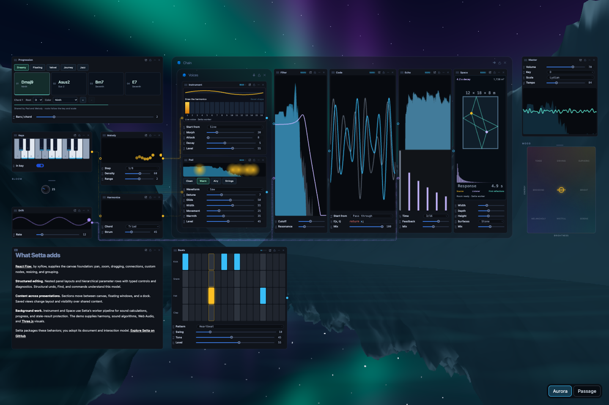

# Example application: an ambient instrument

[Documentation](../README.md) / Package examples

The [instrument at setta.dev/demo](https://setta.dev/demo/) demonstrates one application of
Setta's workspace and browser pipelines. Its musical behavior is implemented by
the consuming application.

| In the demo                              | Setta supplies                                             | The application supplies                                         |
| ---------------------------------------- | ---------------------------------------------------------- | ---------------------------------------------------------------- |
| Sound modules on a canvas                | Sections, nested layouts, controls and editors             | Instruments, effects and parameter meanings                      |
| Cables between modules                   | Ports, edge presentation and connection gestures           | Audio routing, note events, modulation and connection rules      |
| Rearranging and floating modules         | Nested layouts and managed windows                         | How position and visibility affect sound                         |
| Generated waveforms and room responses   | Worker scheduling, dependencies, progress and cancellation | Waveform synthesis, acoustic calculations and Web Audio playback |
| Animated landscapes and visual responses | Workspace UI over a custom background                      | Three.js scenes and their response to music                      |

In this example, horizontal groups chain audio and vertical groups layer it.
Minimizing a module bypasses it. These are application-defined meanings attached
to general workspace operations. Another application could interpret those same
operations as stages of a simulation, a data-processing tool or an editor.

The instrument is maintained separately from this library and runs on static
hosting. Setta's package takes no dependency on its audio engine or 3D renderer.

[Try the instrument](https://setta.dev/demo/) · [Back to Setta](../../README.md)
