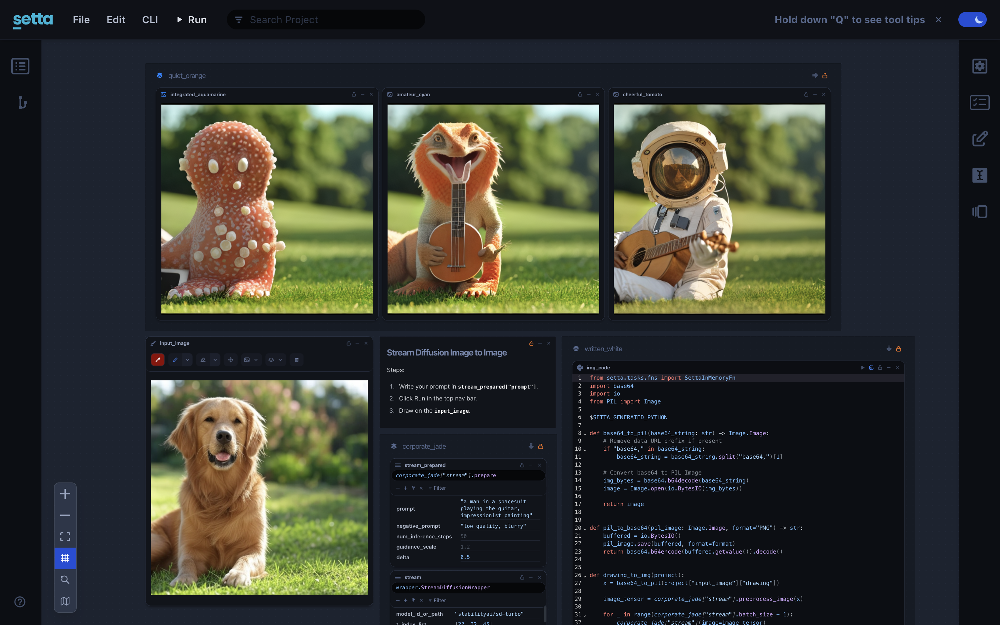
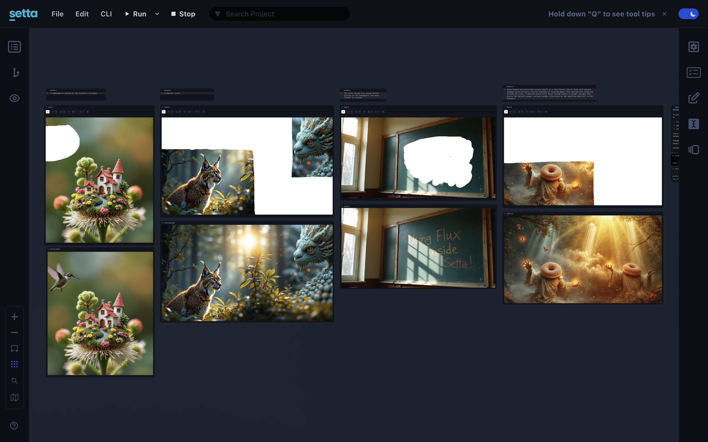
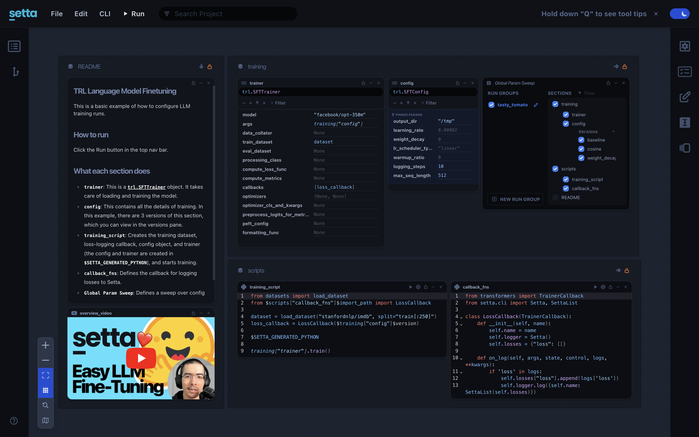
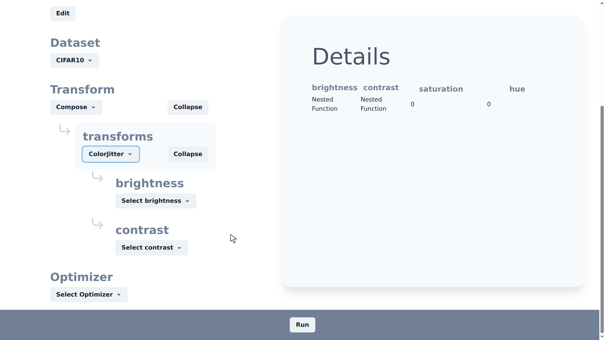
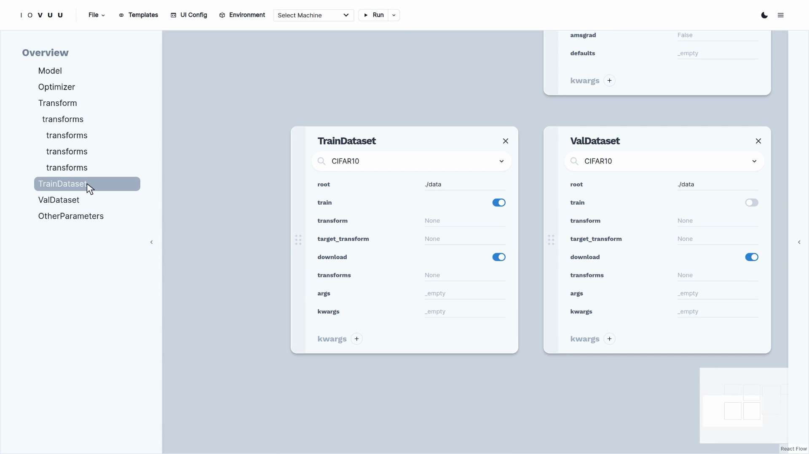
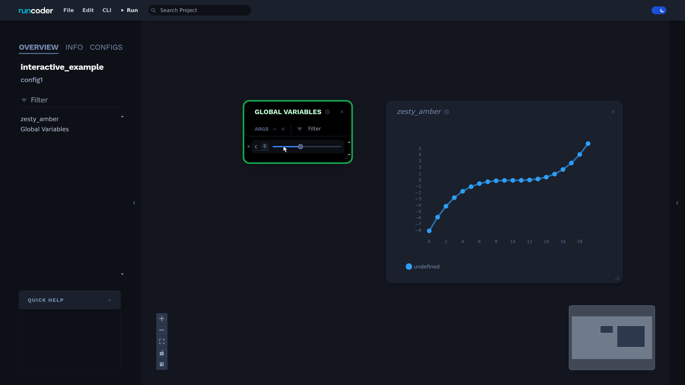
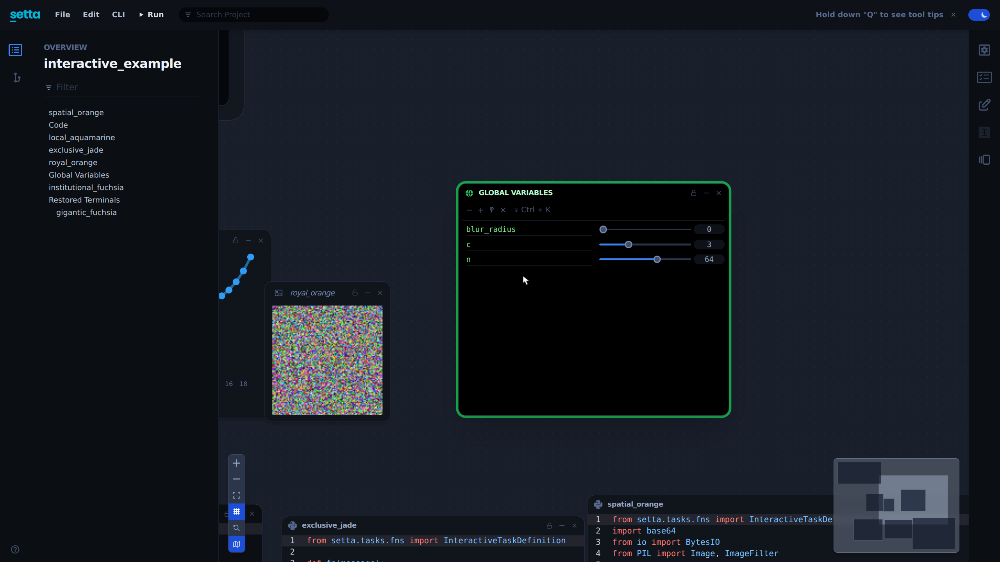
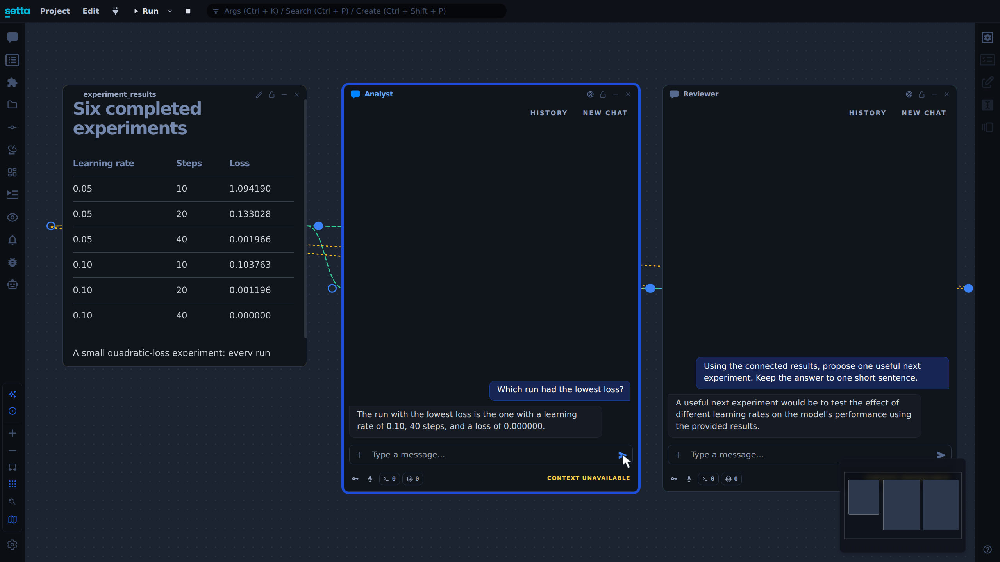
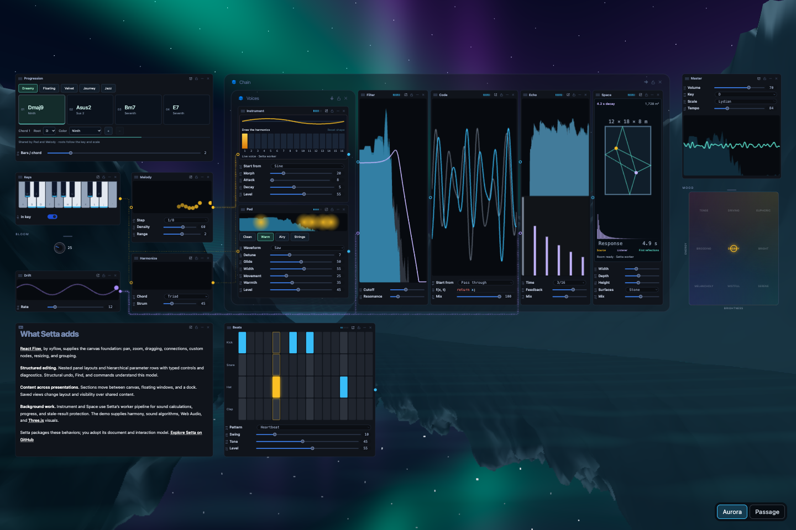

# Six years of building with Setta

Setta began in 2020 as **ABCDE**, a way to turn Python metadata into interfaces.
It became **ioVuu**, then **Runcoder**, then **Setta**. Across those names, the recurring
idea was to bring configuration, code and results into a space people could rearrange.
The current library makes those workspace interactions available to other applications.

This guide follows the ideas and their changing interfaces. The repository combines
16 related source histories on one `main` branch; older applications are found in earlier
commits, while the current checkout contains the library.

[Composition timeline](timeline.md) · [Reconstruction methodology](methodology.md) ·
[Image provenance](images.md) · [Current library](../../README.md)

## From a sketch to an AI image

**Stream Diffusion:** sketch on an image and explore several generated variations in the same
workspace. This original example put drawing, prompts, Python and results side by side.
[Watch it in action](https://www.youtube.com/watch?v=KE6FZxbGVkw) or [explore all seven original examples](examples.md).

| Image editing with FLUX                                                                               | Language-model finetuning with TRL                                                                              |
| ----------------------------------------------------------------------------------------------------- | --------------------------------------------------------------------------------------------------------------- |
|  |  |
| Paint a mask and explore image edits.                                                                 | Compose model, dataset and training settings.                                                                   |

These examples belong to the historical Python application. Today's React library carries
forward its configurable workspace. The tour below traces that evolution; captions distinguish
original previews from restored builds, and [image provenance](images.md) records their sources.

## The journey at a glance

| Period                       | Idea                                                                  |
| ---------------------------- | --------------------------------------------------------------------- |
| 2020–2021 · ABCDE            | Turn Python arguments into composable interfaces.                     |
| 2022–2023 · ioVuu → Runcoder | Arrange configuration on a navigable canvas.                          |
| 2023–2024 · Runcoder         | Bring execution, charts and experiment comparison into the workspace. |
| 2024–2025 · Setta            | Connect images, models, code and live state.                          |
| 2025–2026 · Setta            | Explore a programmable workbench with files, chats and workflows.     |
| 2026 onward · The library    | Make workspace interactions reusable in other applications.           |

## 2020–2021: Python becomes an interface

**Historical application: ABCDE.** A Python function or class could describe its arguments,
allowing the frontend to generate a form. Nested callables made configurations composable:
a transform could contain another transform rather than stopping at a flat list of fields.
Generated Python and execution followed, alongside experiments in control types and navigation.

_Restored November 2020 build: nested configuration forms._

[Follow Python metadata, generated code and execution](features/python-interfaces.md).
The December 2020 sweep editor was explicitly a **UI prototype without execution logic**.

## 2022–2023: a spatial workspace, ioVuu → Runcoder

**Historical application.** Configuration sections became independently positioned canvas
nodes. Groups, orientation, an outline and search helped organize larger projects, while
Markdown brought explanations into the workspace. Generated launch commands connected the
interface with code execution.

_Restored June 2022 ioVuu build: navigating and editing a configuration._

ioVuu is evidenced by May 2022; the **Runcoder** rename follows in August 2022.
Earlier list reordering and pan/zoom experiments were distinct from the free positioning
implemented in February 2022.
[Explore controls, grouping and navigation](features/spatial-controls.md).

## 2023–2024: local execution and experiment management

**Historical application: local Runcoder.** Editors, terminals and interactive Python brought
the execution environment into the project. A control could affect a calculated result;
versions and run groups supported comparing configurations instead of repeatedly rebuilding
them by hand.

_Restored January 2024 build: a parameter alongside its interactive Python result._

Executable parameter-value sweeps appear in January 2024. Sweeps across saved versions
extend them in February. Hover previews of section versions date to December 2023,
separately from the early 2021 saved-version experiment.
[Explore experiments, versions and execution](features/experiments.md).

## 2024–2025: Setta connects representations and live state

**Historical application.** The **Setta** name arrives in July 2024. The workspace grew to
combine richer controls, code, image inputs, charts and documentation. YAML round trips
and reference-aware renaming connected visual configuration to text. Later, listeners,
generated state classes and bound files connected edits to running Python and ordinary
source files.

_Restored November 2024 build: the GUI after a YAML edit sets `c` to 3 and `n` to 64._

Model-backed canvas chat appears in February 2025, project chat develops in March–April,
and MCP workspace operations follow in April. Standalone meta controls arrive in December,
separately from the generated state class introduced in May.
[Explore reactive state and AI](features/reactive-ai.md).

## 2025–2026: a programmable workbench

**Historical application.** Files, Git, SSH workspaces,
plugins, spreadsheets and task boards expanded the workspace beyond experiment configuration.
Saved views presented different surfaces over one project. Chats could receive connected
context, invoke one another and participate in executable workflows.

_Restored March 2026 build with a new demonstration project and a substitute local model:
two chats receive connected experiment results._

Execution also changed form: the old sweeps and run groups were removed in June 2025;
January 2026's SettaRunner and RunPlan added grids, zipped values, sampling, repetition
and detached jobs. Hosted projects, later share deployments and app mode were separate
attempts to turn workspaces into tools other people could use.
[Explore the workbench](features/workbench.md) and [execution's return](features/experiments.md).

## 2026 onward: reusable building blocks

**Current library.** Extraction starts in August 2026 on the Setta 2-derived line. Browser
pipelines follow in October; the Python runtime is removed that month, and the unused Go
backend in November. The result is a TypeScript/React toolkit: the application supplies its
data, computations and persistence, and Setta supplies the workspace and optional worker
coordination.

_An independently maintained application built with the current library. Setta supplies
workspace interactions and worker coordination; the instrument supplies its musical rules,
audio engine and 3D scenery._

**Experiments:** Setta 3 and Setta 4 are also preserved. They explored other directions;
they were not ancestors of the original current-library line. Explicit transitions make
those detours browsable within this reconstructed single lineage.
[Trace extraction and the parallel experiments](features/libraries-and-detours.md).

## Browse by feature or source

- [Python interfaces, generated code, YAML and developer tooling](features/python-interfaces.md)
- [Controls, composition, documentation and navigation](features/spatial-controls.md)
- [Versions, sweeps, run groups and detached execution](features/experiments.md)
- [Listeners, generated state, meta controls and AI](features/reactive-ai.md)
- [Agents, workflows, sharing and the wider workbench](features/workbench.md)
- [Library extraction and experimental directions](features/libraries-and-detours.md)
- [Which repositories coexist, with tags and folder examples](timeline.md)
- [How to browse locally and interpret the reconstructed history](methodology.md)

Original media also survives in source history:
[historical Setta demonstration](https://github.com/riteofstring/setta/blob/9e717b00240916fa8156cdeb4758127ad95e5a04/images/hero.mp4) ·
[compact Setta introduction](https://github.com/riteofstring/setta/blob/c728188acf354fe5cd8878109958cd60a43d2611/images/setta-intro-small.mp4).

The current [ambient instrument](https://setta.dev) is another application built with the
library. Its website, the older website and the old documentation website are maintained
outside this source lineage.
