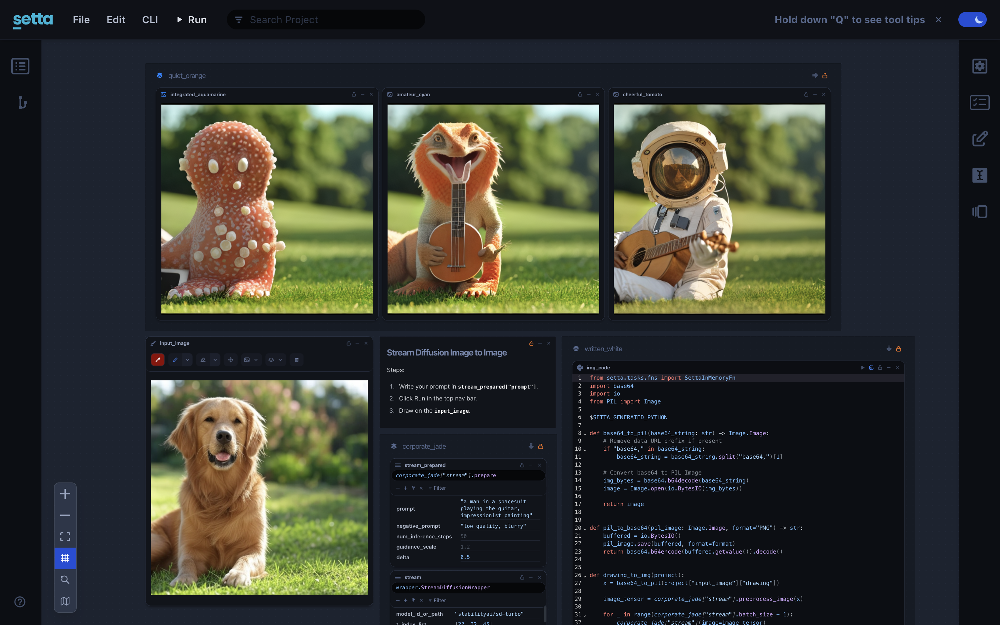
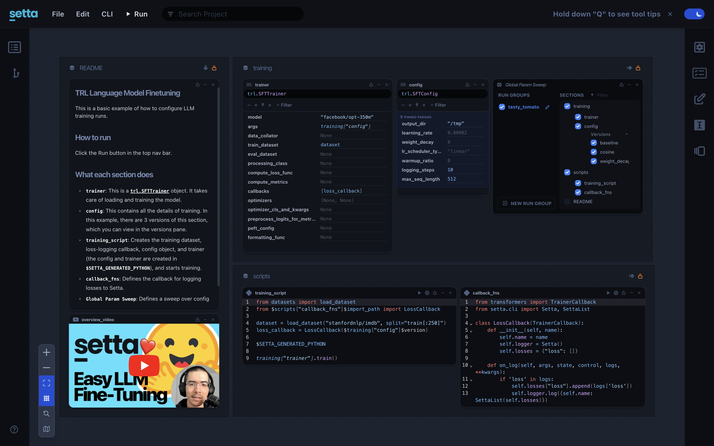
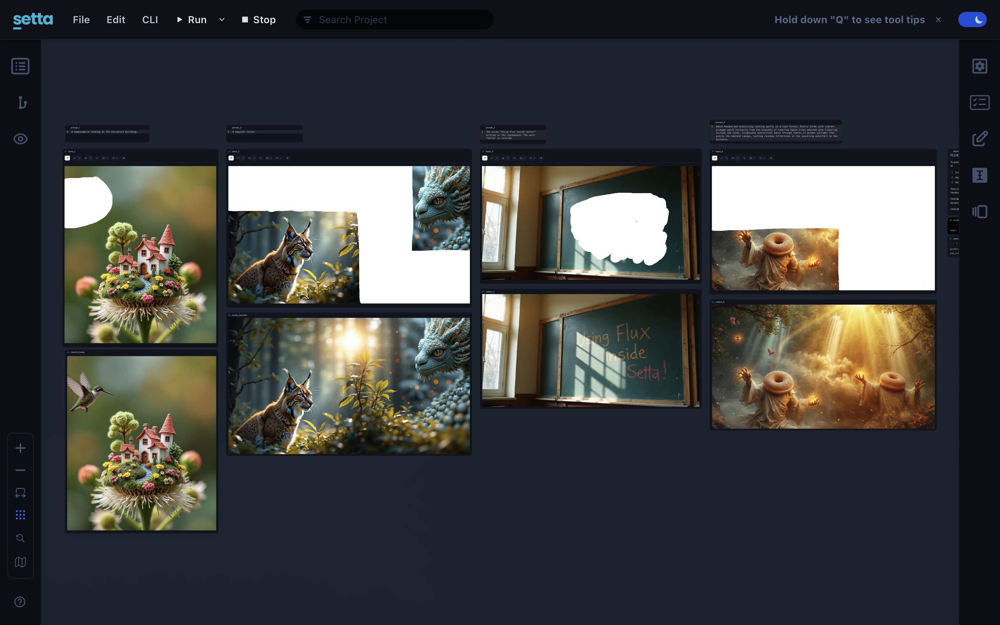
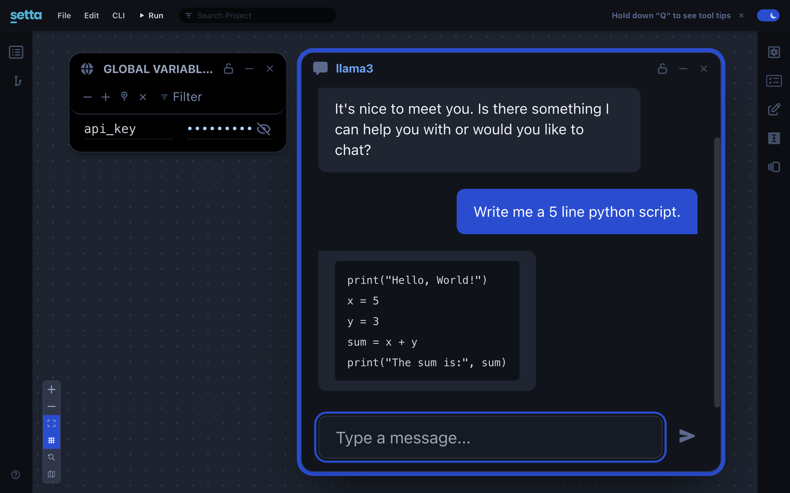
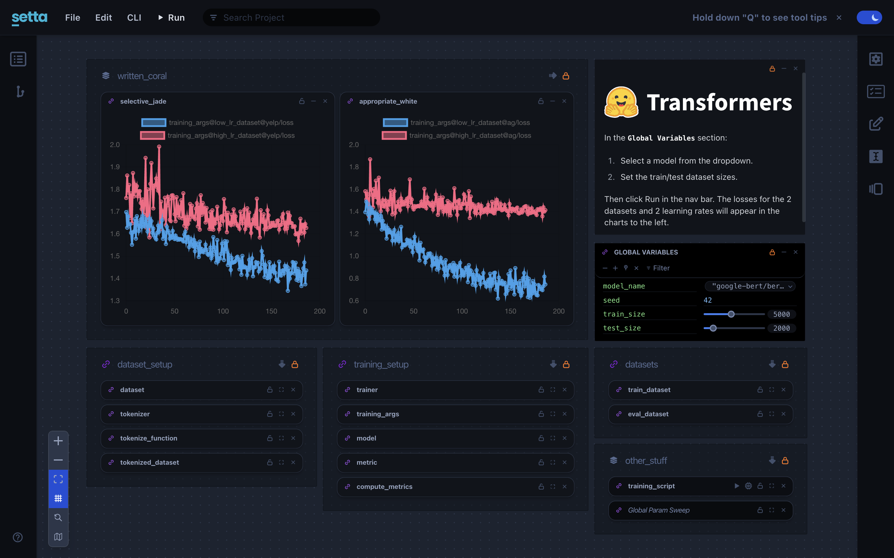
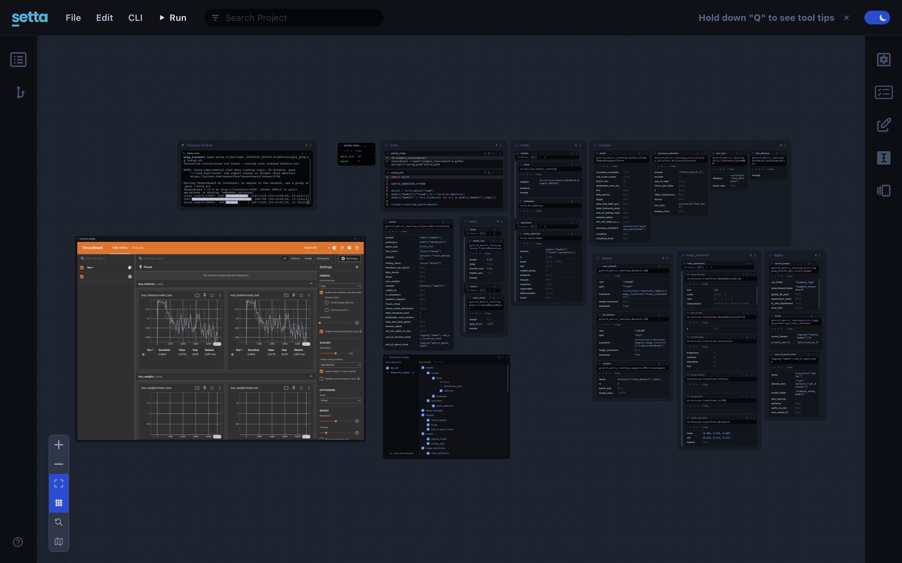
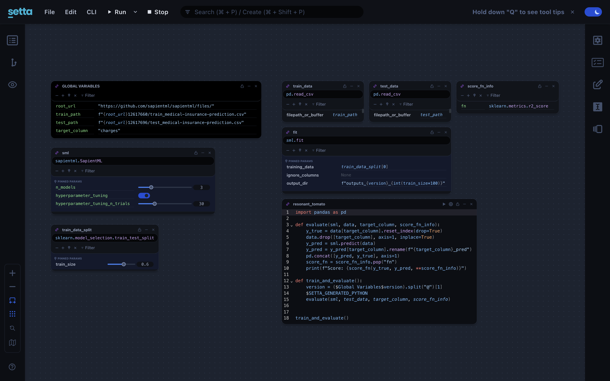

# Made with Setta: the original examples

A drawing could become several AI images. A canvas of controls could configure a training
run. A chat, its model settings, and the Python that powered it could share one workspace.
These projects show how the historical Setta application put code, inputs and results together.

The screenshots below are original previews recovered from the preserved `settadev/examples`
README. Each project links to its archived source in this repository. They use the historical
Python application and its dependencies; they are not examples for the current npm API.

[Visual history](README.md) · [Image sources](images.md#original-example-screenshots)

## Stream Diffusion Image to Image

A real-time drawing interface that creates multiple AI-enhanced images as you sketch in parallel.

[Explore the preserved project](https://github.com/riteofstring/setta/tree/bb40a0d890c29a43039c52bfb3859a1e6e6ed287/setta-examples/stream_diffusion_img_to_img)

[Watch the original demonstration](https://www.youtube.com/watch?v=KE6FZxbGVkw).

## TRL Language Model Finetuning

Trying out different training configurations, using the Hugging Face Transformer Reinforcement Learning (TRL) library.

[Explore the preserved project](https://github.com/riteofstring/setta/tree/bb40a0d890c29a43039c52bfb3859a1e6e6ed287/setta-examples/trl_language_model_finetuning)

## Flux Inpainting

Use the FLUX.1-Fill-dev model by Black Forest Labs to inpaint and outpaint images.

[Explore the preserved project](https://github.com/riteofstring/setta/tree/bb40a0d890c29a43039c52bfb3859a1e6e6ed287/setta-examples/bfl_flux_fill)

## Groq API Chat

Chat with Llama 3.3 using the Groq API.

[Explore the preserved project](https://github.com/riteofstring/setta/tree/bb40a0d890c29a43039c52bfb3859a1e6e6ed287/setta-examples/groq_api_chat)

## Transformers Sequence Classification

Train text classification models using the Hugging Face Transformers library.

[Explore the preserved project](https://github.com/riteofstring/setta/tree/bb40a0d890c29a43039c52bfb3859a1e6e6ed287/setta-examples/transformers_trainer)

## PyTorch Metric Learning

Finetune embedding models using different metric learning algorithms.

[Explore the preserved project](https://github.com/riteofstring/setta/tree/bb40a0d890c29a43039c52bfb3859a1e6e6ed287/setta-examples/pytorch_metric_learning_trainer)

## SapientML

Use AutoML to find the best model for tabular data.

[Explore the preserved project](https://github.com/riteofstring/setta/tree/bb40a0d890c29a43039c52bfb3859a1e6e6ed287/setta-examples/sapientml_automl)
