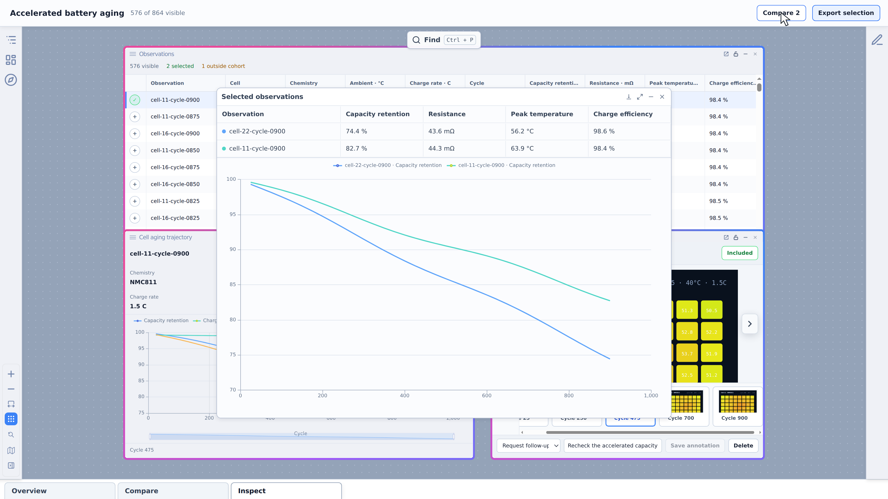
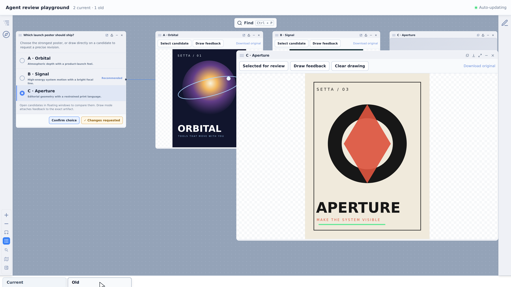
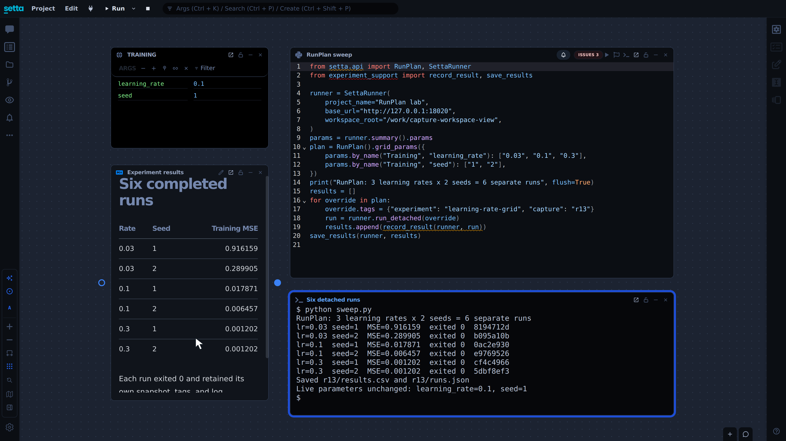

# Four features in motion

These short demonstrations expand four ideas from the [chronological feature history](feature-history.md).
They accompany the [4:37 overview](film.md), with time to follow an action through to its result.
All four were recorded from restored applications on November 23, 2026. They are silent;
the steps below describe the visible actions and outcomes.

| Demonstration   | Watch                                                         | What the recording establishes                                                                                    |
| --------------- | ------------------------------------------------------------- | ----------------------------------------------------------------------------------------------------------------- |
| Experiment Lens | [49 seconds](https://setta.dev/history/#experiment-lens-demo) | A shared selection survives filtering, joins trajectories to a thermal artifact, and exports with its annotation. |
| Review          | [46 seconds](https://setta.dev/history/#review-demo)          | A qualified claim and an image-specific request for changes become durable human responses.                       |
| Bench           | [38 seconds](https://setta.dev/history/#bench-demo)           | Two candidates execute against ten cases each; their generated images support a saved preference.                 |
| RunPlan         | [23 seconds](https://setta.dev/history/#runplan-demo)         | A three-by-two parameter grid produces six successful detached runs while the live parameters stay unchanged.     |

## Experiment Lens: keep an investigation together

The original simulated battery study contains 864 observations across 24 cells.
Select cell 22 at cycle 900, then exclude LCO chemistry: the visible cohort drops
to 576 observations, but the selected observation remains in the basket with an
outside-cohort indicator. Select cell 11, click its trajectory at cycle 300, then
advance the linked gallery to cycle 475.

A follow-up annotation asks to recheck the accelerated capacity loss at that
checkpoint. Include the exact thermal artifact, compare the two trajectories,
and export the selection. The downloaded packet contains both observations,
the thermal artifact and its annotation; the saved selection also survives reload.
These are simulated measurements opened for analysis. Experiment Lens does not
launch the experiments that produced them.

## Review: make the decision traceable

The checkout example contains conflicting imported assessments of the claim
“No database migration is required.” Inspect its Git evidence, then qualify the
claim: “Confirm the audit sink is schemaless before rollout.” That decision
leaves the other four claims unresolved; it does not approve the whole completion.

In the poster comparison, open C · Aperture in a floating window, underline the
red subtitle and request more contrast. Submitting the response moves the request
from Current to Old. The saved response identifies the exact image and retains
the normalized drawing with the requested change. The requests, posters and model
assessments are original fictional fixtures. No new model inference is shown.

## Bench: compare actual candidate outputs

Launch the original product-thumbnail comparison. Contain and Cover each run on
the same ten generated catalog images, yielding twenty case results and twenty
new image artifacts. Both candidates pass the shared checks. Browse the outputs
in Compare, choose Cover and save: “Cover makes the product larger in the square
preview.” The preference and note persist after reload.

Unlike Experiment Lens, Bench executes the candidate commands. Its recorded
measurements describe this small local example, not a general performance ranking.

## RunPlan: vary a snapshot without changing the project

The May 2026 workbench runs a prepared numerical experiment through the original
Python `SettaRunner` and `RunPlan` APIs. `grid_params` combines three learning
rates with two random seeds. Each `run_detached` invocation gets a separate
snapshot, run identifier, tags, status and log.

The experiment fits a line to 81 synthetic samples with 40 gradient steps.
The results below come from the six runs' actual standard output. The helper
writes a CSV and displays those results in a native text section.

| Learning rate | Seed 1 training MSE | Seed 2 training MSE |
| ------------- | ------------------: | ------------------: |
| 0.03          |            0.916159 |            0.289905 |
| 0.1           |            0.017871 |            0.006457 |
| 0.3           |            0.001202 |            0.001202 |

All six runs exit successfully. Reading the project state afterward confirms
that its live learning rate remains `0.1` and its seed remains `1`. Training
loss measures fit on these samples; it does not establish generalization.
The restored editor displays three analysis diagnostics for the SDK/helper
imports and inferred type, while execution completes successfully.

This January 2026 API was a new design after the old sweep cards were removed
in June 2025. The clip demonstrates a grid, not RunPlan's random, zipped or
repeated plans.

## Sources and coverage

Bench uses [September 13 source](https://github.com/riteofstring/setta/tree/674bbd18ad04c6878c128784920dd0ac08263dd1/apps/bench).
Experiment Lens and Review use [October 11 source](https://github.com/riteofstring/setta/tree/74837d35da5cb21bdff2ebc1ebaab0cbb77d5ceb/apps).
RunPlan uses the [May 10 workbench](https://github.com/riteofstring/setta/tree/eea7fb38c8fdb452766d06b08610248e2962c4fc).
These applications and the Python runner are preserved historical software;
they are not bundled services in today's React library.

The [image provenance](images.md#focused-feature-demonstrations) records the
restoration and media sources. The overview and promo keep their existing edits.
The clips add depth to these four areas; the [source history](feature-history.md)
remains the fuller inventory, including unfilmed modes and integrations.
