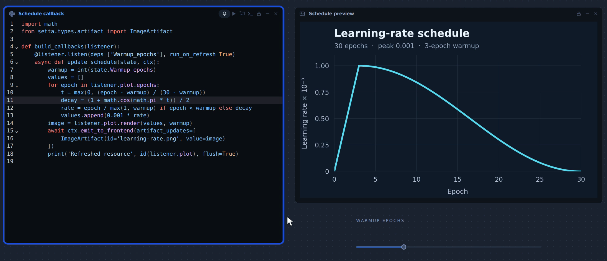
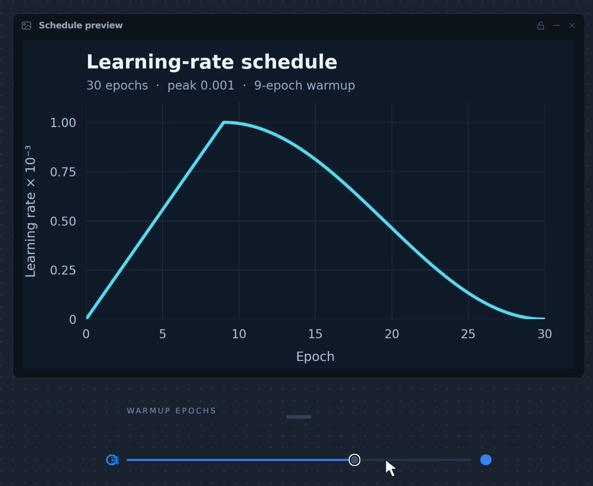

# Features in motion

[Documentation](../README.md) / [History](README.md)

These demonstrations expand the [chronological feature history](feature-history.md).
They appear on the [retrospective webpage](https://setta.dev/history/), with time
to follow an action through to its result. The [coverage index](coverage.md) maps the full feature inventory to
recordings, real app images and explanations. The clips are silent; the steps
below describe the visible actions and measured outcomes.

| Walkthrough                                                           | Watch                                                    | What the recording establishes                                                                    |
| --------------------------------------------------------------------- | -------------------------------------------------------- | ------------------------------------------------------------------------------------------------- |
| [Python Canvas](#python-canvas-change-the-model-then-execute-it)      | [Watch](https://setta.dev/history/#programming-apps)     | Change a model parameter, execute it and inspect measured results and generated Python.           |
| [Realtime](#realtime-one-drawing-two-treatments-one-joined-result)    | [Watch](https://setta.dev/history/#programming-apps)     | Edit a drawing and its recipe, then inspect actual branch and joined outputs.                     |
| [Callback hot reload](#live-python-edit-the-running-callback)         | [Watch](https://setta.dev/history/#live-python)          | Replace linear decay with a cosine formula and see the running plot change.                       |
| [Live front panel](#front-panel-change-the-warmup)                    | [Watch](https://setta.dev/history/#app-mode)             | Move a warmup slider and see the schedule's peak move with it.                                    |
| [Project assistant](#agents-ask-for-a-configurable-training-program)  | [Watch](https://setta.dev/history/#agents)               | Request a configurable trainer, inspect real tool checks and adjust generated controls.           |
| [Connected context](#connected-context-recommend-the-next-experiment) | [Watch](https://setta.dev/history/#agents)               | Supply a note through a connection, then inspect the recommendation grounded in its measurements. |
| [Workflows](#workflows-wait-for-two-independent-reviews)              | [Watch](https://setta.dev/history/#agents)               | Run two reviews and follow the gate that waits for both to finish.                                |
| [Window Spaces](#window-spaces-return-to-the-evidence)                | [Watch](https://setta.dev/history/#workbench)            | Restore a saved window arrangement around the same project evidence.                              |
| [Experiment Lens](#experiment-lens-keep-an-investigation-together)    | [Watch](https://setta.dev/history/#experiment-lens-demo) | Filter a cohort, compare cells, join thermal evidence and export the annotated selection.         |
| [Review](#review-make-the-decision-traceable)                         | [Watch](https://setta.dev/history/#review-demo)          | Save a qualified claim and an image-specific request for changes as human responses.              |
| [Bench](#bench-compare-actual-candidate-outputs)                      | [Watch](https://setta.dev/history/#bench-demo)           | Execute two candidates against ten cases each and save a preference based on their images.        |
| [RunPlan](#runplan-vary-a-snapshot-without-changing-the-project)      | [Watch](https://setta.dev/history/#runplan-demo)         | Run a three-by-two parameter grid while the live parameters stay unchanged.                       |

## Python Canvas: change the model, then execute it

Model Workshop composes Python callables into an executable program. The original
example generates a two-moons classification problem, builds polynomial features,
and fits a classifier. Increasing degree from 1 to 3 changes the learned boundary:
held-out accuracy rises from 83.3% to 94.2%, training accuracy from 86.8% to 97.9%,
and held-out mistakes fall from 20 to 7 of 120. These are the actual terminal
results of this synthetic example, not a benchmark claim.

The recording also inspects the protected generated block inside the authored
Python file. Visual configuration supplies constructor calls while the surrounding
program owns its computation. Python Canvas's runtime belonged to this historical
application; the current React library does not include it.

## Realtime: one drawing, two treatments, one joined result

Move a triangle in the original Signal Bloom drawing. A preparation handler feeds
independent Aurora and Riso treatments, then a join produces the poster from the
same input lineage. The motion preview follows the updated outputs. A companion still shows
the native Python recipe editor beside its composed poster. Source edits can be
applied to the running pipeline; the original app source and retained fixture
remain intact.

The wide graph leaves clear corridors between sections. Realtime's revision checks,
latest-input scheduling, retained last output and cooperative cancellation are
explained from source; this clip does not pretend to exercise every race condition.

## Live Python: edit the running callback

The learning-rate lab starts with a straight decay after a three-epoch warmup.
Replace `decay = 1 - t` with `(1 + math.cos(math.pi * t)) / 2` and save the file.
The plot changes to a cosine curve without restarting the program. The code and
its large graphical result stay beside each other throughout the edit.

This is a new demonstration project running in the preserved March 2026
workbench. Its actual SettaListener reloads the callback and emits the updated
image. The retained runtime log confirms that the same connection and plot
resource survive the edit; the graph is computed by Python, not added to the
recording.

## Front panel: change the warmup

Move the same program's native meta-control slider from 3 to 9 warmup epochs.
The ramp becomes longer and the peak moves from epoch 3 to epoch 9. Moving the
slider back restores the original curve. The plot and slider remain in view,
with a pause at each settled result.

This focused example demonstrates a live control feeding a running program.
Other supported meta-control widgets and button actions are described in the
[feature history](feature-history.md#december-ai-navigation-named-views-and-standalone-controls).

## Agents: ask for a configurable training program

The March workbench receives a high-level request to write a small PyTorch image
classifier and make its training configurable. The OpenCode integration writes a
real Python file; Watch Code discovers its typed function and generates epochs,
batch size, learning rate and seed controls. Corrective conversation turns fix
imports and validation. The completed help and dry-run commands execute in the
historical workspace. No code or successful tool output is inserted for the model.

The exact generated file is also checked in Runpod's existing PyTorch 2.8.0+cu128
environment: two training epochs produce a finite 2,410-parameter model and a
three-image, ten-class output. This separate check establishes that the generated
program runs. It is not presented as training inside the March workspace, whose
environment does not include PyTorch. Model output uses local Qwen3-30B-A3B;
this is a restored integration, not a claim about an original 2026 model response.

## Connected context: recommend the next experiment

[Watch the note-to-chat connection](https://setta.dev/history/#agents).

A high-level request asks which learning rate to investigate next and what evidence
is missing. The prompt does not repeat the measurements: the March workbench
supplies them through a native incoming read-only note connection. The real model
response identifies the tied minimum training loss of 0.007273 at 0.3 and 0.6,
then calls for unseen validation data. The note, chat and straight connection
remain visible together.

The native read-only notice is accurate: the chat can read the linked evidence
but cannot edit a section. The quoted values establish that the connected note
was supplied. No successful response was painted into the interface.

## Workflows: wait for two independent reviews

The May workbench starts two genuine model reviews of measured training results.
One suggests the next experiment; the other identifies missing validation evidence.
The AND gate reaches 2/2 only after both complete, then the workflow reaches End.
A dedicated view puts Start, the two chats, the gate and End in separate columns.

The web edit joins the beginning and completed result of the same run, at original
speed. It removes a waiting interval and a native page refresh needed to display
this historical revision's completed messages. The measured rates and losses are
explicit input to both workflow prompts. This clip demonstrates orchestration;
it does not establish that these chats read an independently connected note.

## Window Spaces: return to the evidence

[Watch the saved arrangement return](https://setta.dev/history/#app-mode).

Open the saved Evidence review Window Space. The actual loss curves and
prepared research note return in two separate floating windows, with their saved
positions and sizes. The underlying canvas sections are hidden in this named view,
so unrelated cards and edges do not compete with the restored windows. The note
summarizes measured training losses and explicitly calls for unseen validation data.

## Experiment Lens: keep an investigation together

Two focused previews cover selecting observations and carrying their evidence
forward. The original simulated battery study contains 864 observations across 24 cells.
Exclude LCO chemistry: the visible cohort drops to 576 observations. Select
cells 16 and 11 at cycle 900 under the same 40°C ambient temperature and 1.5C
charge rate. Their capacity retention is 83.4% and 82.7%. Move the linked
trajectory and thermal gallery to cycle 475.

A follow-up annotation asks to recheck the accelerated capacity loss at that
checkpoint. Include the exact thermal artifact, compare the two trajectories,
and export the selection. The downloaded packet contains both observations,
the thermal artifact and its annotation; the saved selection also survives reload.
These are simulated measurements opened for analysis. Experiment Lens does not
launch the experiments that produced them.

## Review: make the decision traceable

Separate previews show claim review and image feedback, each with its saved result.

The checkout example contains conflicting imported assessments of the claim
“No database migration is required.” Inspect its Git evidence, then qualify the
claim: “Confirm the audit sink is schemaless before rollout.” That decision
leaves the other four claims unresolved; it does not approve the whole completion.

In the poster comparison, inspect C · Aperture beside its review request, underline the
red subtitle and request more contrast. Submitting the response moves the request
from Current to Old. The saved response identifies the exact image and retains
the normalized drawing with the requested change. The requests, posters and model
assessments are original fictional fixtures. No new model inference is shown.

## Bench: compare actual candidate outputs

Launch the original product-thumbnail comparison. Contain and Cover each run on
the same ten generated catalog images, yielding twenty case results and twenty
new image artifacts. Both candidates pass the shared checks. Browse the outputs
in Compare, choose Cover and save: “Cover makes the product larger in the square
preview.” The preference and note persist after reload.

Unlike Experiment Lens, Bench executes the candidate commands. Its recorded
measurements describe this small local example, not a general performance ranking.

## RunPlan: vary a snapshot without changing the project

The May 2026 workbench runs a prepared numerical experiment through the original
Python `SettaRunner` and `RunPlan` APIs. `grid_params` combines three learning
rates with two random seeds. Each `run_detached` invocation gets a separate
snapshot, run identifier, tags, status and log. The demonstration spaces launches
to keep this revision’s second-resolution snapshot filenames distinct.

The experiment fits a line to 81 synthetic samples with 40 gradient steps.
The results below come from the six runs' actual standard output. The helper
writes a CSV and displays those results in a native text section.

| Learning rate | Seed 1 training MSE | Seed 2 training MSE |
| ------------- | ------------------: | ------------------: |
| 0.03          |            0.916159 |            0.289905 |
| 0.1           |            0.017871 |            0.006457 |
| 0.3           |            0.001202 |            0.001202 |

All six runs exit successfully. Reading the project state afterward confirms
that its live learning rate remains `0.1` and its seed remains `1`. Training
loss measures fit on these samples; it does not establish generalization.
The restored editor displays three analysis diagnostics for the SDK/helper
imports and inferred type, while execution completes successfully.

This January 2026 API was a new design after the old sweep cards were removed
in June 2025. The clip demonstrates a grid, not RunPlan's random, zipped or
repeated plans.

## Sources and coverage

Bench uses [September 13 source](https://github.com/riteofstring/setta/tree/674bbd18ad04c6878c128784920dd0ac08263dd1/apps/bench).
Experiment Lens and Review use [October 11 source](https://github.com/riteofstring/setta/tree/74837d35da5cb21bdff2ebc1ebaab0cbb77d5ceb/apps).
RunPlan uses the [May 10 workbench](https://github.com/riteofstring/setta/tree/eea7fb38c8fdb452766d06b08610248e2962c4fc).
These applications and the Python runner are preserved historical software;
they are not bundled services in today's React library.

The [image provenance](images.md#focused-feature-demonstrations) records the
restoration and media sources. The
[source history](feature-history.md) remains the authority for unfilmed modes
and integrations; the [coverage index](coverage.md) makes those limits explicit.

[History guide](README.md) · [All documentation](../README.md)
