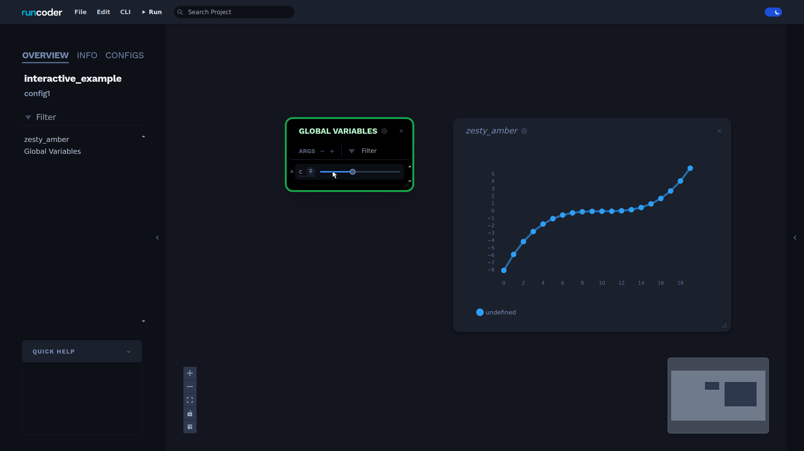

# Experiments, versions and execution

[Documentation](../../README.md) / [History](../README.md) / Feature chapters

**Historical application.** Configuration was useful when it led to comparable runs.
The experiment workbench combined interactive Python and charts with terminals, versions, parameter sweeps
and run groups. The later workbench revisited execution through a programmable runner.
These were different execution models rather than one uninterrupted feature.

_Restored January 2024 build: interactive execution. This image does not show a sweep._

**Current library:** browser pipelines coordinate application-supplied worker computations.
They do not include the historical Python runner, training infrastructure or experiment manager.

See the [original example gallery](../examples.md) for diffusion drawing, FLUX inpainting,
TRL finetuning, text classification, metric learning and AutoML.

## Compose scripts, then consume generated state

Late 2024's `$SETTA_GENERATED_PYTHON` placeholder embedded generated configuration
inside authored code. By February 2025, template variables could also refer to another
section's selected version, Python import path or executable file path. Python could
import a function from a different section, while Bash could launch that section's file.
The [original illustrated guide](https://setta.dev/old/docs/how_template_variables_work)
shows all three forms together.

May introduced a generated class, initially `S`; later programs imported a `state`
instance from `setta_gen.py`. January 2026 added a generated metadata module for project,
section and selected-variant information. Generation settings also let users choose
which sections participated and how supported values were represented, with type defaults
and individual overrides. The [technology history](../technology.md#from-template-variables-to-generated-state-and-metadata)
traces these changes and their source implementations.

## Recover project data

Automatic backups arrived in September 2024, separately from undo, autosave and saved
section versions. February 2026 enabled them by default and added CLI listing and
restoration. Restoring first preserved the existing project in a separate stash, outside
ordinary backup retention. See the [backup and restore implementation](https://github.com/riteofstring/setta/commit/4924b708e09d380a305605bc8b4d01535e01b03f)
and [technical explanation](../technology.md#backups-with-a-separate-recovery-path).

## Implementation landmarks

These are preserved implementation landmarks, not a release calendar.

| Month   | Preserved work                                                                                                       | Source                                                                                          |
| ------- | -------------------------------------------------------------------------------------------------------------------- | ----------------------------------------------------------------------------------------------- |
| 2020-12 | A parameter-range UI prototype, explicitly without sweep execution logic.                                            | [Change](https://github.com/riteofstring/setta/commit/c436b2cc7939d2c69feafa1419ae95cfa33c2c57) |
| 2021-02 | An early named-version saving interface; later versions are a separate development.                                  | [Change](https://github.com/riteofstring/setta/commit/a45efc6c87fdc0ca1d285d1418f719ec193db238) |
| 2023-01 | Chart.js UI work appears in the split frontend.                                                                      | [Change](https://github.com/riteofstring/setta/commit/268715911a89dbc7c5b8f1d8bbfe3a7f4197ea43) |
| 2023-01 | The CLI adds logging support.                                                                                        | [Change](https://github.com/riteofstring/setta/commit/3695dc1974cf39f9a15f461e13c21b7939ebe9d7) |
| 2023-12 | Hovering a saved section version changes its preview.                                                                | [Change](https://github.com/riteofstring/setta/commit/81c8ebf0e0557ee287fd7d3b430676fe1c5b333b) |
| 2024-01 | An interactive graph demonstrates Python execution and visible results.                                              | [Change](https://github.com/riteofstring/setta/commit/6d21c9c7e53f991cea12174bae1c038a241b75a1) |
| 2024-01 | Persistent terminals support work that outlives a single interaction.                                                | [Change](https://github.com/riteofstring/setta/commit/6e69cf3568a39db9d42442972c5b16aafbe24e74) |
| 2024-01 | Cartesian parameter-value combinations are sent to terminals for execution.                                          | [Change](https://github.com/riteofstring/setta/commit/2d0edd8357f059abb08f1ecc333108b8df2d283c) |
| 2024-01 | Selected run groups execute combinations of project configuration.                                                   | [Change](https://github.com/riteofstring/setta/commit/ed71f6ae255f83d875e80a3d1dc60917ab12abe4) |
| 2024-02 | Sweeps extend across saved versions, beyond parameter values alone.                                                  | [Change](https://github.com/riteofstring/setta/commit/18df00fb4771ddabf4bdac276526803dcf789714) |
| 2025-02 | The example collection includes TRL language-model finetuning.                                                       | [Change](https://github.com/riteofstring/setta/commit/c2c1e3005b8646f9ddeb4b0f6166e02c9f135c8a) |
| 2025-02 | A Stream Diffusion example exercises an interactive image workflow.                                                  | [Change](https://github.com/riteofstring/setta/commit/003797b855c46b8c1a919eb25148f862783e0e17) |
| 2025-03 | A SapientML example preserves another ML configuration and execution workflow.                                       | [Change](https://github.com/riteofstring/setta/commit/3debb3888fcb7dba0933b69ee6e28fcf081bb40c) |
| 2025-06 | The old sweep and run-group machinery is removed.                                                                    | [Change](https://github.com/riteofstring/setta/commit/e33715d454805045e7f1160c343a46e61181ad23) |
| 2026-01 | Execution returns through SettaRunner and RunPlan: grids, zipped values, seeded sampling, repeats and detached jobs. | [Change](https://github.com/riteofstring/setta/commit/ba758e7e090536356f67a1bd787db14c9f11d83f) |

The 2020 range editor was a UI prototype. Executable value sweeps appear in January 2024, with saved-version sweeps extending them in February. The 2025 removal and the 2026 runner are separate developments.

[Historical guide](../README.md) · [Repository composition](../timeline.md)
