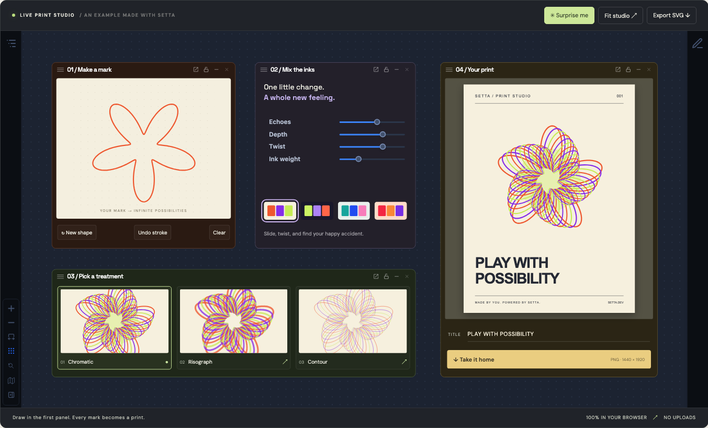
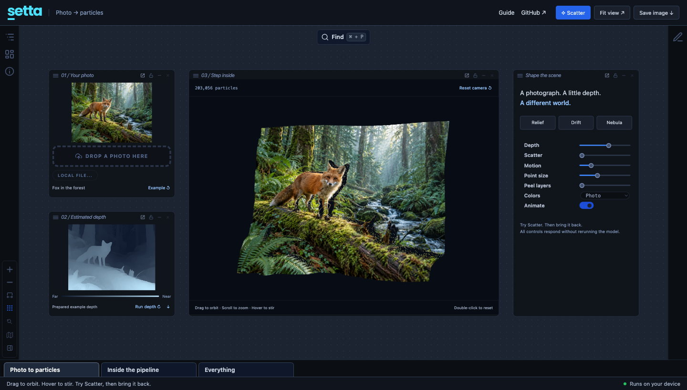
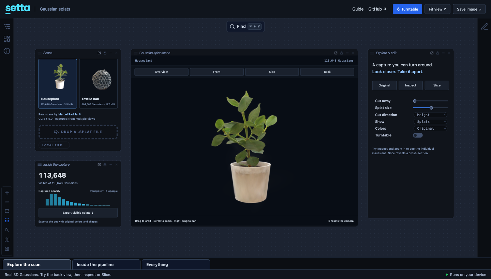
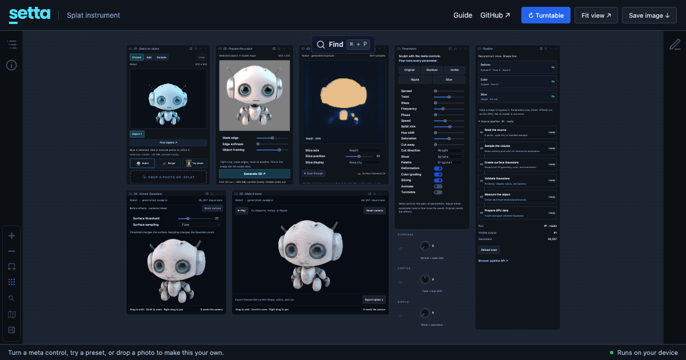
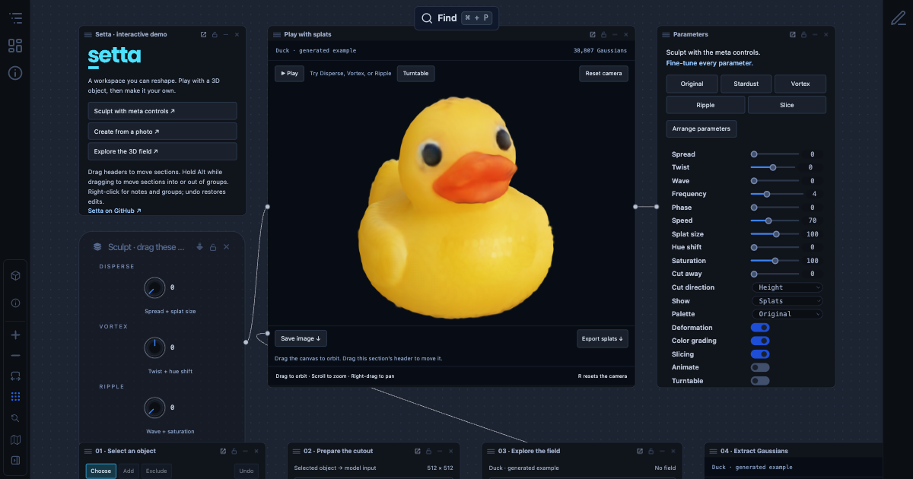
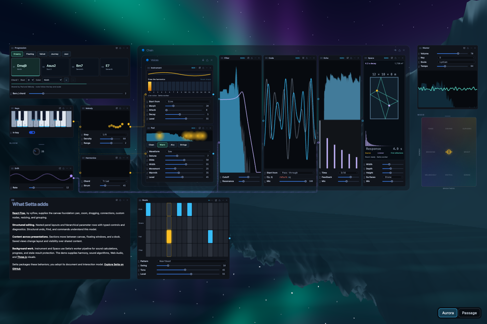

# From workbench to reusable tools

Extraction made the workspace useful beyond the application that had grown around it.
The Setta 2-derived line separated controls, nested sections, editors, graphs, saved views
and windows into a React library. Browser pipelines then made it possible to coordinate
application computations on static hosting.

The examples below show what people could build around those pieces. Their printing,
machine learning, rendering and Python algorithms belong to the applications. Setta
provides the workspace and execution coordination.

## October 2026: a sketch becomes a print

**Draw once, explore three treatments.** The print studio turned a stroke into chromatic,
risograph and contour treatments, then composed the selected treatment into a poster.
Ink controls changed the result; SVG and PNG exports took it out of the workspace.

Its [worker](https://github.com/riteofstring/setta-site/blob/7051440aba168e8cc34a2572f5c6ebe7b8b38722/src/studio/print.worker.ts)
used the public browser pipeline API: three treatment stages fed a dependent poster stage.
The drawing, SVG artwork and export code belonged to the independent site.

_Original archived application screenshot. This browser example was separate from the
Python-backed Signal Bloom Press example below._

## October 2026: photographs and captured objects

**Step into a photograph.** The photo playground combined a picture and depth map into
colored particles. Depth, scatter, motion, size and slicing controls changed the scene
without rerunning the model. The application supplied
[depth estimation and particle construction](https://github.com/riteofstring/setta-site/blob/682754a1894b9f03989a441b30849999b66dc24f/src/studio/depth.worker.ts);
Setta coordinated the worker stages and presented the controls.

_Original archived screenshot using the prepared fox example and its saved depth map.
The interface also supported estimating depth for a new photo._

**Inspect a capture from the inside.** The Gaussian splat studio opened real captured
objects, measured their contents, and let users orbit, inspect individual Gaussians,
cut cross-sections and export the visible selection. Its
[worker pipeline](https://github.com/riteofstring/setta-site/blob/f2802703613b0092037ab2e375e7d7d1e82f3439/src/studio/splat.worker.ts)
read, decoded, measured and packed the data; Spark and Three.js supplied the rendering.

_Original archived screenshot. Houseplant contains 113,648 Gaussians and is a multi-view
capture by [Marcel Padilla](https://marcelpadilla.com/Gaussian_Splat_Object_Dataset/),
licensed [CC BY 4.0](https://creativecommons.org/licenses/by/4.0/). It is distinct from
the generated single-photo examples that followed._

## October 2026: make the processing visible

**See every step from a photo to a 3D object.** The later playground added object
selection, cutout refinement, a radiance-field viewer and Gaussian extraction.
Users could scrub through the field, change the extraction threshold and adjust
sampling without rerunning the reconstruction model. A pipeline panel exposed stage
progress beside the intermediate results.

The [application](https://github.com/riteofstring/setta-site/tree/c55310fa8befe0265cf8334d41a11a1c48bdbe17/src/studio)
used SlimSAM for selection and TripoSR for reconstruction in the browser. TripoSR
predicted a radiance field; application code placed Gaussians on its estimated surface.
Unseen surfaces were guesses, so this was an approximate single-image reconstruction,
not a measured multi-view capture. The screenshot shows a saved generated example.

**One knob, several related changes.** The 3D sketchbook made those relationships
visible. Disperse linked spread and splat size; Vortex linked twist and hue;
Ripple linked wave amplitude and saturation. The native meta controls and individual
parameters operated on the same application state. The scene could be reshaped,
recolored, animated and exported.

_Original archived application screenshots. Exact source checkpoints and asset credits
are recorded in [image provenance](../images.md#library-era-application-screenshots)._

## Four local applications around the library

The same retained line also explored focused local tools. Their source is preserved
before the example applications and Python runtime were removed in October 2026.

| Application     | What made it interesting                                                                                                                                                                                                                                          | Preserved source                                                                                                                      |
| --------------- | ----------------------------------------------------------------------------------------------------------------------------------------------------------------------------------------------------------------------------------------------------------------- | ------------------------------------------------------------------------------------------------------------------------------------- |
| Python Canvas   | Compose real scikit-learn objects into a classifier. Changing polynomial degree from 1 to 3 changes the learned decision boundary; the model workshop plots mistakes on held-out samples and can download the generated Python.                                   | [Model workshop](https://github.com/riteofstring/setta/blob/5344734e39ae8eb8fbd0f2253c8271a8388d7644/apps/python-canvas/README.md)    |
| Realtime        | Signal Bloom Press turns a drawing into a shared ink plate, runs SVG and Pillow treatments in separate branches, then joins their results into a poster. Python handlers power this example.                                                                      | [Drawing playground](https://github.com/riteofstring/setta/blob/74837d35da5cb21bdff2ebc1ebaab0cbb77d5ceb/apps/realtime/README.md)     |
| Review          | Claims and choices stay connected to exact Git hunks, source lines, JSON values and artifacts. A poster comparison supports drawings anchored to the reviewed image, then records a portable human response.                                                      | [Review](https://github.com/riteofstring/setta/blob/74837d35da5cb21bdff2ebc1ebaab0cbb77d5ceb/apps/review/README.md)                   |
| Experiment Lens | Shared selections connect scatterplots, histograms, heatmaps, parallel coordinates, tables, trajectories and artifact galleries. A simulated battery study contains 864 observations across 24 cells; selected evidence and annotations can be exported together. | [Experiment Lens](https://github.com/riteofstring/setta/blob/74837d35da5cb21bdff2ebc1ebaab0cbb77d5ceb/apps/experiment-lens/README.md) |

Review recorded decisions without running agents. Experiment Lens explored already-recorded
results without launching experiments. The model workshop's small synthetic dataset illustrated
composition and generalization; its accuracy was not a claim about real-world performance.

## The current library

The current package keeps the reusable interactions: typed controls, nested sections,
saved views, windows, graph presentation, navigation and optional structural history.
[Browser pipelines](../../../packages/workspace/BROWSER.md) coordinate dependent stages
with progress, latest-input queuing, cancellation and recovery. A consuming application
supplies its data, algorithms and persistence.

The independently maintained instrument at [setta.dev](https://setta.dev) supplies its
musical rules, audio engine and scenery. Its workspace and worker coordination use Setta.

## Implementation landmarks

These are preserved implementation landmarks, not a release calendar.

| Month   | Preserved work                                                                 | Source                                                                                                                                                                                              |
| ------- | ------------------------------------------------------------------------------ | --------------------------------------------------------------------------------------------------------------------------------------------------------------------------------------------------- |
| 2026-08 | Workspace package extraction starts on the Setta 2-derived line.               | [Change](https://github.com/riteofstring/setta/commit/57f92584bff7f31b18ed1e829ea4b02b69fadfd8)                                                                                                     |
| 2026-10 | Python Canvas gains the composition model workshop.                            | [Change](https://github.com/riteofstring/setta/commit/5344734e39ae8eb8fbd0f2253c8271a8388d7644)                                                                                                     |
| 2026-10 | React and browser-worker APIs become reusable package entry points.            | [Change](https://github.com/riteofstring/setta/commit/74837d35da5cb21bdff2ebc1ebaab0cbb77d5ceb)                                                                                                     |
| 2026-10 | Browser pipelines expose progress by stage.                                    | [Change](https://github.com/riteofstring/setta/commit/e003c84df188b0dcc154e33c14f718c1cd39756e)                                                                                                     |
| 2026-10 | The Python runtime and example applications are removed from the library line. | [Change](https://github.com/riteofstring/setta/commit/4919cb096ebbcd861619e54bd0330b09b47088ff)                                                                                                     |
| 2026-11 | The unused local Go backend is removed.                                        | [Change](https://github.com/riteofstring/setta/commit/2866560207b0c2926136748fce42322f3a43aebf)                                                                                                     |
| 2026-11 | Hosts can define graph port families and record their own undoable operations. | [Ports](https://github.com/riteofstring/setta/commit/7ee1c6ba30c890683817345d6f5d84616403f123) · [History](https://github.com/riteofstring/setta/commit/9ed6e5739c901f3386a402c61a763931302a7ba5)   |
| 2026-11 | Graph cables can share bundles and route around workspace sections.            | [Bundles](https://github.com/riteofstring/setta/commit/02a947202a23ee3252982a4fc28cd7c34c91c351) · [Routing](https://github.com/riteofstring/setta/commit/e48fe6bbf822a9cb6b5284dddeb033d9411b1179) |

Setta 3 and Setta 4 were separate experimental directions and are outside this tour.
Their position in the reconstructed chain does not make them ancestors of the
Setta 2-derived library.

[Historical guide](../README.md) · [Repository composition](../timeline.md)
