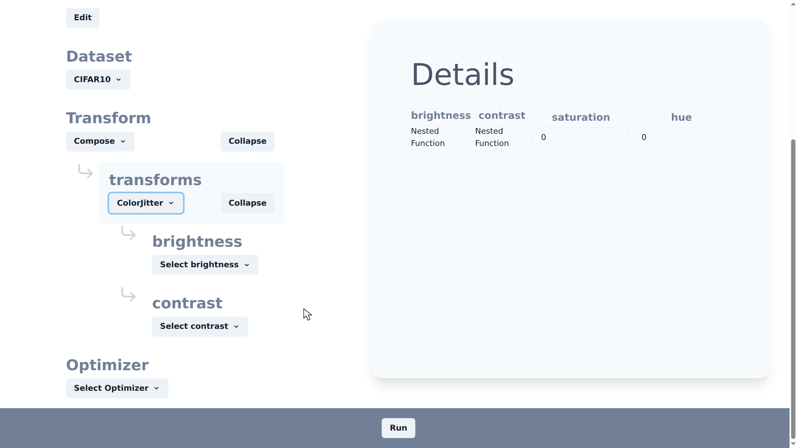

# Python becomes an interface

**Historical application.** The original problem was making Python configuration explorable.
Function metadata became controls; nested callables, references and generated code connected
those controls to executable programs. Later autocomplete, YAML and reference-aware renaming
made visual and textual editing work together.

_Restored November 2020 build. This shows nested forms; it does not demonstrate execution._

**Current library:** typed controls and custom sections remain reusable building blocks.
Python introspection, code generation and execution belong to the historical applications;
a current consuming application supplies its own domain logic and runtime.

## Implementation landmarks

These are preserved implementation landmarks, not a release calendar.

| Month   | Preserved work                                                              | Source                                                                                          |
| ------- | --------------------------------------------------------------------------- | ----------------------------------------------------------------------------------------------- |
| 2020-10 | Functions and classes export Python metadata as JSON.                       | [Change](https://github.com/riteofstring/setta/commit/6ab75eb9bca555c3db6b04e7cfa232af9efadab4) |
| 2020-10 | YAML references connect configuration objects.                              | [Change](https://github.com/riteofstring/setta/commit/ebf589fcc9c5d82fcaa2e631b16fb2697ac078a4) |
| 2020-10 | Developers can specify argument types.                                      | [Change](https://github.com/riteofstring/setta/commit/05ee6933a1c0d9241710c9a10152a220709eddf1) |
| 2020-11 | Selecting a callable exposes nested generated controls.                     | [Change](https://github.com/riteofstring/setta/commit/f4f2bd2593de3bc71c7121291df5efcb8bfc08af) |
| 2021-01 | Generated Python constructs a model and optimizer.                          | [Change](https://github.com/riteofstring/setta/commit/fa04ba8d96d257bdf76f80b29d905a1da5d56d1f) |
| 2021-01 | The early backend executes a function.                                      | [Change](https://github.com/riteofstring/setta/commit/fa04831c7ae4b84037f089edf55fd0f76ece8bf8) |
| 2021-01 | The frontend writes and launches generated Python through the desktop path. | [Change](https://github.com/riteofstring/setta/commit/e8df01c42cf6098d7b2675def33e7a1364766626) |
| 2022-11 | The split application generates a downloadable-code launch command.         | [Change](https://github.com/riteofstring/setta/commit/1a6b25c90386b79d3fe0bb1399397e05dba15b65) |
| 2022-11 | The standalone CLI runs downloaded code.                                    | [Change](https://github.com/riteofstring/setta/commit/86b1385c8fff3db435472b199cb08069956cfcc0) |
| 2023-12 | Local Runcoder adds interactive Python execution.                           | [Change](https://github.com/riteofstring/setta/commit/2cf4f39dceaf2e9bf28c1f267c8b238fd404c102) |
| 2024-04 | An initial working autocomplete path is preserved.                          | [Change](https://github.com/riteofstring/setta/commit/2c1ee8f26306eba3eb1fb7d78ebe7045138b647a) |
| 2024-09 | Parsed YAML updates code information; later work completes the round trip.  | [Change](https://github.com/riteofstring/setta/commit/49014dbdf6f899e6b504a904ef8560d03e8ff9f8) |
| 2024-11 | The two-way YAML representation develops further.                           | [Change](https://github.com/riteofstring/setta/commit/e1e934e626fe9ebafab656a8a16120e56d3b667e) |
| 2024-12 | Reference-aware renaming exposes an Update References interaction.          | [Change](https://github.com/riteofstring/setta/commit/b15dfa24899ca36c55754d6fa4c5ba990dc8f09a) |

[Historical guide](../README.md) · [Repository composition](../timeline.md)
