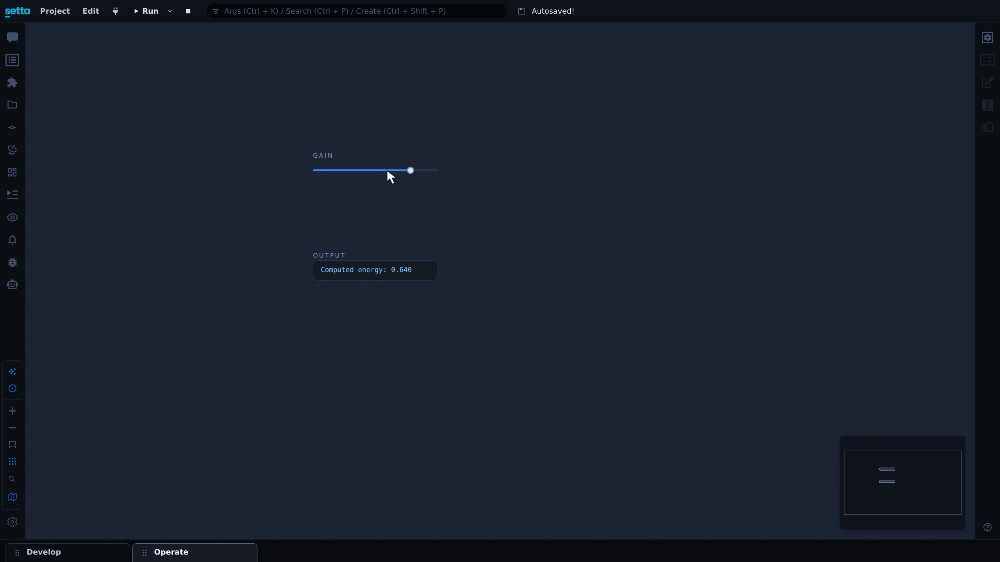

# Reactive state and AI

**Historical application.** Listeners and generated state connected workspace values to
running code. Bound files brought source editing and hot reload into the same loop. AI chat
then gained access to project context and operations, allowing it to act on the workspace.
Standalone meta controls made the operating surface simpler than the underlying program.

_Restored March 2026 build with a new demonstration project: the Operate view exposes a
control and live Python result while the Develop view contains the implementation._

**Current library:** host subscriptions, typed controls and saved views support reactive
applications. Python listeners, model providers and MCP integrations belong to the preserved
application histories; the current toolkit does not supply an AI service.

## Implementation landmarks

These are preserved implementation landmarks, not a release calendar.

| Month   | Preserved work                                                                                       | Source                                                                                          |
| ------- | ---------------------------------------------------------------------------------------------------- | ----------------------------------------------------------------------------------------------- |
| 2025-02 | A chat card becomes a canvas section.                                                                | [Change](https://github.com/riteofstring/setta/commit/65ccfe429425509bf9d709bfdf616cd2ba2ca52e) |
| 2025-02 | The chat example uses a model client through in-memory Python execution.                             | [Change](https://github.com/riteofstring/setta/commit/339c16e3e9d80cfc3467271434fc94dff960ad43) |
| 2025-03 | A rough project-level chat pane appears.                                                             | [Change](https://github.com/riteofstring/setta/commit/beadd50c118d7bbf27c97ba5c2b46f917fe395cd) |
| 2025-03 | An experimental LLM API branch is preserved as a detour, not the ancestor of every later chat build. | [Change](https://github.com/riteofstring/setta/commit/f383021d7601ecbf4656f5f5e52c2f24f67011ea) |
| 2025-03 | Integrated project chat develops along the continuing application line.                              | [Change](https://github.com/riteofstring/setta/commit/bf10abdc4d15183a0400d9629659c2f77c41d1f2) |
| 2025-04 | The SettaChat wrapper supports streaming.                                                            | [Change](https://github.com/riteofstring/setta/commit/b2503fcecc7a4557e32230d0383297c27d8d45d7) |
| 2025-03 | SettaListener introduces a bridge to live project state.                                             | [Change](https://github.com/riteofstring/setta/commit/e99fb4c1fb7cfee63bffd66a8978d4326c8a71e4) |
| 2025-03 | Listener callbacks connect workspace changes to Python functions.                                    | [Change](https://github.com/riteofstring/setta/commit/298f466ba3bb0ec09396b21106035c810e3957a6) |
| 2025-04 | FastMCP is mounted as the protocol foundation.                                                       | [Change](https://github.com/riteofstring/setta/commit/5bd0161148fb1b28c0eb01dfab5afd74671f5225) |
| 2025-04 | A frontend tool request adds a section to the workspace.                                             | [Change](https://github.com/riteofstring/setta/commit/074824b9723723320e53d2227b60a00b2bab611a) |
| 2025-04 | Workspace tools can set parameter values.                                                            | [Change](https://github.com/riteofstring/setta/commit/b1750b1971fd89a8723f0267654ab20c770e3772) |
| 2025-05 | A generated state class exposes configuration to Python.                                             | [Change](https://github.com/riteofstring/setta/commit/0c8758825ab766bd75227989915c5b889af38504) |
| 2025-05 | Code generation follows dependency ordering.                                                         | [Change](https://github.com/riteofstring/setta/commit/fea01c019ebc43c0cd82cbec32c5582d3ca85f59) |
| 2025-10 | Bound source files connect the workspace to ordinary development.                                    | [Change](https://github.com/riteofstring/setta/commit/0f7b11670974fdaf4d3780a9a2ade1ca5c2f9794) |
| 2025-11 | Hot reload develops the live file workflow.                                                          | [Change](https://github.com/riteofstring/setta/commit/04435ec501efa94e6bb5ff4ee20109eafd004a14) |
| 2025-12 | Following AI actions makes workspace activity visible.                                               | [Change](https://github.com/riteofstring/setta/commit/7c29be57c70eaabdf9de08dd11c80d0b673c4116) |
| 2025-12 | Standalone meta controls become workspace nodes.                                                     | [Change](https://github.com/riteofstring/setta/commit/e08f15a8a646ef2ad58b55b685308fb4f2d30f9a) |
| 2025-12 | Meta controls gain persistence and realtime values.                                                  | [Change](https://github.com/riteofstring/setta/commit/256f31e1d10fb2afe42a446d6022873beb606553) |
| 2025-12 | Action events connect controls to executable behavior.                                               | [Change](https://github.com/riteofstring/setta/commit/3d4e88186dc714c4e7479b92b77941c6afc632f3) |

[Historical guide](../README.md) · [Repository composition](../timeline.md)
