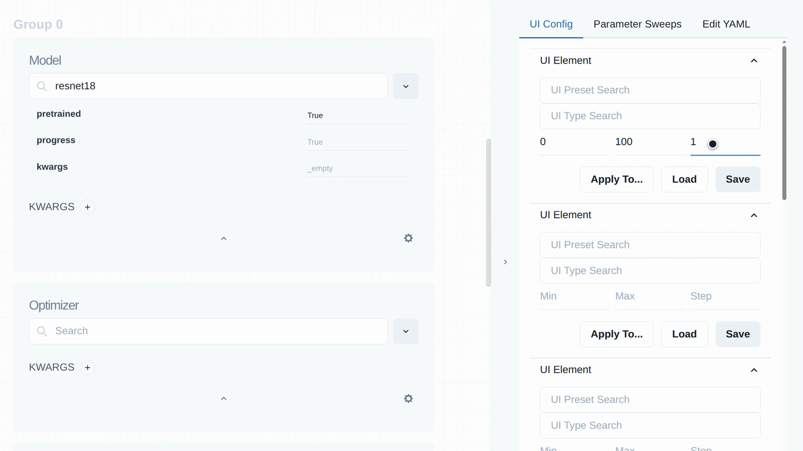
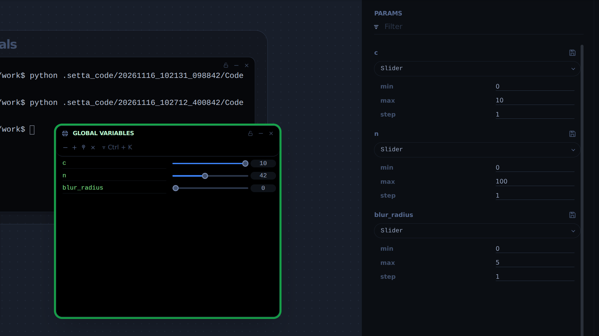

# Controls, composition and navigation

[Documentation](../../README.md) / [History](../README.md) / Feature chapters

**Historical application → current library.** A long configuration became easier to manage
when its parts could be searched, regrouped and shown in different layouts. This developed
through distinct steps: list reordering, pan/zoom navigation, free positioning, nested groups
and saved views. Markdown and embedded content kept explanations beside the work.

_Restored June 2022 build: the outline navigates a larger configuration._

**Current library:** nested composition, typed controls, navigation, saved views and managed
windows are public APIs. The application chooses the content and what its arrangement means.

## An interface you could reshape

The controls themselves were configurable. A parameter could use a slider instead of a text
field, and a useful configuration could become a reusable preset. Groups and decks let a
collection of controls become one movable part of the workspace. By May 2023, undo and redo
covered structural edits as well as entered values.

Explanations could become part of the tool: editable Markdown lived beside the controls,
mathematical notation rendered in notes, and a floating documentation tooltip could be
turned into a persistent section.

## Setta configures itself

In September 2024, Setta opened its own settings as a project. A JSON-backed section
edited `setta-settings.json` using the same controls and workspace as a user's program.
October's save behavior wrote the configuration file and reloaded settings, instead of
storing the settings workspace as an ordinary project in the database.

This was a direct application of Setta's central idea to Setta itself.
The [settings project](https://github.com/riteofstring/setta/commit/2a87c216017cfc5d65ef1369355fda7ce43f3fbe)
and [configuration save path](https://github.com/riteofstring/setta/commit/819e8fb57437af273edfdfc280882c25176937ba)
establish the two steps. The [technology history](../technology.md#setta-configures-itself)
explains the persistence boundary.

## The inspector changes with the canvas

_December 2021 layout. The visible preset Apply/Load/Save buttons were unfinished._

In 2021, Overview navigated the nested form while the right editor handled YAML.
Control design first worked in a gear modal, then moved into the right UI Config pane
in December. January 2022 added reusable preset saving. Later that year Card and
Parameters replaced the old YAML tab. February 2023 added authored parameter and section
explanations, with contextual help shown on the left.

_By November 2024 the inspector offered widget selectors, minimum, maximum and step
fields. This restored still shows the configured state, not a newly applied edit._

Versions followed a different path: a card-header selector in December 2023 became a
right-hand Section Variants pane in August 2024. The original January 2025 recording
on the [webpage](https://setta.dev/features/#f-variants-and-control-implementations) shows that later interface.
The [chronology](../feature-history.md) distinguishes these implementations from the
removed 2021 SavedVersions model and from whole-project configurations.

## Drawing as an input

The September 2024 drawing surface sent its image to dependent interactive Python tasks.
A stroke could therefore change a computation's input and its displayed result. December
added editable layers, visibility and opacity controls, brush and eraser settings, and
image resizing. This put a small image-composition environment inside the same workbench
as the code and parameters.

The [technical account](../technology.md#a-custom-draw-section-inside-the-workspace)
covers its custom Canvas 2D layers, artifact transforms and image transfer to Python.
The earlier [pan/zoom implementation](../technology.md#panning-before-react-flow) and
later [drag-and-drop integration](../technology.md#drag-and-drop-inside-react-flow)
explain how navigation and nested editing worked around the content.

These are features of the historical application. The current library lets applications
host custom content; it does not bundle that drawing editor or Python runtime.

## Implementation landmarks

These are preserved implementation landmarks, not a release calendar.

| Month   | Preserved work                                                                | Source                                                                                          |
| ------- | ----------------------------------------------------------------------------- | ----------------------------------------------------------------------------------------------- |
| 2021-02 | Early spatial navigation predates independently positioned sections.          | [Change](https://github.com/riteofstring/setta/commit/63ee486f680f60e824b0edc3c7b97aefcc1ff2d4) |
| 2021-03 | Drag handles reorder a vertical list. This is distinct from free positioning. | [Change](https://github.com/riteofstring/setta/commit/d8c7659f6ade86f53d4268b034d9bc1e71ef852f) |
| 2021-03 | Alternative control types include a working slider.                           | [Change](https://github.com/riteofstring/setta/commit/1f8db6ae4337f253f3d66d102cffaad7c233af3b) |
| 2022-01 | Control configurations can be saved as reusable presets.                      | [Change](https://github.com/riteofstring/setta/commit/7e3fa175e4701bae478e4ab0a0eee707463215fc) |
| 2022-02 | React Flow sections become independently positioned nodes.                    | [Change](https://github.com/riteofstring/setta/commit/8217da51fdfe52f8983122c9b8aa091adcbf2243) |
| 2022-06 | Decks and grouping organize the canvas.                                       | [Change](https://github.com/riteofstring/setta/commit/e85fb1f9bd64d4e44ae306ae579feff93fb50cb2) |
| 2022-09 | An explicit Group section type appears.                                       | [Change](https://github.com/riteofstring/setta/commit/19527db913b842d4e9195c0c6450257fe52203ae) |
| 2023-01 | Editable Markdown becomes content inside the project.                         | [Change](https://github.com/riteofstring/setta/commit/07ef6381f0cffd6aeb242334a17c9bfc5761287d) |
| 2023-05 | Project undo and redo restore coordinated workspace state.                    | [Change](https://github.com/riteofstring/setta/commit/d47946d06496c46f5c1f53afe4ea19d45b38c663) |
| 2024-09 | Interactive image input broadens the configuration surface.                   | [Change](https://github.com/riteofstring/setta/commit/87275831fe509bd7a265a7fc1ed877bc9a5672dd) |
| 2024-09 | Drawing sends image input to dependent interactive tasks.                     | [Change](https://github.com/riteofstring/setta/commit/82e84e5ae3da61d2592124180bec62a03b357ffe) |
| 2024-11 | A floating documentation tooltip can become a persistent section.             | [Change](https://github.com/riteofstring/setta/commit/9849f6b277a249c9330822bd77cf58457ecf96c8) |
| 2024-11 | Markdown sections render mathematical notation.                               | [Change](https://github.com/riteofstring/setta/commit/8c09a654a16c05ccb50eda2547a10a991cfef38b) |
| 2024-12 | Drawing layers can be added and reordered, with visibility and opacity.       | [Change](https://github.com/riteofstring/setta/commit/30bdf9dda496eadf3388586b8f27e3e54577acd1) |
| 2024-12 | Image elements can be resized inside the drawing surface.                     | [Change](https://github.com/riteofstring/setta/commit/3a89e8ae537250c421e344d42824b8e3a1a802f5) |
| 2025-12 | Saved view modes offer different surfaces for one project.                    | [Change](https://github.com/riteofstring/setta/commit/57e438be1714f12cde879c5eaf04e67da397ca07) |
| 2026-02 | Per-view layouts extend the view model.                                       | [Change](https://github.com/riteofstring/setta/commit/3383f5a22c27ff02367076376b5c7db71206b3d0) |

[Historical highlights](../highlights.md) · [Historical guide](../README.md) · [Repository composition](../timeline.md)
