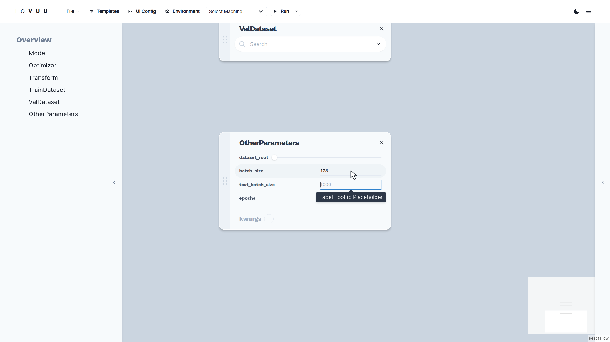

# Controls, composition and navigation

**Historical application → current library.** A long configuration became easier to manage
when its parts could be searched, regrouped and shown in different layouts. This developed
through distinct steps: list reordering, pan/zoom navigation, free positioning, nested groups
and saved views. Markdown and embedded content kept explanations beside the work.

_Restored June 2022 ioVuu build: the outline navigates a larger configuration._

**Current library:** nested composition, typed controls, navigation, saved views and managed
windows are public APIs. The application chooses the content and what its arrangement means.

## Implementation landmarks

These are preserved implementation landmarks, not a release calendar.

| Month   | Preserved work                                                                | Source                                                                                          |
| ------- | ----------------------------------------------------------------------------- | ----------------------------------------------------------------------------------------------- |
| 2021-02 | Early spatial navigation predates independently positioned sections.          | [Change](https://github.com/riteofstring/setta/commit/63ee486f680f60e824b0edc3c7b97aefcc1ff2d4) |
| 2021-03 | Drag handles reorder a vertical list. This is distinct from free positioning. | [Change](https://github.com/riteofstring/setta/commit/d8c7659f6ade86f53d4268b034d9bc1e71ef852f) |
| 2021-03 | Alternative control types include a working slider.                           | [Change](https://github.com/riteofstring/setta/commit/1f8db6ae4337f253f3d66d102cffaad7c233af3b) |
| 2022-02 | React Flow sections become independently positioned nodes.                    | [Change](https://github.com/riteofstring/setta/commit/8217da51fdfe52f8983122c9b8aa091adcbf2243) |
| 2022-06 | Decks and grouping develop during the ioVuu period.                           | [Change](https://github.com/riteofstring/setta/commit/e85fb1f9bd64d4e44ae306ae579feff93fb50cb2) |
| 2022-09 | An explicit Group section type appears.                                       | [Change](https://github.com/riteofstring/setta/commit/19527db913b842d4e9195c0c6450257fe52203ae) |
| 2023-02 | Editable Markdown becomes content inside the project.                         | [Change](https://github.com/riteofstring/setta/commit/07ef6381f0cffd6aeb242334a17c9bfc5761287d) |
| 2024-09 | Interactive image input broadens the configuration surface.                   | [Change](https://github.com/riteofstring/setta/commit/87275831fe509bd7a265a7fc1ed877bc9a5672dd) |
| 2024-09 | Drawing becomes an interactive workspace operation.                           | [Change](https://github.com/riteofstring/setta/commit/82e84e5ae3da61d2592124180bec62a03b357ffe) |
| 2025-12 | Saved view modes offer different surfaces for one project.                    | [Change](https://github.com/riteofstring/setta/commit/57e438be1714f12cde879c5eaf04e67da397ca07) |
| 2026-02 | Per-view layouts extend the view model.                                       | [Change](https://github.com/riteofstring/setta/commit/3383f5a22c27ff02367076376b5c7db71206b3d0) |

[Historical guide](../README.md) · [Repository composition](../timeline.md)
