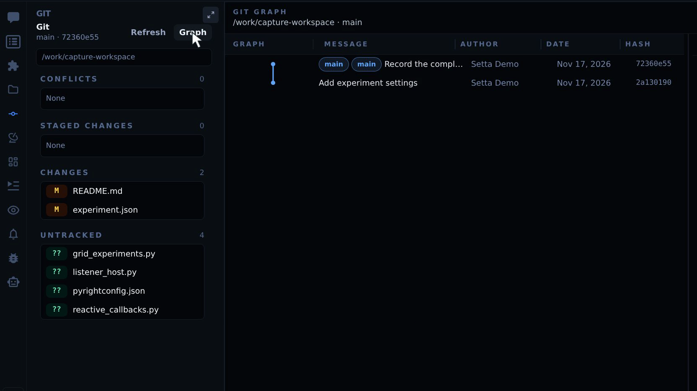
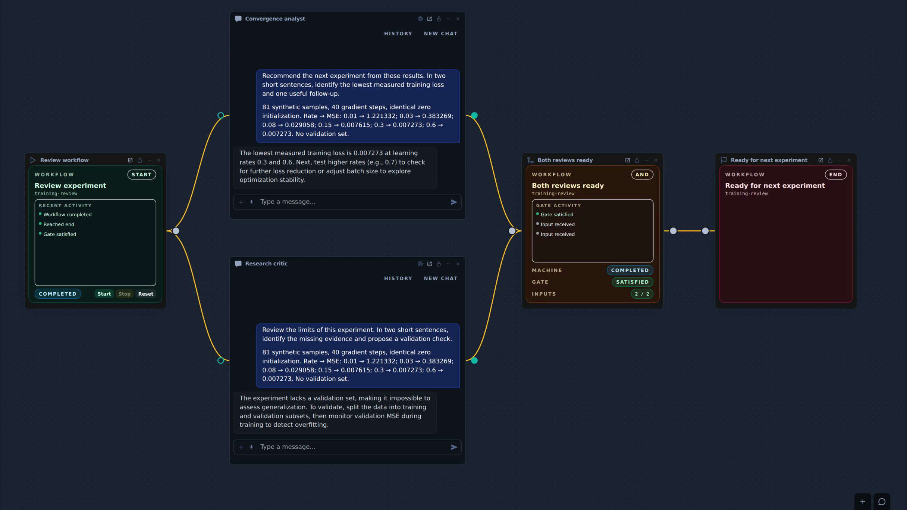
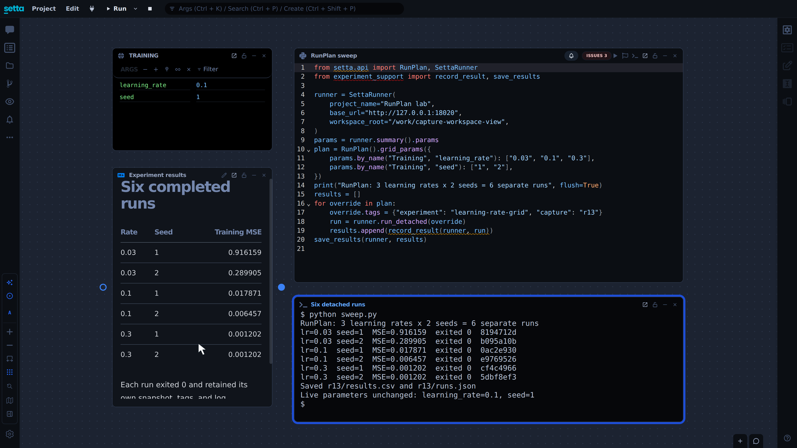
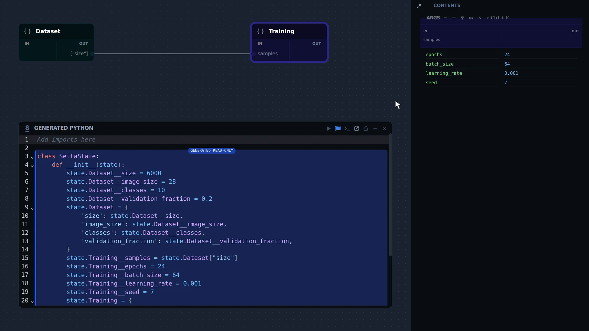
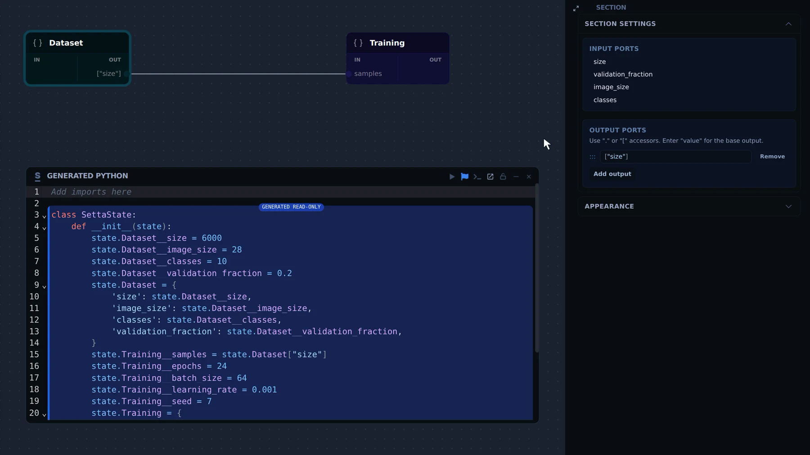

# The programmable workbench

[Documentation](../../README.md) / [History](../README.md) / Feature chapters

**Historical application.** Setta expanded into a place to work with files, repositories,
remote environments, tasks and agents. Connected context and executable workflows made the
canvas part of how work ran, while views and app mode made it possible to expose a smaller
surface to another person.

**On this page**

- [2025–2026: project tools enter the left pane](#20252026-project-tools-enter-the-left-pane)
- [From provider settings to an agent workspace](#from-provider-settings-to-an-agent-workspace)
- [Control Setta from an external assistant](#control-setta-from-an-external-assistant)
- [Give each conversation a role](#give-each-conversation-a-role)
- [Turn conversations into a workflow](#turn-conversations-into-a-workflow)
- [Keep the evidence beside the work](#keep-the-evidence-beside-the-work)
- [Run experiments without changing the live project](#run-experiments-without-changing-the-live-project)
- [May 30: a smaller canvas and a full Contents editor](#may-30-a-smaller-canvas-and-a-full-contents-editor)
- [Implementation landmarks](#implementation-landmarks)

_Restored March 2026 build with a new demonstration project and substitute local model.
The chats consume connected results; the provider session is newly restored._

**Experiments:** the hosted service, later share deployments and app generation represent
separate approaches to distribution. They should not be read as one continuous hosted product.
**Current library:** the generic workspace survives; Git, SSH, task management and external
agents are historical application integrations, not bundled services in today's package.

## 2025–2026: project tools enter the left pane

The panes changed their responsibilities as Setta grew. Project chat arrived in March
2025 and exposed MCP tool activity in April. December added backend logs and named
Custom Runs, with one-shot or continuous execution. January 2026 brought Files and
Watch Code; February added Git inspection, plugin management and an App editor.

The [project-tool examples](https://setta.dev/history/#chapter-5) show file previews,
a working-tree diff, commit history and a plugin installing its own pane. The February
Files editor also supported editing CSV/Excel cells, adding rows and columns, and saving
back to the source; that authoring surface was separate from a canvas Spreadsheet.

_The Git image comes from the restored March 2026 workbench. Its training-study
branches, merges and selected checkpoint change belong to a prepared demonstration
repository. The recording demonstrates inspection, not staging, committing or pushing.
[Image provenance](../images.md)._

## From provider settings to an agent workspace

The 2025 API-key settings grew into provider/model configuration, then January 2026's
AI Settings added profiles, system prompts, tool allowlists, memory scopes, reusable
prompts and external-agent adapters. This was a sequence of distinct interfaces.

Skills/MCP browsing moved out of App configuration into Project Chat in February.
March added editable skill Markdown, rendered/raw views and reusable slash commands.
Chat then gathered Skills, MCP, commands and AI Settings into its auxiliary views;
the old standalone settings entry was retired. Resizable thread navigation, persistent
drafts and search supported longer work across conversations.

The [chronological history](../feature-history.md) records the introductions and moves.
The earlier control-design and variant inspectors are covered with their own periods in
[controls and navigation](spatial-controls.md), rather than dated from a late workbench snapshot.

## Control Setta from an external assistant

December 2025's stdio MCP bridge exposed the running workbench's operations to outside
assistants. The CLI also offered tool discovery and JSON calls through `setta tools`
and `setta api`. An assistant could manipulate the workspace directly without living
inside Setta's chat. See the [bridge](https://github.com/riteofstring/setta/commit/a1a25f079792a6faa9d9b38e347eaaf6e3e054ea)
and [CLI interface](https://github.com/riteofstring/setta/blob/eabd8f56e9273148d3cd771860dc290ca191255d/backend/setta/start.py).

February 2026 added tools for finding, reading, changing and revealing registered
settings. A reveal opened the right pane and tab, scrolled to the control and highlighted
it. Initial settings included Watch Code, App configuration and parameter display names,
with plugin extensions. This went beyond Follow AI's navigation between canvas sections;
it could show a person where a setting lived. The [settings implementation](https://github.com/riteofstring/setta/commit/eabd8f56e9273148d3cd771860dc290ca191255d)
and [technology history](../technology.md#external-assistants-and-discoverable-settings)
describe the supported scope.

## Give each conversation a role

Chats could branch from edited messages and keep the alternatives visible. Canvas links
then connected conversations to the material they should inspect or change. A section-to-chat
link supplied read access and context; a chat-to-section link granted read/write scope.
Context could be a reference, an excerpt or a cached summary.

Conversation also gained new ways to work with the canvas. Image attachments let
the assistant inspect visual evidence; Follow AI moved the viewport to its current
edits. The [image-chat example](https://setta.dev/history/features/#f-chat-image-attachments) sends a
loss plot and gets a checkpoint recommendation. The
[Follow example](https://setta.dev/history/features/#f-ai-follow) starts with a high-level
request and follows four real configuration changes, keeping the action visible.

The [agentic-edge implementation](https://github.com/riteofstring/setta/commit/2468b2d36433e138d3e4c52b6abc790c4886d3a6)
made those relationships operational. A later
[linked-chat bridge](https://github.com/riteofstring/setta/blob/f347b886ac7f4273b220e57bbce30360955c4efd/backend/setta/agentic/linked_chat_invocation.py)
let one conversation invoke a directly connected peer and receive its result. That version
allowed one level of invocation and bounded the returned text.

## Turn conversations into a workflow

**Start two reviews, then wait for both.** Workflow connections could dispatch chats,
react to completed or failed runs, or route a structured signal. AND, OR and XOR gates
determined when the next step could proceed. Start, stop and reset controls and visible
gate progress made execution inspectable on the same canvas.

The [March 2026 runner](https://github.com/riteofstring/setta/blob/1f435b942c7d2860b368f34d91cf6fe1cd7becea/backend/setta/agentic/state_machine_runner.py)
executed those graphs. Prompt sections later provided editable or saved-template-backed
instructions, which workflow edges could resolve when dispatching a chat.

The [state-machine explanation](../technology.md#state-machines-turn-connections-into-execution)
covers machine groups, draft validation, structured signals and run lifecycle.

_Restored May 2026 build with a new demonstration project. The two responses completed
through the application using a substitute local Qwen model. The measured experiment was
included in the prompts; the picture does not establish link-only context delivery.
[Image provenance](../images.md) records the restoration._

## Keep the evidence beside the work

Files, Python, Git diffs, repository graphs and editable CSV/XLSX data could share the
workspace with research notes and task boards. Named views changed which sections were
visible and how they were arranged: Analyze could foreground code and measurements,
while Plan brought tasks and decisions forward over the same project.

Floating and docked conversations added another kind of arrangement. Saved **window spaces**
retained window layouts, with standalone routes for opening them again. These were separate
from the canvas's named views. The [March 2026 windowing changes](https://github.com/riteofstring/setta/commit/f75bef87614f0651b15af57e16117dd60522ae7b)
also brought Git Graph into that presentation system.

The workbench briefly tried dedicated Clock and Calendar sections on February 14, 2026.
They were [removed the following day](https://github.com/riteofstring/setta/commit/d7a63e1f68c7a839587990414f5676ec5b51c490);
calendar and time selection became
[text and meta-control modes](https://github.com/riteofstring/setta/commit/01d3c59cf2b960e129c5dea4584ffe137f1e81b1).
Task boards and spreadsheets continued as dedicated sections.

## Run experiments without changing the live project

The Python `RunPlan` API combined overrides into plans; `SettaRunner` launched
separate snapshots and exposed each run's status and logs. In the restored May
workbench, three learning rates and two seeds produce six successful numerical
experiments. The live project's parameters remain `0.1` and `1`.

[Watch the six-run demonstration and read its results](../feature-demos.md#runplan-vary-a-snapshot-without-changing-the-project).
This is a new prepared experiment executed through the historical API. It shows
a grid; random, zipped and repeated plans are documented in the
[source history](../feature-history.md#settarunner-and-runplan-replace-the-old-sweep-design).

## May 30: a smaller canvas and a full Contents editor

The late-May layout experiment replaced full Callable and Dict cards with compact
nodes. Selecting one opened its actual editable form in a new right-hand Contents pane.
This changed where primary value editing happened; it was more than another settings
panel. The [source and follow-up presentation changes](../feature-history.md#may-30-compact-nodes-move-whole-forms-into-contents)
are distinct from the subsequent Setta 3 experiment and the August library extraction.

In the new recording, selecting Dataset or Training changes the Contents editor.
An edit changes epochs from 12 to 24 and updates the real generated Python. A
single unobscured edge supplies Training’s sample count from `Dataset["size"]`.
These are prepared configuration values, not a completed training run.

Input/output port authoring had arrived in January. The inspector selects input
parameters and exposes outputs with Python accessors; JSON-backed forms could
select a nested source path. The May 30 capture shows these settings in the
compact layout.

## Implementation landmarks

These are preserved implementation landmarks, not a release calendar.

| Month   | Preserved work                                                                           | Source                                                                                                                                                                                                        |
| ------- | ---------------------------------------------------------------------------------------- | ------------------------------------------------------------------------------------------------------------------------------------------------------------------------------------------------------------- |
| 2025-05 | The separate SaaS experiment deploys projects through Fly Machines.                      | [Change](https://github.com/riteofstring/setta/commit/714290e028dcef6d83d5ac6649b8223b107e7b33)                                                                                                               |
| 2025-12 | Later share deployments introduce another publishing model.                              | [Change](https://github.com/riteofstring/setta/commit/8b4ee8d7122b0efb2fa59efd597b1ceefffcb4d0)                                                                                                               |
| 2026-01 | Name/version routing develops share deployment addressing.                               | [Change](https://github.com/riteofstring/setta/commit/2eba48c6436edaec29908d37412cd7bafaf4bd23)                                                                                                               |
| 2026-01 | An agentic runner provides a foundation for external coding agents.                      | [Change](https://github.com/riteofstring/setta/commit/836cb0ba72152f069190f532ad6c365b305eefb2)                                                                                                               |
| 2026-01 | A file explorer joins the workspace.                                                     | [Change](https://github.com/riteofstring/setta/commit/a2444de42201253b7e05f4ca06869474c65fc57f)                                                                                                               |
| 2026-02 | Edited messages can branch a conversation, with nested branches shown in chat.           | [Branching](https://github.com/riteofstring/setta/commit/165ad31a57b7bf43e977aebc87075c962587a204) · [Nested branches](https://github.com/riteofstring/setta/commit/ec331e59377643afbff33271aad10d0996f0a449) |
| 2026-02 | App mode turns project state into a user-facing application surface.                     | [Change](https://github.com/riteofstring/setta/commit/bc0989e379aca4581368bc5104ac45786161bd19)                                                                                                               |
| 2026-02 | AI app-spec generation develops that application-creation direction.                     | [Change](https://github.com/riteofstring/setta/commit/cf9fe3fbe4d4bd9dc167a79cf45338ddadcd0a7c)                                                                                                               |
| 2026-02 | SSH workspaces extend the development environment to remote machines.                    | [Change](https://github.com/riteofstring/setta/commit/ae708854b1fc5d9db79966ebdabbf9f0f43835c4)                                                                                                               |
| 2026-02 | Git diff and graph interfaces make repository work visible.                              | [Change](https://github.com/riteofstring/setta/commit/d95c966bd0dbeedb0e4d421391434569db9f3ed9)                                                                                                               |
| 2026-02 | Plugin management introduces extensible workspace behavior.                              | [Change](https://github.com/riteofstring/setta/commit/7beab4e61d4fe3e6cc928faae0c7a369ac45d7d9)                                                                                                               |
| 2026-02 | A plugin CLI supports extension development.                                             | [Change](https://github.com/riteofstring/setta/commit/d768b4e425f441909dc99acf510fc359f4d10c22)                                                                                                               |
| 2026-02 | CSV and XLSX authoring bring spreadsheet data into the workbench.                        | [Change](https://github.com/riteofstring/setta/commit/69e253ded2b29963f7023a46346041651868fc28)                                                                                                               |
| 2026-02 | Task lists, Kanban and spreadsheet sections broaden the workspace.                       | [List modes](https://github.com/riteofstring/setta/commit/67c7b3d9cd0fe1ecca0ac09df70ed3090a93bb68) · [Sections](https://github.com/riteofstring/setta/commit/8d8729e5aa4598b27041925f0b73862a94f2f6e2)       |
| 2026-02 | Calendar and time controls replace the short-lived dedicated Clock/Calendar sections.    | [Change](https://github.com/riteofstring/setta/commit/01d3c59cf2b960e129c5dea4584ffe137f1e81b1)                                                                                                               |
| 2026-02 | Dictation adds another input path.                                                       | [Change](https://github.com/riteofstring/setta/commit/e46c1267f27aac4e2b8c085c1875aa7f4c4e1de0)                                                                                                               |
| 2026-03 | Linked chats support bounded invocation between conversations.                           | [Change](https://github.com/riteofstring/setta/commit/f347b886ac7f4273b220e57bbce30360955c4efd)                                                                                                               |
| 2026-03 | Workflow edges, inspectors and run controls develop executable graphs.                   | [Change](https://github.com/riteofstring/setta/commit/8d9b5b5fba1375648fd8ca75e101956e0d1dd0ed)                                                                                                               |
| 2026-03 | Start-edge actions execute chats from workflow connections.                              | [Change](https://github.com/riteofstring/setta/commit/d4c99108f3267bcd64a88653f0b4589b406d08fb)                                                                                                               |
| 2026-03 | Chat results flow through AND, OR and XOR gates.                                         | [Change](https://github.com/riteofstring/setta/commit/1f435b942c7d2860b368f34d91cf6fe1cd7becea)                                                                                                               |
| 2026-03 | Saved window spaces retain floating layouts and integrate Git Graph.                     | [Change](https://github.com/riteofstring/setta/commit/f75bef87614f0651b15af57e16117dd60522ae7b)                                                                                                               |
| 2026-03 | Prompt sections link to saved templates and supply instructions to workflow actions.     | [Templates](https://github.com/riteofstring/setta/commit/f45ac534938934bc01d01fd42a8bbda006612252) · [Dispatch](https://github.com/riteofstring/setta/commit/f433bf59d1b0276536514c57a3e4de9e8602f88a)        |
| 2026-03 | The Go backend migration begins; it is a different phase from the final browser library. | [Change](https://github.com/riteofstring/setta/commit/1db3317abf1d6fdcb288f67649c0f2744ea01018)                                                                                                               |

[Historical guide](../README.md) · [Repository composition](../timeline.md)
