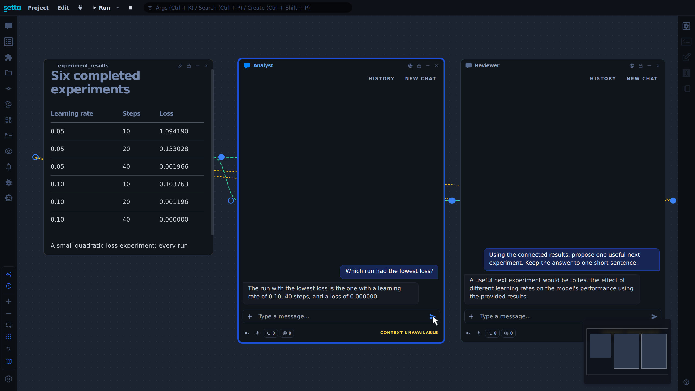

# The programmable workbench

**Historical application.** Setta expanded into a place to work with files, repositories,
remote environments, tasks and agents. Connected context and executable workflows made the
canvas part of how work ran, while views and app mode made it possible to expose a smaller
surface to another person.

_Restored March 2026 build with a new demonstration project and substitute local model.
The chats consume connected results; the provider session is newly restored._

**Experiments:** the hosted service, later share deployments and app generation represent
separate approaches to distribution. They should not be read as one continuous hosted product.
**Current library:** the generic workspace survives; Git, SSH, task management and external
agents are historical application integrations, not bundled services in today's package.

## Implementation landmarks

These are preserved implementation landmarks, not a release calendar.

| Month   | Preserved work                                                                           | Source                                                                                          |
| ------- | ---------------------------------------------------------------------------------------- | ----------------------------------------------------------------------------------------------- |
| 2025-05 | The separate SaaS experiment deploys projects through Fly Machines.                      | [Change](https://github.com/riteofstring/setta/commit/714290e028dcef6d83d5ac6649b8223b107e7b33) |
| 2025-12 | Later share deployments introduce another publishing model.                              | [Change](https://github.com/riteofstring/setta/commit/8b4ee8d7122b0efb2fa59efd597b1ceefffcb4d0) |
| 2026-01 | Name/version routing develops share deployment addressing.                               | [Change](https://github.com/riteofstring/setta/commit/2eba48c6436edaec29908d37412cd7bafaf4bd23) |
| 2026-01 | An agentic runner provides a foundation for external coding agents.                      | [Change](https://github.com/riteofstring/setta/commit/836cb0ba72152f069190f532ad6c365b305eefb2) |
| 2026-01 | A file explorer joins the workspace.                                                     | [Change](https://github.com/riteofstring/setta/commit/2961e37d0a6dab5e7c83b668c247ba30bf1e7edd) |
| 2026-02 | App mode turns project state into a user-facing application surface.                     | [Change](https://github.com/riteofstring/setta/commit/bc0989e379aca4581368bc5104ac45786161bd19) |
| 2026-02 | AI app-spec generation develops that application-creation direction.                     | [Change](https://github.com/riteofstring/setta/commit/cf9fe3fbe4d4bd9dc167a79cf45338ddadcd0a7c) |
| 2026-02 | SSH workspaces extend the development environment to remote machines.                    | [Change](https://github.com/riteofstring/setta/commit/ae708854b1fc5d9db79966ebdabbf9f0f43835c4) |
| 2026-02 | Git diff and graph interfaces make repository work visible.                              | [Change](https://github.com/riteofstring/setta/commit/d95c966bd0dbeedb0e4d421391434569db9f3ed9) |
| 2026-02 | Plugin management introduces extensible workspace behavior.                              | [Change](https://github.com/riteofstring/setta/commit/7beab4e61d4fe3e6cc928faae0c7a369ac45d7d9) |
| 2026-02 | A plugin CLI supports extension development.                                             | [Change](https://github.com/riteofstring/setta/commit/d768b4e425f441909dc99acf510fc359f4d10c22) |
| 2026-02 | CSV and XLSX authoring bring spreadsheet data into the workbench.                        | [Change](https://github.com/riteofstring/setta/commit/69e253ded2b29963f7023a46346041651868fc28) |
| 2026-02 | Task lists, Kanban, clocks and calendars broaden the workspace.                          | [Change](https://github.com/riteofstring/setta/commit/8d8729e5aa4598b27041925f0b73862a94f2f6e2) |
| 2026-02 | Dictation adds another input path.                                                       | [Change](https://github.com/riteofstring/setta/commit/e46c1267f27aac4e2b8c085c1875aa7f4c4e1de0) |
| 2026-03 | Linked chats support bounded invocation between conversations.                           | [Change](https://github.com/riteofstring/setta/commit/f347b886ac7f4273b220e57bbce30360955c4efd) |
| 2026-03 | Workflow edges, inspectors and run controls develop executable graphs.                   | [Change](https://github.com/riteofstring/setta/commit/8d9b5b5fba1375648fd8ca75e101956e0d1dd0ed) |
| 2026-03 | Start-edge actions execute chats from workflow connections.                              | [Change](https://github.com/riteofstring/setta/commit/d4c99108f3267bcd64a88653f0b4589b406d08fb) |
| 2026-03 | The Go backend migration begins; it is a different phase from the final browser library. | [Change](https://github.com/riteofstring/setta/commit/1db3317abf1d6fdcb288f67649c0f2744ea01018) |

[Historical guide](../README.md) · [Repository composition](../timeline.md)
