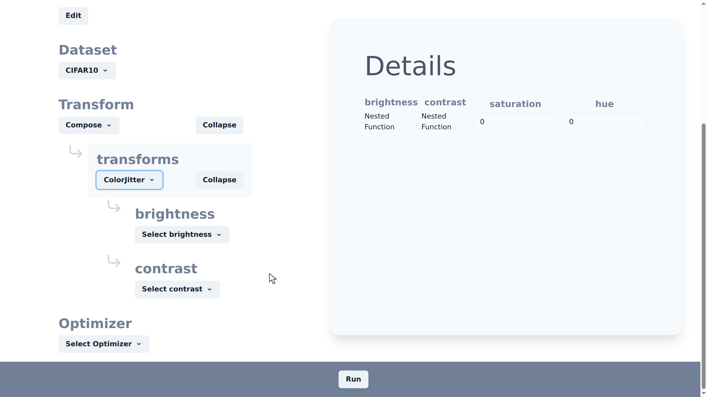
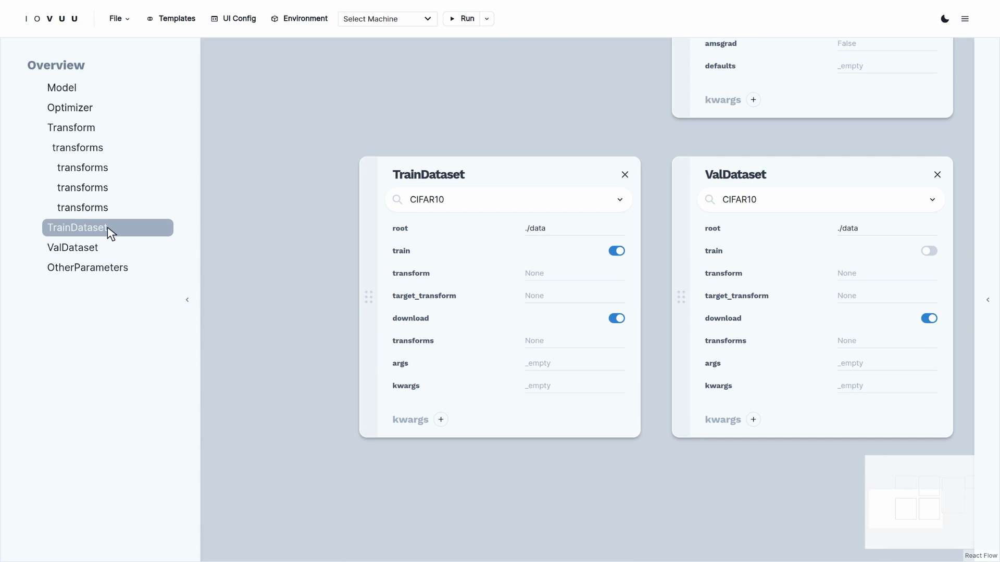
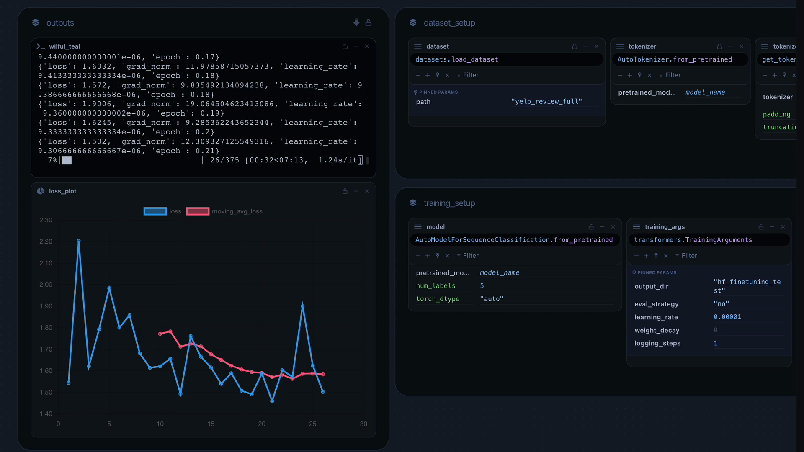
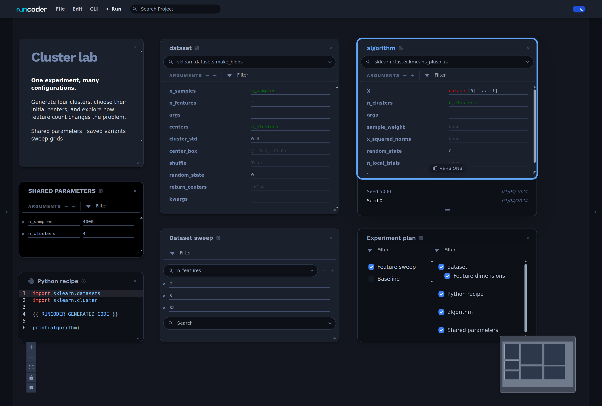
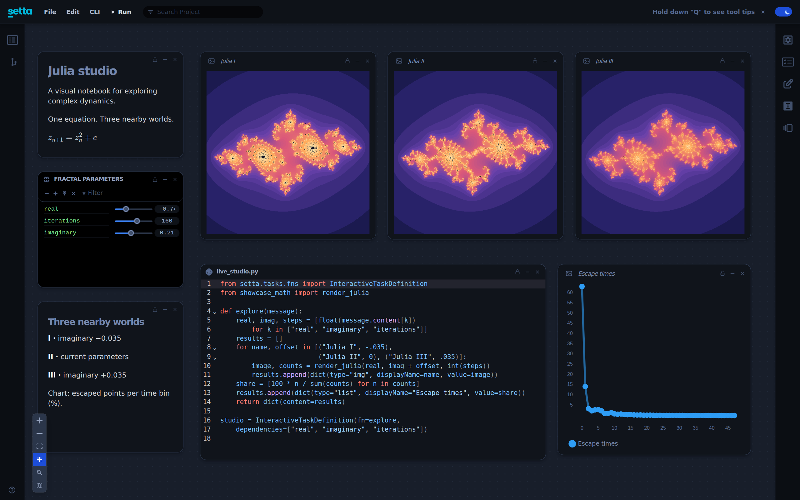
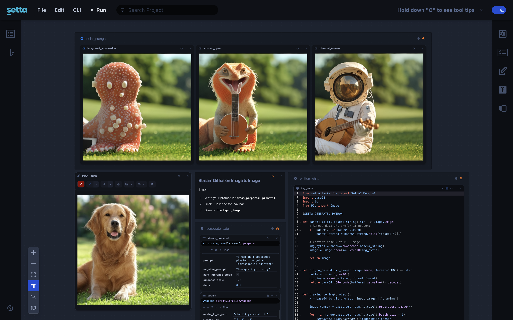
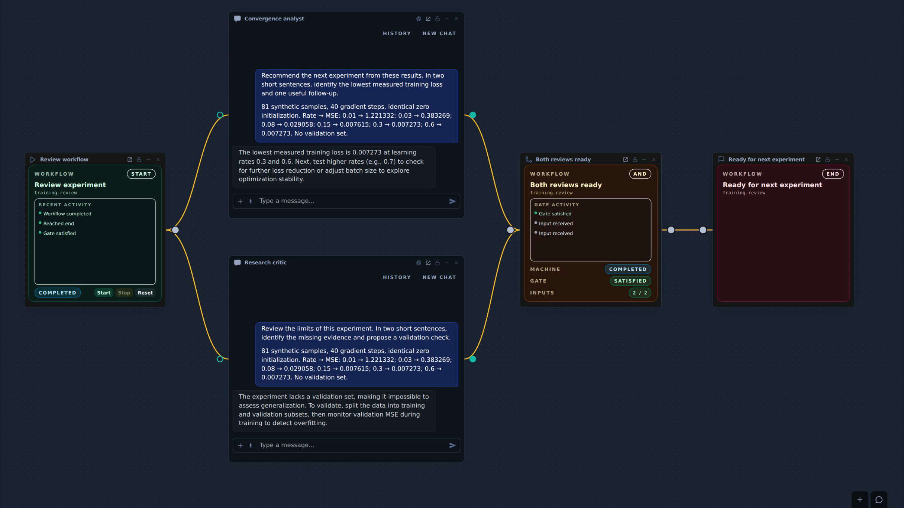
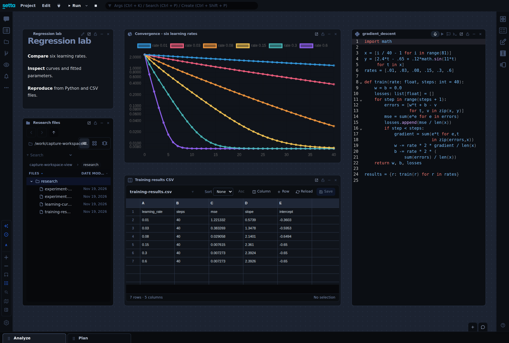
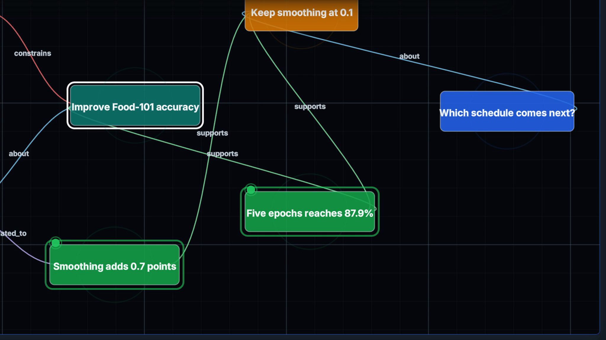
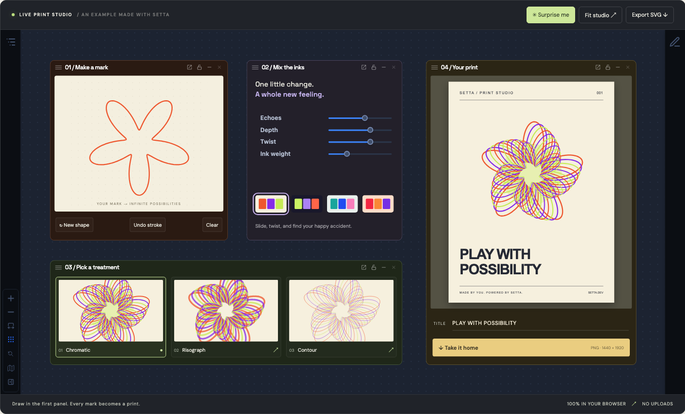

# Ideas worth remembering

Setta's history is full of tools within tools: controls generated from Python, drawings
that feed computations, experiments assembled from saved configurations, and workspaces
that keep the result beside the code that produced it. Here are some of those ideas in
action, from ABCDE through ioVuu and Runcoder to Setta.

The applications below are historical. Their Python execution and built-in editors are
distinct from today's [React workspace library](../../README.md). Restored-build images
were captured in 2026; they are not release-day screenshots. [Image provenance](images.md)
identifies their source checkpoints and demonstration data.

## Make a Python object something you can explore

**2020–2021 · ABCDE.** Select a transform, explore its arguments, then put another transform
inside it. Python metadata supplied names, defaults and types; nested callables turned
the resulting forms into a way to assemble a program. Generated Python could construct
a model and optimizer, and the desktop application could launch it.

_Restored November 2020 interface. This image shows nested forms; code generation and
execution followed in January 2021._

[Nested controls](https://github.com/riteofstring/setta/commit/f4f2bd2593de3bc71c7121291df5efcb8bfc08af) ·
[Generated Python](https://github.com/riteofstring/setta/commit/fa04ba8d96d257bdf76f80b29d905a1da5d56d1f) ·
[Desktop execution](https://github.com/riteofstring/setta/commit/e8df01c42cf6098d7b2675def33e7a1364766626)

## Arrange the interface around the problem

**2022–2023 · ioVuu and Runcoder.** Sections became independently positioned canvas nodes.
Decks and groups gathered related controls, while the outline and minimap helped navigate
the larger project. A useful control configuration could become a reusable preset.
Undo and redo later made changes to values and workspace structure reversible.

_Restored June 2022 ioVuu interface. The undo/redo implementation dates to May 2023._

[Canvas sections](https://github.com/riteofstring/setta/commit/8217da51fdfe52f8983122c9b8aa091adcbf2243) ·
[Groups and decks](https://github.com/riteofstring/setta/commit/e85fb1f9bd64d4e44ae306ae579feff93fb50cb2) ·
[Control presets](https://github.com/riteofstring/setta/commit/7e3fa175e4701bae478e4ab0a0eee707463215fc) ·
[Undo and redo](https://github.com/riteofstring/setta/commit/d47946d06496c46f5c1f53afe4ea19d45b38c663)

## Follow the program’s output

**2023–2024 · Runcoder.** Interactive Python connected controls to computed output,
and terminals and charts brought the running program into the workspace. This
original January 2025 recording shows actual training logs and loss curves.
The [live Python examples](https://setta.dev/history/#live-python) show controls,
authored callbacks and generated images together.

[Interactive execution](https://github.com/riteofstring/setta/commit/2cf4f39dceaf2e9bf28c1f267c8b238fd404c102) ·
[Visible chart output](https://github.com/riteofstring/setta/commit/6d21c9c7e53f991cea12174bae1c038a241b75a1)

## Explore a family of experiments

**2023–2024 · Runcoder.** Hover over a saved version to preview its values. Keep useful
variants, then sweep several parameter choices instead of rebuilding the configuration
for each run. Executable sweeps generated Cartesian combinations and sent them to
terminals; later work extended execution across saved versions and selected run groups.

_New demonstration in the restored January 2024 build. This image shows an experiment
configuration, not completed sweep results. The December 2020 sweep editor was an earlier
UI prototype without execution logic._

[Version previews](https://github.com/riteofstring/setta/commit/81c8ebf0e0557ee287fd7d3b430676fe1c5b333b) ·
[Executable value sweeps](https://github.com/riteofstring/setta/commit/2d0edd8357f059abb08f1ecc333108b8df2d283c) ·
[Saved-version sweeps](https://github.com/riteofstring/setta/commit/18df00fb4771ddabf4bdac276526803dcf789714)

## Put images, mathematics and code on the same canvas

**2024 · Setta.** A workspace could hold an image input, a live Python computation and
its visual results. Drawing became another input: strokes were sent to dependent tasks.
The drawing surface later gained layers, opacity, brushes, erasers and image resizing.
Markdown could render formulas, and a documentation tooltip could become a persistent
panel beside the work.

_New Julia studio demonstration in the restored November 2024 build. Python calculated
these images and the chart. This capture does not show the December layer editor._

[Drawing feeds computations](https://github.com/riteofstring/setta/commit/82e84e5ae3da61d2592124180bec62a03b357ffe) ·
[Drawing layers](https://github.com/riteofstring/setta/commit/30bdf9dda496eadf3388586b8f27e3e54577acd1) ·
[Mathematical notes](https://github.com/riteofstring/setta/commit/8c09a654a16c05ccb50eda2547a10a991cfef38b) ·
[Documentation panels](https://github.com/riteofstring/setta/commit/9849f6b277a249c9330822bd77cf58457ecf96c8)

## Keep visual configuration connected to text

**2024 · Setta.** The same configuration could be edited through controls or YAML.
JSON-backed sections read ordinary files and saved changed values back to them. Reference
updates connected structural edits to code: moving or renaming a section could update
the expressions that referred to it.

[Two-way YAML](https://github.com/riteofstring/setta/commit/e1e934e626fe9ebafab656a8a16120e56d3b667e) ·
[JSON file save-back](https://github.com/riteofstring/setta/commit/ec9c5eeaa236334b48eb1306f8d7ad2bbabe67b1) ·
[Reference updates](https://github.com/riteofstring/setta/commit/b8ec26789066d81eddf1c0ac4b203033eb5e8a2a)

## Draw a sketch, explore several AI images

**Spring 2025 · Setta.** The workspace connected a drawing to an image-generation pipeline.
The original examples also covered FLUX inpainting and iterative outpainting, TRL
language-model finetuning, Transformers sequence classification, metric learning,
SapientML and Groq chat. They made model inputs and experimental choices inspectable.
The models and training algorithms came from those applications and their dependencies.

_Original example preview. The [seven-example gallery](examples.md) preserves their
instructions, screenshots and demonstration links._

[Stream Diffusion](https://github.com/riteofstring/setta/commit/003797b855c46b8c1a919eb25148f862783e0e17) ·
[Iterative outpainting](https://github.com/riteofstring/setta/commit/cf29035ce23c8c986ce872b207c9d08d9b029e49)

## Let ordinary code grow its own controls

**2025–2026 · Setta.** Generated state classes, listeners and bound source files connected
controls to Python. Watch Code took another step: a new top-level function, async function
or class could become a Callable section; changed signatures updated its arguments.
Existing definitions were baselined when a watch path was added. JSON-source sections
later watched and saved selected objects in JSON, YAML and TOML files.

[Watch Code](https://github.com/riteofstring/setta/commit/8786063d529c8517cb6df4f8687d010d9002dd27) ·
[Generated state](https://github.com/riteofstring/setta/commit/0c8758825ab766bd75227989915c5b889af38504) ·
[Reactive-state history](features/reactive-ai.md)

## Make AI part of the project

**2025–2026 · Setta.** Chats could receive explicit project context and use workspace
operations. Linked conversations and executable workflow graphs coordinated reviews;
AND, OR and XOR gates controlled how work continued. Reusable Prompt sections connected
saved templates to workflows, while message branching kept alternative conversations.

_New Training review project in the restored May 2026 build. Both reviewer responses
were generated through the application with a substitute local model. The prompts include
the experiment data; this image alone does not demonstrate link-only context injection._

[Executable gates](https://github.com/riteofstring/setta/commit/1f435b942c7d2860b368f34d91cf6fe1cd7becea) ·
[Reusable prompts](https://github.com/riteofstring/setta/commit/f45ac534938934bc01d01fd42a8bbda006612252) ·
[Workbench history](features/workbench.md)

## Keep the evidence and the next decision together

**2026 · Setta.** Saved views switched a project between analysis and planning. Files,
Git diffs, terminals, spreadsheets, task boards and saved window spaces made the workspace
useful beyond a single calculation. SettaRunner and RunPlan brought programmable grids,
zipped values, sampling, repetition and detached jobs back after the earlier sweeps had
been removed in June 2025.

_New Regression lab in the restored May build. These numerical results were calculated
in Python and imported into the chart and spreadsheet; the image does not establish
RunPlan execution. [Execution history](features/experiments.md) separates the two._

## Make agent work and its context visible

**July–August 2026 · Setta 3 and Setta 4.** Setta 3 explored a scrolling workspace
for chats, terminals and task status, alongside a semantic graph and workflow
editor. The prepared research graph makes relationships between a goal,
evidence and a decision visible. The workflow editor lets a user arrange
steps and validate the draft before execution.

Setta 4 explored another shape for the work: a Director graph of workstreams,
requests, actions and milestones, with structured reports for artifacts.
Its captured graph and report are the original built-in demonstrations.
These were separate directions from the Setta 2-derived library.

_Restored July 2026 graph with authored, synthetic research data. The captures
do not establish automatic cartography, completed Setta 3 workflow execution
or live Setta 4 orchestration._

[Explore the six summer captures](features/libraries-and-detours.md#summer-2026-two-agent-workspace-experiments) ·
[Explore the interactive history](https://setta.dev/history/)

## Give the same building blocks very different jobs

**October 2026 · Applications around the extracted library.** Print Studio turned a mark
into an artwork. A depth playground turned a photograph into a particle scene. A Gaussian
viewer put a captured plant beside its controls. A later reconstruction playground selected
an object in an image and explored a predicted 3D representation. These were distinct
consumer applications, with their own algorithms, built around Setta's workspace.

The retained line also included Python Canvas's model workshop, Realtime's branching
image pipeline, evidence-based Review, and Experiment Lens's linked plots and artifact
comparisons. Experiment Lens inspected recorded results; it did not run experiments.

_Original Print Studio screenshot. [The library-era gallery](features/libraries-and-detours.md)
contains the other original screenshots, implementation links and image credits. These
examples are on the retained lineage, separate from the extracted v3/v4 projects._

The current [ambient instrument](https://setta.dev) carries the idea forward: Setta supplies
controls, composition, graphs, windows and worker coordination; the application supplies
its musical rules, audio engine and scenery.

[Full visual history](README.md) · [Original example gallery](examples.md) ·
[Feature histories](README.md#browse-by-feature-or-source)
