# Setta through the years

[Documentation](../README.md) / [History](README.md)

Setta began in 2020 by turning Python metadata into interfaces. Those forms grew
into a canvas for composing experiments, then a live programming environment with
files, tools and AI agents. The current library makes the workspace interactions
available to other applications. This tour follows those changes in capability
and the interfaces that made them usable.

The repository combines 16 related source histories on one `main` branch;
older applications are found in earlier
commits, while the current checkout contains the library.

[Explore the interactive retrospective](https://setta.dev/) or follow the chapters below.
Captions distinguish original previews from restored builds; [image provenance](images.md)
records the source revisions and demonstration data.

## The journey at a glance

| Period                                                                         | Idea                                                                               |
| ------------------------------------------------------------------------------ | ---------------------------------------------------------------------------------- |
| [2020–2021](#20202021-python-becomes-an-interface)                             | Turn Python arguments into composable interfaces.                                  |
| [2022–2023](#20222023-a-spatial-workspace)                                     | Arrange configuration on a navigable canvas.                                       |
| [2023–2024](#20232024-local-execution-and-experiment-management)               | Bring execution, charts and experiment comparison into the workspace.              |
| [2024–2025](#20242025-setta-connects-representations-and-live-state)           | Connect images, models, code and live state.                                       |
| [2025–2026](#summer-2025spring-2026-an-ai-native-workbench)                    | Build an AI-native workbench around code, data, agents and workflows.              |
| [July–August 2026 · Setta 3 & 4](#summer-2026-two-agent-workspace-experiments) | Explore scrolling agent workspaces, research graphs and a Director command center. |
| [2026 onward · The library](#2026-onward-reusable-building-blocks)             | Make workspace interactions reusable in other applications.                        |

## 2020–2021: Python becomes an interface

A Python function or class could describe its arguments,
allowing the frontend to generate a form. Nested callables made configurations composable:
a transform could contain another transform rather than stopping at a flat list of fields.
Generated Python and execution followed, alongside experiments in control types and navigation.

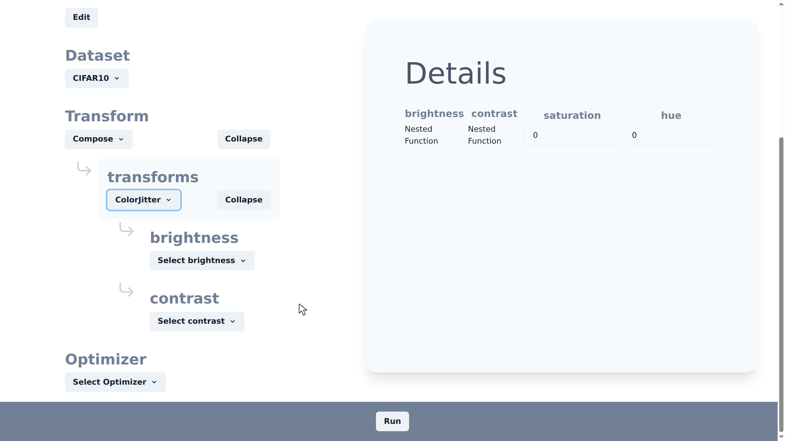

_Restored November 2020 build: nested configuration forms._

[Follow Python metadata, generated code and execution](features/python-interfaces.md).
The December 2020 sweep editor was explicitly a **UI prototype without execution logic**.

## 2022–2023: a spatial workspace

**Historical application.** Configuration sections became independently positioned canvas
nodes. Groups, orientation, an outline and search helped organize larger projects, while
Markdown brought explanations into the workspace. Generated launch commands connected the
interface with code execution.

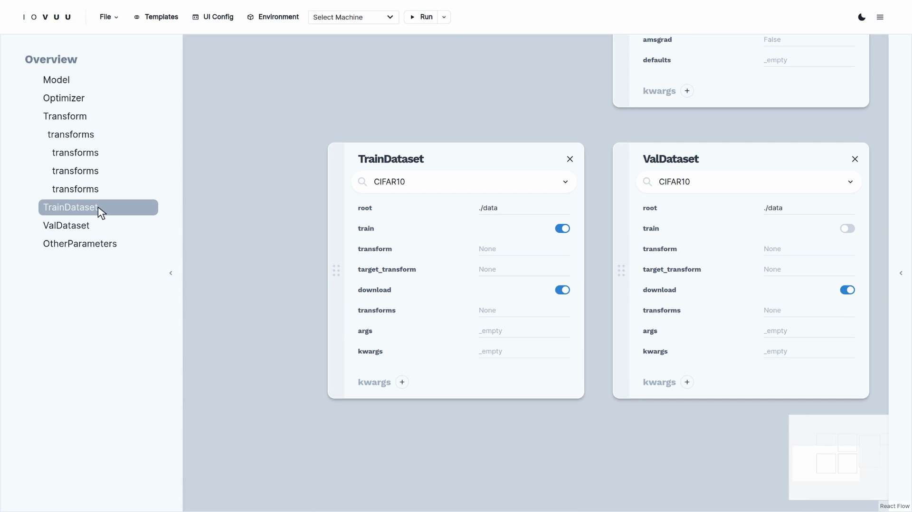

_Restored June 2022 build: navigating and editing a configuration._

Earlier list reordering and pan/zoom experiments were distinct from the free positioning
implemented in February 2022.
[Explore controls, grouping and navigation](features/spatial-controls.md).

## 2023–2024: local execution and experiment management

Editors, terminals and interactive Python brought
the execution environment into the project. A control could affect a calculated result;
versions and run groups supported comparing configurations instead of repeatedly rebuilding
them by hand.

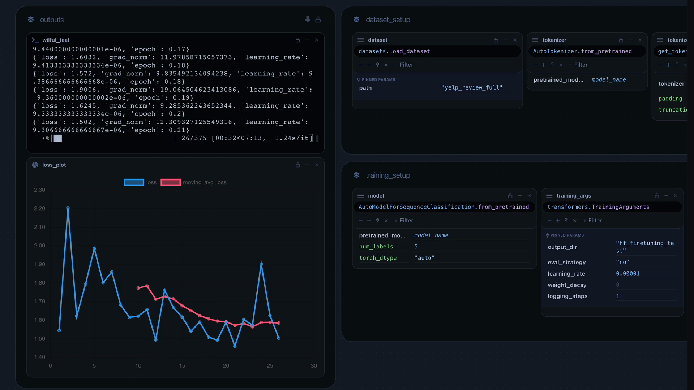

**Follow a computation as it runs.** Terminal logs and loss curves update together
in the original January 2025 recording. Interactive Python also let changing
controls recompute outputs; the later [Julia studio](https://setta.dev/features/#f-interactive-python)
shows that relationship through actual images.

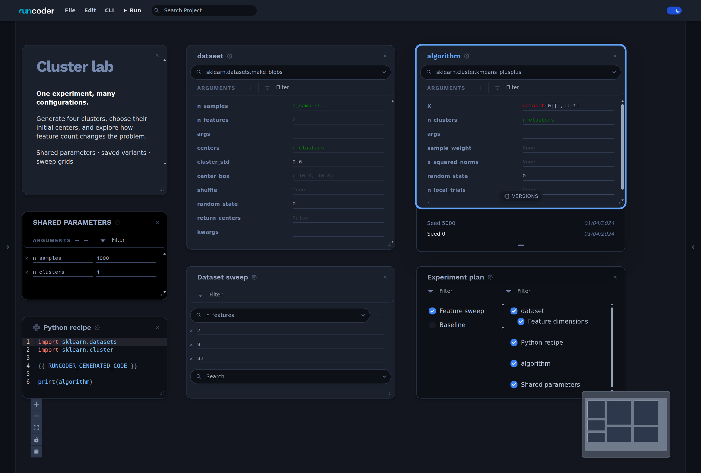

**An experiment you could inspect.** Shared variables feed the dataset and algorithm;
saved variants retain different seeds; a sweep selects feature counts of 2, 8 and 32.
This view shows configuration and experiment planning, rather than completed training runs.

_Cluster lab is a prepared demonstration in the restored January 2024 build; the training frame comes from an original January 2025 recording._

Executable parameter-value sweeps appear in January 2024. Sweeps across saved versions
extend them in February. Hover previews of section versions date to December 2023,
separately from the early 2021 saved-version experiment.
[Explore experiments, versions and execution](features/experiments.md).

## 2024–2025: Setta connects representations and live state

The workspace grew to combine richer controls, code, image inputs, charts and
documentation. YAML round trips
and reference-aware renaming connected visual configuration to text. Later, listeners,
generated state classes and bound files connected edits to running Python and ordinary
source files.

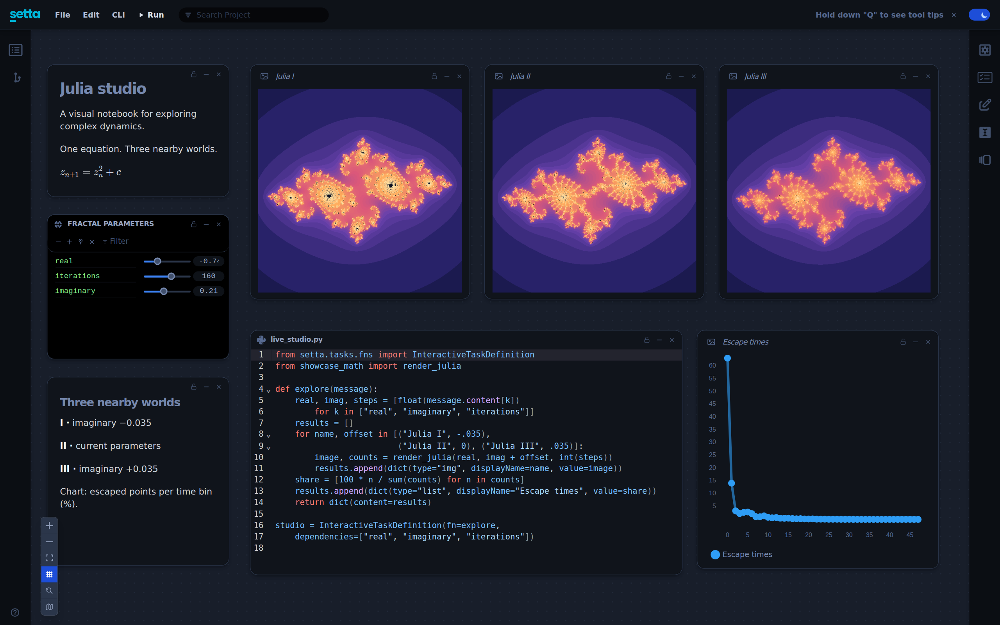

**Small changes, new worlds.** The Julia studio renders three neighboring complex constants
as images. Controls, the recurrence formula, live Python and an escape-time distribution
share the canvas. The images and chart were calculated by the restored application's
interactive task, using a new demonstration project.

_Restored November 2024 build._

By **spring 2025**, the [original examples](examples.md) took this workspace into image
generation, inpainting, language-model finetuning, sequence classification and metric
learning. The Stream Diffusion, FLUX and TRL previews below come from those examples.
The [archived website](https://setta.dev/old) and
[documentation](https://setta.dev/old/docs) preserve that period's presentation.

Model-backed canvas chat appears in February 2025, project chat develops in March–April,
and MCP workspace operations follow in April. Standalone meta controls arrive in December,
separately from the generated state class introduced in May.
[Explore reactive state and AI](features/reactive-ai.md).

## Spring 2025: from a sketch to an AI image

[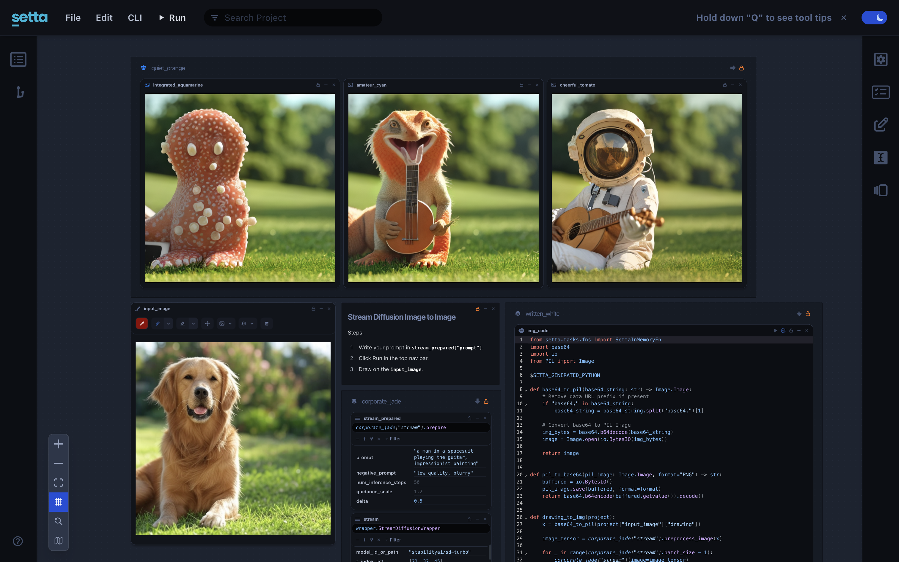](examples.md#stream-diffusion-image-to-image)

**Stream Diffusion:** sketch on an image and explore several generated variations in the same
workspace. This original example put drawing, prompts, Python and results side by side.
[Watch it in action](https://www.youtube.com/watch?v=KE6FZxbGVkw) or [explore all seven original examples](examples.md).

| Image editing with FLUX                                                                               | Language-model finetuning with TRL                                                                              |
| ----------------------------------------------------------------------------------------------------- | --------------------------------------------------------------------------------------------------------------- |
| [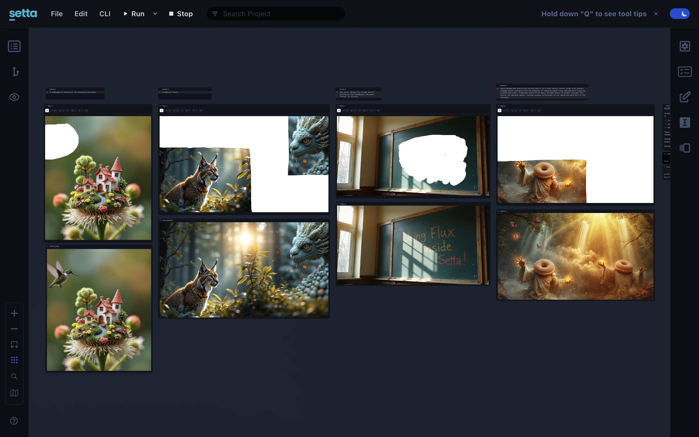](examples.md#flux-inpainting) | [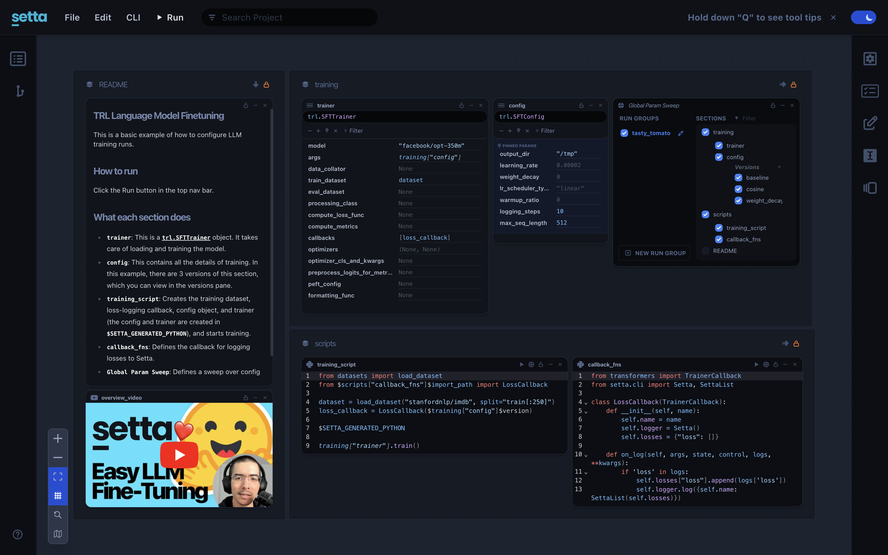](examples.md#trl-language-model-finetuning) |
| Paint a mask and explore image edits.                                                                 | Compose model, dataset and training settings.                                                                   |

## Summer 2025–spring 2026: an AI-native workbench

**Historical application.** The workspace expanded from experiment configuration into
an environment for working with code, files, models and agents together. Files, Git, SSH
workspaces, plugins, spreadsheets and task boards joined the canvas. Saved views let one
project serve several stages of the work. Chats could receive connected context, invoke
one another and take part in executable workflows.

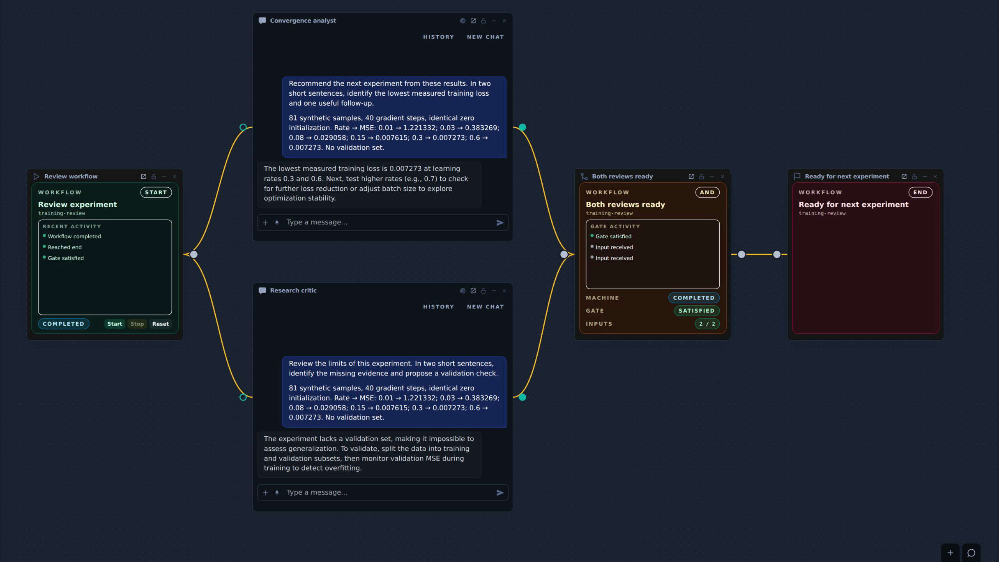

**AI as part of the project.** Two reviewers examine the same six-run experiment. The
workflow starts both reviews, waits for both to finish, then reaches its end. The visible
responses identify the tied candidates and the need for validation; the gate reports two
inputs received. These are actual responses generated through the restored application
with a substitute local model.

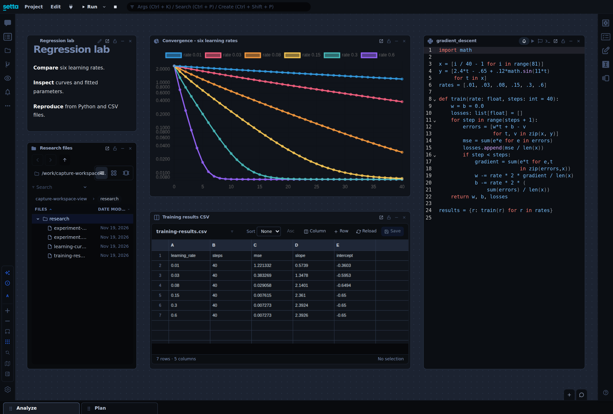

**The evidence stays close.** The Analyze view puts six measured convergence curves beside
an editable CSV, the Python calculation and the experiment files. The curves use a logarithmic
loss axis, making the difference between slow convergence and the shared loss floor visible.

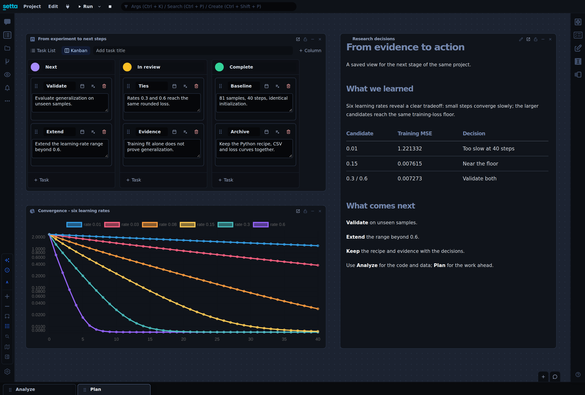

**One project, several working views.** Plan brings the task board and research decisions
forward while keeping the same chart. Analyze brings back code and data. The next steps
remain explicit: validate on unseen samples and explore learning rates beyond the tested range.

_All three captures use the restored May 2026 build with new demonstration projects.
The numerical experiment was computed in Python and imported into its native chart and
spreadsheet. [Image provenance](images.md) describes the restoration and model substitution._

Execution also changed form: the old sweeps and run groups were removed in June 2025;
January 2026's SettaRunner and RunPlan added grids, zipped values, sampling, repetition
and detached jobs. Hosted projects, later share deployments and app mode were separate
attempts to turn workspaces into tools other people could use.
[Explore the workbench and its side panes](features/workbench.md#20252026-project-tools-enter-the-left-pane) and [execution's return](features/experiments.md).

## Summer 2026: two agent-workspace experiments

**Separate experimental applications.** Setta 3 and Setta 4 explored organizing
ongoing agent work. They ran alongside the Setta 2-derived line from which the
current library was extracted.

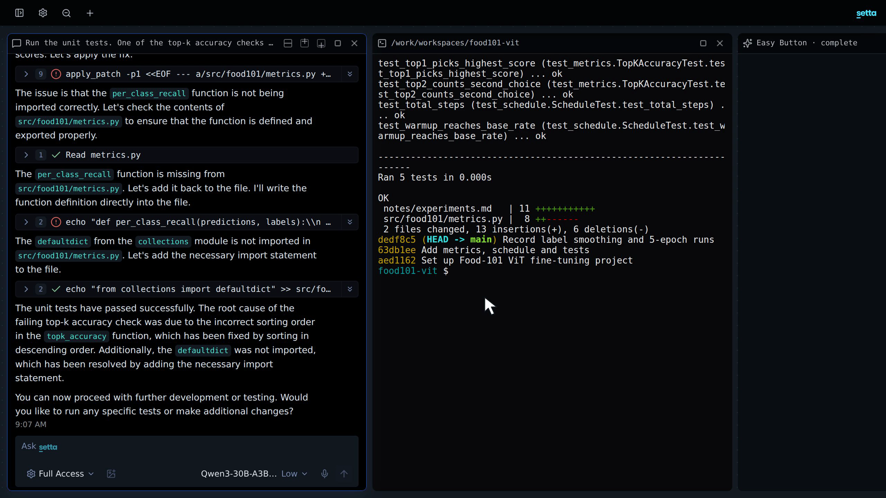

**Keep working as the workspace moves.** Setta 3 combined chat, terminals and
other surfaces in a scrolling strip. Panes could change width, maximize or
shrink into an overview. Easy Button put a request and its active run into a
focused surface. The restored workspace contains actual local-model work;
the Easy Button recording shows a run in progress.

_Restored July 11, 2026 build, using a prepared project and local Qwen3-30B-A3B.
The native web client connects to the restored Go backend._

The same experiment added a semantic research graph and a separate workflow
editor. New captures show an authored graph with synthetic experiment data
and a workflow draft that passed validation. They demonstrate editing and
presentation, not automatic cartography or completed workflow execution.

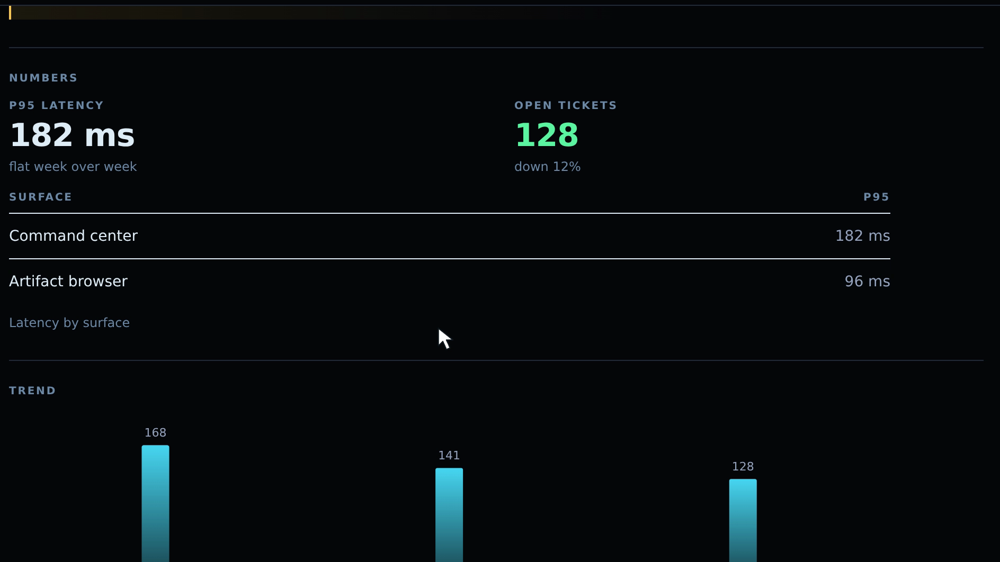

**Make the work itself visible.** Setta 4 explored workstreams and their
relationships in a Director command center. Structured artifacts combined
metrics, tables and charts into readable results. The report uses the application’s original built-in demonstration; the restored
live Director did not dispatch work successfully.

_Restored August 2, 2026 build · built-in report example._

[Explore the captures and the experimental directions](features/libraries-and-detours.md#summer-2026-two-agent-workspace-experiments).
[Image provenance](images.md#summer-2026-restoration-captures) records exact
source revisions, prepared data and model substitutions.

## 2026 onward: reusable building blocks

**Current library.** Extraction starts in August 2026 on the Setta 2-derived line. Browser
pipelines follow in October; the Python runtime is removed that month, and the unused Go
backend in November. The result is a TypeScript/React toolkit: the application supplies its
data, computations and persistence, and Setta supplies the workspace and optional worker
coordination.

[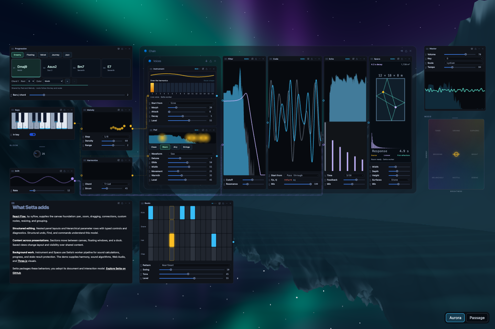](https://setta.dev/demo/)

_An independently maintained application built with the current library. Setta supplies
workspace interactions and worker coordination; the instrument supplies its musical rules,
audio engine and 3D scenery._

The library era also produced a print studio, depth-particle and Gaussian-splat viewers,
a photo-reconstruction tool, Python Canvas, Realtime, Review and Experiment Lens.
Their algorithms belong to the applications; the shared workspace made them configurable.
[Explore the original gallery and library extraction](features/libraries-and-detours.md).

## Continue exploring

[Browse the feature chapters](README.md#browse-by-feature-or-source) or use the
[detailed chronology](feature-history.md) to look up an implementation and its date.

Original media also survives in source history:
[historical Setta demonstration](https://github.com/riteofstring/setta/blob/9e717b00240916fa8156cdeb4758127ad95e5a04/images/hero.mp4) ·
[compact Setta introduction](https://github.com/riteofstring/setta/blob/c728188acf354fe5cd8878109958cd60a43d2611/images/setta-intro-small.mp4).

The current [ambient instrument](https://setta.dev/demo/) is another application built with the
library. Its website, the older website and the old documentation website are maintained
outside this source lineage.

[History guide](README.md) · [All documentation](../README.md)
