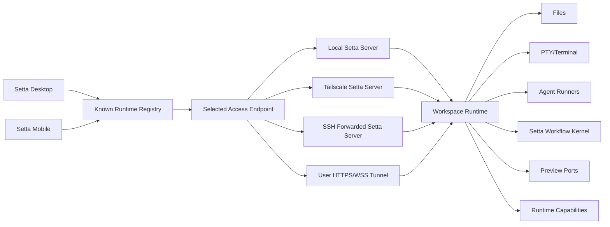

# BYO Setta Runtime Architecture Report

**Date:** 2026-07-02  
**Status:** SUPERSEDED by `remote-runtime-plan.md` — kept as background research only. The plan of record is `remote-runtime-plan.md`; where the two differ (e.g. this doc's multiple access methods vs. Tailscale-only), `remote-runtime-plan.md` wins.  
**Scope:** Evaluate BYO cloud/runtime direction, mobile implications, PocketDev/T3/Orca/Coder-style references, and a practical plan of action for Setta.

## Executive Recommendation

Setta should focus on a **bring-your-own Setta Runtime** rather than a Setta-managed cloud runtime for the next product phase.

The recommended product shape is:

```text
Setta Desktop / Setta Mobile
        -> Known Runtime
        -> Access Endpoint
             - localhost
             - LAN
             - Tailscale
             - SSH-forwarded localhost
             - HTTPS/WSS tunnel
        -> Setta Server on user-owned compute
        -> Files, terminals, agents, workflow kernel, previews, GPUs
```

This keeps Setta focused on the product layer where it can be meaningfully differentiated:

- Workflow orchestration.
- Agent session UX.
- Human approvals.
- Run/activity history.
- Workspace previews.
- Remote continuation from desktop and mobile.
- A coherent UI over terminals, files, ports, agents, and workflows.

It avoids making Setta responsible for the hardest, lowest-margin parts of the product too early:

- Cloud provider provisioning.
- VM inventory and support.
- GPU availability.
- Billing disputes.
- Idle shutdown policy.
- Security patching.
- Regional capacity issues.
- User-specific provider quirks.

The architecture should leave room for a future managed Setta Runtime, but no managed-runtime control plane or provider-specific managed infrastructure should be built now.

## What Changed From The Earlier Cloud Box Direction

The earlier `setta-v3-architecture-recommendations.md` points in a broadly useful direction: separate control and workload concerns, keep user code outside the UI process, support cloud workspaces later, and preserve provider adapters.

The part I would change is the default ownership model.

Instead of:

```text
Setta provisions and operates Cloud Boxes for users.
```

Prefer:

```text
Users provide compute.
Setta installs or connects to a Setta Server running on that compute.
```

This is not just a pricing concern. It is an architectural simplification:

- The runtime state lives with the machine that owns the files and processes.
- GPUs are just machine capabilities, not a Setta billing/product obligation.
- Tailscale, SSH, provider consoles, Runpod, Paperspace, AWS, Hetzner, and local machines become access/setup choices rather than separate product modes.
- Setta can still expose one consistent desktop/mobile UX.

## Current Setta Baseline

The current repo already has good foundations for this direction:

- The Go backend is already a runtime process with an HTTP API boundary.
- The Electron app talks through main/preload/backend contracts.
- The workflow kernel is already Setta-owned rather than outsourced to a third-party workflow engine.
- Terminals, workspace sessions, chat, semantic graph, workflow state, and activity streams already live behind backend services.

The main limitation is that the current runtime is intentionally local:

- `internal/runtime/server.go` binds to loopback by default and rejects non-loopback hosts.
- `internal/workspace` validates local absolute filesystem paths.
- `internal/workspacesession` opens and resolves local workspaces.
- `internal/terminal` starts local PTYs against the resolved workspace path.

That is fine. In the proposed model, a remote runtime is not a remote filesystem bolted onto the local app. It is the same kind of Setta backend running on the remote machine, close to the files, terminals, agents, ports, and GPUs.

## Research Summary

### PocketDev

Repository: [0xMassi/pocketdev](https://github.com/0xMassi/pocketdev)

PocketDev is a small, very focused Go tool for creating or adopting a remote development box. Its README describes the product as one command to run the AI coding CLI the user already pays for on a Tailscale-only Hetzner box, then code from a phone over SSH.

Observed GitHub adoption on 2026-07-02: about 87 stars and 3 forks.

Useful ideas:

- BYO model is explicit and honest.
- Tailscale-first access.
- No public inbound SSH.
- Hardened SSH configuration.
- Non-root development user.
- Cloud-init/bootstrap scripts.
- Adopt an existing server.
- Install multiple agent CLIs: Claude Code, Codex, Cursor, opencode, Gemini, Grok, Aider.
- Mobile helper that prints a QR, SSH details, and key setup guidance.
- Clear acknowledgement that consumer AI subscriptions are per-user and a hosted product should default to bring-your-own-auth.

What not to copy as Setta's main product experience:

- Phone UX is SSH app plus tmux.
- No durable Setta-style application protocol.
- No native mobile workflow UI.
- No runtime event model.
- No visual workflow layer.
- No Setta-owned run history, approval UX, or preview model.
- Hetzner-specific provisioning is useful but too narrow for GPU-heavy Setta users.

Conclusion: PocketDev is excellent inspiration for a **server installer/bootstrapper**, not for Setta's core runtime architecture.

### T3 Code

Repository: [pingdotgg/t3code](https://github.com/pingdotgg/t3code)  
Remote architecture: [docs/architecture/remote.md](https://github.com/pingdotgg/t3code/blob/main/docs/architecture/remote.md)  
Remote access guide: [docs/user/remote-access.md](https://github.com/pingdotgg/t3code/blob/main/docs/user/remote-access.md)

Observed GitHub adoption on 2026-07-02: about 13.1k stars and 2.7k forks.

T3's remote architecture is the closest match to the recommended Setta direction. The important ideas are:

- An execution environment is one running server.
- A known environment is a saved client-side entry.
- An access endpoint is one route to the same environment.
- SSH is a launch/access helper, not the core renderer transport.
- Direct `ws` / `wss` access should work first.
- Tailscale, tunnels, LAN addresses, public HTTPS, and SSH forwarding are access methods, not separate runtime types.
- Launch and access should stay separate.

This should be the architectural spine for Setta.

Setta does not need to copy T3's implementation language or provider runtime. Setta already has a Go backend and a workflow kernel. The useful part is the domain model.

### Orca

Repository: [stablyai/orca](https://github.com/stablyai/orca)  
Mobile app README: [mobile/README.md](https://github.com/stablyai/orca/blob/main/mobile/README.md)  
Headless server guide: [docs/reference/headless-linux-server.md](https://github.com/stablyai/orca/blob/main/docs/reference/headless-linux-server.md)

Observed GitHub adoption on 2026-07-02: about 10.4k stars and 695 forks.

Orca is relevant because it has a real desktop/mobile agent product surface and remote/headless support. Useful ideas:

- Mobile companion app rather than phone-only SSH.
- Pairing QR/code.
- Per-device revocation.
- Scoped mobile RPC allowlist.
- Protocol compatibility checks.
- Reconnect logic.
- SSH worktree support.
- `serve` command for headless usage.
- Tailscale-aware pairing address selection.

What not to copy too early:

- Electron/AppImage headless server path.
- Xvfb/headless desktop complexity.
- Large SSH relay/multiplexer implementation.
- Broad remote filesystem/PTY provider stack before Setta's server protocol is stable.

Conclusion: copy Orca's mobile pairing/security discipline, not its heaviest remote implementation.

### Coder And code-server

Repositories:

- [coder/coder](https://github.com/coder/coder)
- [coder/code-server](https://github.com/coder/code-server)

Observed GitHub adoption on 2026-07-02:

- code-server: about 78k stars.
- Coder: about 13.7k stars.

These projects validate that remote development environments are a real category, and that users understand "server runs near your code; client connects to it."

Useful lessons:

- BYO infrastructure can be a serious product shape.
- Secure remote access matters as much as editor UX.
- Tailscale/private-network setups are normal for technical users.
- Browser/mobile access can matter, but generic cloud IDE functionality is a huge surface area.

What not to do:

- Do not become a generic cloud IDE.
- Do not become a Terraform workspace manager.
- Do not compete with VS Code-in-browser.

Setta should integrate with this world, not try to replace it.

### OpenHands, opencode, Aider, Plandex, bolt.diy

Representative repositories:

- [OpenHands](https://github.com/OpenHands/OpenHands)
- [opencode](https://github.com/opencode-ai/opencode)
- [Aider](https://github.com/Aider-AI/aider)
- [Plandex](https://github.com/plandex-ai/plandex)
- [bolt.diy](https://github.com/stackblitz-labs/bolt.diy)

These projects are more about agent execution, terminal agents, browser coding, or autonomous development loops than Setta's remote runtime architecture.

Useful lesson:

- Setta should treat external coding agents as **runners/adapters**, not as the product architecture.

This aligns with Setta's existing workflow-kernel direction: Setta owns workflow definitions, run lifecycle, approvals, state projection, and history; runners own provider/tool-specific execution.

## Mobile App Store Implications

Apple's [App Store Review Guidelines](https://developer.apple.com/app-store/review/guidelines/) do not ban WebViews outright, but Guideline 4.2 requires apps to provide enough app-like value beyond a repackaged website. Guideline 4.2.7 is also relevant for remote desktop/thin-client behavior.

For Setta, the safer path is:

```text
Native mobile companion app
  - host/runtime list
  - QR pairing
  - run monitor
  - approvals
  - prompt/steer
  - activity stream
  - terminal tail/input
  - file/diff previews
  - preview browser links
```

Do not ship:

```text
Whole Electron renderer embedded in a mobile WebView
```

React Native or Expo is the better mobile path:

- [React Native](https://reactnative.dev/) gives native iOS/Android UI with React.
- [Expo development builds](https://docs.expo.dev/develop/development-builds/create-a-build/) let the project use native libraries while keeping a productive development loop.

Limited WebViews are still acceptable for specific content:

- Web app previews.
- Documentation pages.
- Browser-like preview panes.
- Possibly terminal rendering, if a native terminal surface is not practical at first.

The app shell should be native.

## GPU And Provider Implications

Setta should not hard-code a "Cloud Box provider" into the product model.

GPU-capable users may want:

- Runpod.
- Paperspace.
- AWS.
- Lambda Labs.
- Local workstation.
- University/HPC machines.
- A custom company VM.
- Hetzner or DigitalOcean for CPU-only work.

Fly should not be the first serious GPU assumption. Fly's GPU story has changed over time, and its GPU Machines documentation has indicated deprecation/unavailability. Treat Fly as a possible CPU provider or future adapter, not as the default GPU path.

The runtime should advertise capabilities:

```text
RuntimeCapability
  - os
  - arch
  - cpu cores
  - memory
  - disk
  - gpu present
  - gpu vendor/model
  - vram
  - cuda available
  - docker available
  - tailscale available
  - public preview tunnel available
  - installed agent CLIs
```

This lets Setta guide users without owning their infrastructure.

## Proposed Domain Model

### ExecutionRuntime

One running Setta Server instance.

Owns:

- Workspace records local to that machine.
- Filesystem access.
- Terminal sessions.
- Agent process execution.
- Workflow runs.
- Runtime-local SQLite state.
- Preview port discovery.
- Capability reporting.

### KnownRuntime

A client-side saved runtime entry.

Examples:

- Local Setta backend.
- `setta serve` on a desktop machine.
- Runpod box.
- Paperspace machine.
- AWS VM.
- Tailscale-only home workstation.

The same runtime can have multiple access endpoints.

### AccessEndpoint

One concrete route to a runtime.

Examples:

- `http://127.0.0.1:NNNN`
- `http://192.168.1.20:NNNN`
- `http://100.x.y.z:NNNN`
- `https://setta-box.example.com`
- `http://127.0.0.1:forwarded-port` after SSH forwarding

Endpoint metadata should include:

- Kind: loopback, LAN, tailnet, public HTTPS, SSH-forward, custom.
- HTTP base URL.
- WebSocket/SSE base URL.
- Last successful connection time.
- Compatibility with hosted web, desktop, and mobile.
- Whether TLS is required.

### LaunchMethod

How a runtime comes into existence.

Examples:

- Already running.
- Local desktop-launched backend.
- User-installed systemd service.
- SSH-launched `setta serve`.
- Provider setup script.
- Future managed Setta runtime.

Launch method is not the same thing as access endpoint.

### PairingCredential

A one-time or short-lived credential used to authorize a device.

Result of pairing:

- Device ID.
- Device public key or token binding.
- Scope.
- Created/last-seen timestamps.
- Revocation state.

Scopes should be explicit:

- `desktop`: broad control of workspace and runtime UX.
- `mobile`: restricted companion operations.
- `runtime-admin`: server setup/admin actions.
- `preview-only`: optional future sharing mode.

### RuntimeConnection

Client-side state machine for connection lifecycle:

- disconnected
- connecting
- authenticating
- connected
- reconnecting
- incompatible
- revoked
- unreachable

This should be shared conceptually by desktop and mobile.

## Security Recommendation

Remote-capable Setta Server must not be "the current loopback backend with host validation relaxed."

Minimum security requirements:

- Loopback default.
- Non-loopback bind requires explicit flag and auth.
- Pairing required for new clients.
- Pairing token expires.
- Device sessions are revocable.
- Mobile scope is allowlisted.
- No unauthenticated SSE/WebSocket streams.
- No global broadcast without workspace/runtime scoping.
- Runtime version/protocol compatibility check before enabling controls.
- Clear UI around what machine a command or agent will run on.

Transport options:

- First: HTTP/WebSocket over Tailscale or SSH-forwarded localhost.
- For public endpoints: HTTPS/WSS required.
- Later: optional embedded Tailscale via [tsnet](https://tailscale.com/docs/features/tsnet), but do not require it for the first version.

Application-layer encryption can be added if mobile/network constraints make TLS management awkward, but the first version can be simpler if the recommended access paths are Tailscale, SSH forwarding, or user-managed HTTPS.

## Recommended Architecture



The key principle:

```text
The runtime owns execution.
The clients own presentation and control.
Access methods only connect the two.
```

## Plan Of Action

### Phase 1: Name And Model The Runtime Boundary

Goal: Make the product model explicit before adding remote behavior.

Deliverables:

- Add internal product terminology:
  - `ExecutionRuntime`
  - `KnownRuntime`
  - `AccessEndpoint`
  - `LaunchMethod`
  - `RuntimeCapability`
  - `PairingCredential`
- Document which existing backend services are runtime-local.
- Keep the current Electron-local backend as the first runtime implementation.
- Do not change provider provisioning yet.

Success criteria:

- Desktop can still use local Setta exactly as before.
- The code and docs have a clear place for "which runtime am I controlling?"
- No remote-specific hacks are added to workspace, terminal, or workflow services.

### Phase 2: Build `setta serve`

Goal: A headless Setta Server can run outside Electron.

Deliverables:

- A first-class CLI entry point:
  - `setta serve`
  - `--host`
  - `--port`
  - `--app-data-dir`
  - `--pair`
  - `--advertise-address`
- Loopback-only default remains.
- Non-loopback requires explicit `--allow-remote` or equivalent.
- Server prints:
  - local URL
  - pairing URL
  - QR code if terminal supports it
  - version/protocol metadata
- Linux systemd service template.
- Install script for a user-owned machine.

Success criteria:

- A user can SSH into a machine, install Setta Server, run `setta serve`, and pair desktop to it over Tailscale or SSH forwarding.
- No Electron/Xvfb/AppImage headless dependency.

### Phase 3: Desktop Known Runtime UX

Goal: Desktop can connect to local or remote Setta Server through the same conceptual model.

Deliverables:

- Runtime picker/switcher.
- Add runtime from pairing URL.
- Save known runtimes locally.
- Show connection status.
- Show runtime identity and capabilities.
- Route existing workspace/chat/workflow/terminal calls through the selected runtime connection.

Success criteria:

- Local runtime remains the default.
- A paired remote runtime can list/open workspaces that exist on that remote machine.
- Terminal and workflow actions clearly run on the selected runtime.

### Phase 4: Minimal Remote Runtime Surface

Goal: Prove remote execution with Setta-owned UI.

Deliverables:

- Workspace list/open on remote runtime.
- Terminal create/attach/input/resize over remote connection.
- Chat/agent run lifecycle over remote connection.
- Workflow definition list/read/run where definitions are workspace-local on the remote machine.
- Runtime activity stream.
- Preview port detection and open/copy URL.

Non-goals:

- Remote file explorer parity.
- Full SSH relay.
- Provider-specific provisioning.
- Multi-user server.
- Managed Setta cloud.

Success criteria:

- A user can connect to a remote box and do meaningful Setta work without opening a separate SSH app.

### Phase 5: Mobile Companion

Goal: Mobile is a native companion, not a WebView wrapper.

Deliverables:

- React Native/Expo app.
- Pair by QR/link.
- Runtime list and connection state.
- Active runs.
- Approvals.
- Prompt/steer/cancel.
- Activity stream.
- Terminal tail and limited input.
- Preview links.
- Push notification groundwork.

Mobile scope should be restricted by an explicit allowlist.

Success criteria:

- The app is useful even if it is not a full IDE.
- It should feel like "control and supervise Setta from the phone," not "squint at desktop Setta in a WebView."

### Phase 6: Bootstrap Helpers

Goal: Make BYO setup pleasant without making provider control the core architecture.

Deliverables:

- `setta install-server` script.
- `setta doctor`.
- `setta pair`.
- `setta runtime capabilities`.
- SSH bootstrap helper:
  - connect
  - upload/install server
  - start or reuse service
  - create local port forward
  - hand desktop a normal local endpoint
- Tailscale helper:
  - detect tailnet IP/MagicDNS where available
  - suggest correct bind/advertise address

Success criteria:

- A technical user can bring an existing Linux box online quickly.
- Access and launch remain separate in the model.

### Phase 7: Provider Setup Recipes

Goal: Support common cloud/GPU setups as recipes, not as Setta-owned managed infrastructure.

Deliverables:

- Runpod guide/script.
- Paperspace guide/script.
- AWS EC2 guide/script.
- Local workstation guide.
- Hetzner CPU-only guide inspired by PocketDev.

Each recipe should answer:

- How to create the box.
- How to install Setta Server.
- How to expose it safely.
- How to pair desktop/mobile.
- How to verify GPU/tooling capability.
- How to stop billing.

Success criteria:

- Provider-specific work improves onboarding without leaking into the core runtime model.

## What To Avoid

Avoid these until there is strong product pressure:

- Managed Setta runtime provisioning.
- Postgres/Clerk/cloud control plane for runtime state.
- Provider billing integration.
- A Setta-owned public tunnel service.
- Full remote IDE/file explorer parity.
- SSH as the renderer protocol.
- Remote filesystem sync as the first solution.
- Mobile full-app WebView.
- GPU provider lock-in.
- Broad compatibility shims around early runtime contracts.

## Immediate Next Step

The next architectural task should be a focused RFC for the runtime boundary:

```text
RFC: Setta Execution Runtime, Known Runtime, and Access Endpoint model
```

It should specify:

- The runtime identity model.
- Client-side saved runtime state.
- Endpoint selection.
- Pairing/auth scopes.
- Required backend contract changes.
- How the current local Electron backend maps to the model.
- The minimal `setta serve` command.

Do this before changing the backend host validation or adding provider-specific setup code.

## Final Recommendation

Setta should use **T3's remote-environment architecture as the spine**, **PocketDev's BYO bootstrap philosophy as the onboarding inspiration**, and **Orca's mobile/pairing discipline as the client-experience reference**.

The product should not be:

```text
Setta, the cloud VM provider.
```

It should be:

```text
Setta, the orchestration and control surface for AI work running on your machines.
```

That position is simpler, more defensible, and better aligned with Setta's existing workflow-kernel investment.

