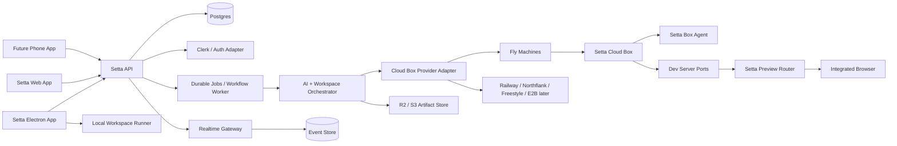

# Setta v3 Architecture Recommendations

**Date:** 2026-06-29  
**Audience:** Setta founding/engineering team  
**Document type:** Architecture and product-technical recommendation  
**Status:** Working recommendation for next implementation phase

---

## 1. Executive recommendation

Setta v3 should be architected as an **AI orchestration system with workspace execution**, not as a deployment platform, Python-node UI, or cloud-hosting wrapper.

The recommended v3 shape is:

```text
Setta Electron App / Web App / Future Mobile App
        ↓
Setta Control Plane
        ↓
AI Orchestration + Workflow Engine
        ↓
Workspace Layer
   ├─ Local workspace on desktop
   └─ Cloud Box workspace when remote/cloud execution is needed
        ↓
Preview / Terminal / Files / Agent Events / Integrated Browser
```

Deployment should remain a **future adapter**. The architecture should preserve the ability to later deploy to Cloudflare, Fly, Railway, AWS, RunPod, etc., but the v3 MVP should focus on:

- AI orchestration.
- Workflow/session state.
- Local and cloud workspaces.
- Integrated preview browser.
- Project sync/checkpointing.
- Durable agent execution.
- Secure, scoped realtime events.
- Cost-controlled Cloud Boxes.

The strongest practical recommendation is:

```text
Build the v3 backend/control plane in Go.
Use Postgres as the source of truth.
Use Clerk for auth initially.
Use Fly Machines as the first serious Cloud Box backend candidate.
Keep Cloud Box providers behind an adapter interface.
Use R2/S3-compatible object storage for snapshots, artifacts, logs, and backups.
Keep deployment out of the MVP, but model projects/artifacts so deployment can come later.
```

The uploaded Setta SaaS memo should be treated as historical evidence, not a template. Its useful lesson is the **control-plane/workload-plane split**. Its risky lesson is that long-running orchestration, WebSocket broadcasts, log streaming, runtime state, and provider cleanup should not live inside a single web process.

---

## 2. What Setta v3 is and is not

### Setta v3 is

```text
An AI orchestration and development workspace system.
```

It should help users:

- Create or open projects.
- Use AI agents against real files and workflows.
- Run workflows made of model calls, tools, human approvals, local/cloud commands, and UI actions.
- Develop locally when on desktop.
- Start a Cloud Box when they want cloud execution from desktop, browser, or phone.
- See the result through Setta's integrated browser or preview panel.
- Maintain project/session/workflow history.
- Sync/checkpoint work between local and cloud contexts.

### Setta v3 is not

```text
A direct continuation of Setta v1/v2.
```

Setta v2's concept of exposing Python functions as UI nodes was a different product. Some workflow concepts can survive, but the v3 product center is not "Python functions as nodes." It is:

```text
AI sessions + workflows + project workspaces + previewable results.
```

Setta v3 should also not start as:

- A production deployment platform.
- An AWS wrapper.
- A general cloud IDE clone.
- A phone-to-laptop remote-control system.
- A Terraform product.
- A Docker/Fly/Railway UI wrapper.

Those may become adjacent capabilities later, but they should not define v3.

---

## 3. Lessons from the prior SaaS prototype

The prior SaaS prototype had the right top-level split:

```text
Control plane
  manages records, auth, provider APIs, logs, events

Workload plane
  runs user code separately in Fly machines
```

This is still the right category of architecture for v3. User/agent code should run in a workload environment, not inside the Setta API server.

However, the old prototype should not be copied as-is. The major issues to avoid are:

- In-process background tasks as the source of truth.
- Global unauthenticated WebSocket broadcasts.
- In-process `fly logs` subprocesses tied to the API web server.
- One service object owning CRUD, machine state, deployment, logs, storage cleanup, and broadcasts.
- A single `projects.status` field trying to represent project, runtime, deployment, and machine states.
- Provider-specific behavior leaking into the core state model.
- Python-specific runtime assumptions such as `requirements.txt`, `app.py`, `main.py`, and `pip`.
- Manual/ad hoc migrations.
- R2/source sync and dependency installation happening on every runtime startup.

For Setta v3, the corrected version is:

```text
Durable workflows / jobs
Explicit state machines
Scoped event streams
Provider adapters
Workspace-first model
Language-agnostic runtime detection
Cloud Box lifecycle management
Object storage for durable snapshots/artifacts
Volumes/caches for active workspace speed
```

---

## 4. Product architecture overview

### Recommended high-level system



### Core runtime modes

Setta v3 should have two development runtime modes:

```text
Local Mode
  Runs on the user's desktop machine through Electron/local process control.
  No phone-to-laptop control by default.

Cloud Box Mode
  Runs in an isolated cloud workspace.
  Desktop, web, and phone control the Cloud Box through Setta.
```

Local Mode is for low cost and fast desktop use. Cloud Box Mode is for:

- Phone-created projects.
- Laptop unavailable/offline.
- Stronger isolation.
- Cloud execution.
- Multi-device continuation.
- Heavier builds than the user's machine can handle.
- Long-running agent tasks.

---

## 5. Recommended v3 stack

### Client applications

| Surface | Recommendation | Notes |
|---|---|---|
| Desktop | Keep Electron for now | Already exists; gives local filesystem/process access. |
| Web | Keep a web-compatible UI core | Useful for account/project access and future mobile wrapper. |
| Mobile MVP | Start with responsive web/PWA or Capacitor-style wrapper | Fastest path for a two-person team if the phone mainly controls cloud workspaces. |
| Mobile long-term | Consider React Native + Expo | Better native app path if mobile becomes a major product surface. |

Electron is appropriate for the current desktop app because it embeds Chromium and Node.js to build cross-platform desktop apps with JavaScript, HTML, and CSS. Capacitor is the quickest bridge if you want a web UI to become a basic iOS/Android/PWA app. Expo/React Native is stronger if the phone app becomes more native and interaction-heavy.

### Control plane

Use Go for the v3 backend/control plane.

Recommended Go services:

```text
setta-api
  HTTP API, auth, project/session/workspace commands

setta-worker
  durable jobs, workflow steps, Cloud Box lifecycle, snapshots, cleanup

setta-realtime
  WebSocket/SSE event gateway, scoped subscriptions

setta-router
  preview proxy, authenticated dev-server routing
```

For a two-person team, these can initially be one Go binary with multiple run modes:

```bash
setta serve api
setta serve worker
setta serve realtime
setta serve router
```

or one deployable service with internal packages, as long as durable background work is persisted and resumable.

### Data and state

Use:

```text
Postgres
  source of truth for users, projects, sessions, workflow runs, workspaces, events, usage, provider refs

R2 / S3-compatible storage
  snapshots, source bundles, artifacts, logs, file exports, backups

Fly Volumes or provider-local disks
  fast active workspace state only
```

Do not rely on Fly volumes or any provider-local disk as the only durable copy of a project.

### Auth

Keep Clerk for v1 unless you have a strong reason to switch. Use it for:

- User identity.
- Organizations/teams.
- Session tokens.
- Basic account lifecycle.

But Setta should own authorization:

```text
Clerk says who the user is.
Setta DB says which projects, workspaces, runs, events, and Cloud Boxes they can access.
```

---

## 6. Core domain model

The old model used `projects` as the main durable entity. Setta v3 needs a richer model.

### Recommended entities

```text
User
  external auth identity, e.g. Clerk user ID

Organization
  team/account boundary

Project
  durable user-facing project container

Workspace
  a development context for a project: local or cloud

WorkspaceRun
  one active/resumable execution of a workspace

CloudBoxInstance
  provider-specific cloud runtime record

AgentSession
  one AI conversation/task session against a project/workspace

Workflow
  reusable workflow definition

WorkflowRun
  one execution of a workflow

WorkflowStepRun
  one step execution: model call, command, tool call, approval, file edit, preview check, etc.

ToolInvocation
  typed record of tool usage

Artifact
  source snapshot, workspace snapshot, build artifact, uploaded file bundle, generated output

PreviewPort
  dev server port and access policy

Event
  scoped event stream for UI/realtime

UsageRecord
  active Cloud Box seconds, model usage, storage, workflow steps, build minutes
```

### Minimal schema sketch

```sql
users (
  id,
  clerk_user_id,
  created_at
)

organizations (
  id,
  clerk_org_id,
  name,
  plan,
  created_at
)

projects (
  id,
  org_id,
  owner_user_id,
  name,
  description,
  visibility,
  created_at,
  updated_at,
  archived_at
)

project_members (
  project_id,
  user_id,
  role
)

workspaces (
  id,
  project_id,
  mode, -- local | cloud
  source_ref,
  branch,
  status,
  default_resource_class,
  created_at,
  updated_at
)

workspace_runs (
  id,
  workspace_id,
  status, -- queued | starting | running | sleeping | stopped | failed | archived
  started_by_user_id,
  active_since,
  last_active_at,
  stopped_at,
  error
)

cloud_box_instances (
  id,
  workspace_run_id,
  provider, -- fly | railway | northflank | freestyle | e2b
  provider_app_id,
  provider_machine_id,
  provider_volume_id,
  region,
  resource_class,
  state,
  created_at,
  updated_at
)

agent_sessions (
  id,
  project_id,
  workspace_id,
  created_by_user_id,
  status,
  title,
  model_policy,
  created_at,
  updated_at
)

workflow_runs (
  id,
  project_id,
  agent_session_id,
  status,
  started_by_user_id,
  started_at,
  finished_at,
  error
)

workflow_step_runs (
  id,
  workflow_run_id,
  step_type,
  status,
  input_json,
  output_json,
  started_at,
  finished_at,
  error
)

artifacts (
  id,
  project_id,
  workspace_id,
  kind, -- source_snapshot | workspace_snapshot | generated_file | build_artifact | log_export
  storage_uri,
  checksum,
  metadata_json,
  created_at
)

preview_ports (
  id,
  workspace_run_id,
  port,
  protocol,
  label,
  access_policy,
  last_seen_at
)

events (
  id,
  scope_type, -- project | workspace | agent_session | workflow_run
  scope_id,
  sequence,
  type,
  payload_json,
  created_at
)

usage_records (
  id,
  org_id,
  user_id,
  project_id,
  resource_type,
  quantity,
  unit,
  period_start,
  period_end
)
```

---

## 7. AI orchestration model

Setta v3's core should be AI orchestration. Treat the AI layer as first-class rather than bolting it onto a devbox product.

### AI orchestration primitives

```text
AgentSession
  conversational/task context

Run
  durable execution of an agent action or workflow

Step
  a model call, tool call, command, file edit, test run, preview check, or approval

Tool
  typed capability exposed to agents

Policy
  permissions and limits for what a session/run can do

Event
  observable state transition for UI

Artifact
  durable output from a run or step
```

### Core tools in v3

Setta should expose a small set of tools to AI sessions:

```text
read_file
write_file
list_files
search_files
run_command
start_dev_server
stop_process
list_processes
open_preview
inspect_preview
create_checkpoint
restore_checkpoint
ask_user_approval
invoke_workflow
```

Later tools can include:

```text
deploy_preview
connect_database
run_browser_automation
create_mobile_build
open_pull_request
connect_github_issue
```

### Human approval boundaries

Require approval for:

- Installing large dependencies.
- Running destructive commands.
- Touching secrets.
- Spending significant Cloud Box time.
- Scaling to larger resource classes.
- Making network calls to sensitive destinations.
- Deleting files or resetting branches.
- Publishing/deploying anything publicly.

---

## 8. Workflow system recommendation

Do not overbuild the workflow engine in the first version. But do make runs durable.

### v1 workflow engine

Use:

```text
Postgres-backed jobs
+ worker leases
+ retry/backoff
+ step records
+ idempotency keys
+ event emission
```

This is enough for:

- Start Cloud Box.
- Stop/sleep Cloud Box.
- Snapshot workspace.
- Restore workspace.
- Run agent step.
- Run command step.
- Stream logs/events.
- Reconcile provider state.
- Cleanup orphaned resources.

### Do not start with

```text
Temporal / Cadence / Airflow / custom DAG engine
```

unless you already know the workflow complexity demands it. Temporal can be added later if workflows become long-lived, highly concurrent, and hard to recover with a Postgres job table.

### Workflow/job table sketch

```sql
jobs (
  id,
  type,
  status,
  priority,
  idempotency_key,
  input_json,
  output_json,
  error,
  run_after,
  attempts,
  max_attempts,
  locked_by,
  locked_until,
  created_at,
  updated_at
)
```

Each job should emit events:

```text
workspace.start.queued
workspace.start.provisioning
workspace.start.hydrating
workspace.start.ready
workspace.start.failed
```

---

## 9. Cloud Box architecture

A **Cloud Box** is a development workspace runtime. It is not a production deployment.

Definition:

```text
A Cloud Box is a temporary, isolated cloud computer that Setta can start, stop, sleep, snapshot, resize, and expose through the Setta UI.
```

A Cloud Box should contain:

- Project files.
- Git.
- Language runtimes/toolchains.
- Terminal/process execution.
- Setta Box Agent.
- File watcher.
- Port detector.
- Dev server processes.
- Preview routing.
- Workspace cache/volume.

### Recommended v1 provider: Fly Machines

Because you already prototyped with Fly Machines, Fly should be the first serious Cloud Box backend candidate. The v3 architecture should not depend on Fly permanently, but Fly is credible for v1 if you build the scheduler/control plane correctly.

Recommended mapping:

```text
Setta Project / Workspace
  → Fly App boundary where possible
      → one active Fly Machine while the Cloud Box is running
      → optional Fly Volume mounted at /workspace
```

Default rule:

```text
One active project workspace = one active Fly Machine.
```

Do not create one permanent Machine per user or per project. Create/keep Machines only for active or recently active Cloud Boxes.

### Fly app boundary

Preferred:

```text
one Fly App per project cloud workspace
```

Acceptable early compromise:

```text
one Fly App per user/team, one Machine per active project
```

Avoid:

```text
one Fly App for all users/projects
```

Reasons:

- Better secrets isolation.
- Cleaner logs.
- Cleaner private networking boundaries.
- Cleaner app-level settings.
- Easier cleanup/reconciliation.
- Reduced blast radius.

### Cloud Box lifecycle

```text
none
  no cloud runtime exists

queued
  user requested Cloud Box

provisioning
  provider app/machine/volume being created or assigned

hydrating
  workspace restored from Git/object storage/snapshot

running
  user/agent is active

sleeping/suspended
  fast resume path for recent inactivity

stopped
  no CPU/RAM billing, slower resume

archived
  durable state in Git/object storage only; provider resources released

failed
  requires user or worker action
```

### Cloud Box provider interface

```go
type CloudBoxProvider interface {
    CreateBox(ctx context.Context, input CreateBoxInput) (BoxRef, error)
    AssignPooledBox(ctx context.Context, input AssignBoxInput) (BoxRef, error)
    StartBox(ctx context.Context, ref BoxRef) error
    SuspendBox(ctx context.Context, ref BoxRef) error
    StopBox(ctx context.Context, ref BoxRef) error
    DestroyBox(ctx context.Context, ref BoxRef) error
    ResizeBox(ctx context.Context, ref BoxRef, class ResourceClass) (BoxRef, error)
    SnapshotBox(ctx context.Context, ref BoxRef) (ArtifactRef, error)
    State(ctx context.Context, ref BoxRef) (BoxState, error)
    Exec(ctx context.Context, ref BoxRef, command ExecCommand) (<-chan ExecEvent, error)
    Ports(ctx context.Context, ref BoxRef) ([]PreviewPort, error)
}
```

Initial implementation:

```text
FlyCloudBoxProvider
```

Future implementations:

```text
RailwaySandboxProvider
NorthflankSandboxProvider
FreestyleVMProvider
E2BProvider
DaytonaProvider
AWSProvider
```

---

## 10. Setta Box Agent

Every Cloud Box should run a small Setta-controlled agent process.

### Responsibilities

```text
Authenticate to Setta with a short-lived box token.
Open outbound control connection to Setta.
Expose terminal sessions.
Run commands with scoped permissions.
Watch files.
Detect dev servers and ports.
Report process/log events.
Create snapshots/checkpoints.
Receive agent tool calls.
Enforce local policy inside the box where possible.
```

The Box Agent should not contain privileged Setta secrets.

### Box Agent communication

Preferred:

```text
Cloud Box Agent → outbound WebSocket/gRPC/HTTP stream → Setta Control Plane
```

Avoid:

```text
Setta directly SSHs into boxes for normal operation
```

SSH can exist later as an escape hatch, but the product should not depend on users understanding SSH.

### Token model

The Box Agent receives:

```text
project-scoped box token
short TTL
specific workspace_run_id
allowed event channels
allowed artifact prefixes
allowed preview ports
```

It must not receive:

```text
Setta master Fly token
Stripe key
Clerk admin key
LLM provider master key
cross-user storage credentials
```

---

## 11. Preview and integrated browser

The integrated browser is central to the "feels local" experience.

### Preview flow

```text
Dev server starts in Cloud Box on port 3000/5173/8000/etc.
      ↓
Setta Box Agent detects listening port
      ↓
Setta records PreviewPort
      ↓
Setta Preview Router exposes authenticated URL
      ↓
Integrated browser opens the URL
```

Example URLs:

```text
https://<workspace-id>-3000.preview.setta.dev
https://<workspace-id>-5173.preview.setta.dev
```

### Requirements

The preview router must support:

- HTTP.
- HTTPS.
- WebSockets.
- Server-sent events.
- Hot module reload.
- Authenticated access by default.
- Temporary public share links.
- Mobile viewport preview.
- Desktop viewport preview.
- QR handoff to phone.

### Fly routing option

For Fly-backed Cloud Boxes, use:

```text
Setta preview router app
  → authenticate Setta session
  → map preview URL to target Fly app/machine/port
  → use fly-replay to route request
```

Fly's per-user development environment guidance and dynamic request routing docs are directly relevant to this.

---

## 12. Local mode

Setta should still support local development, but without phone control of the laptop by default.

### Local mode goals

```text
Open local project folder.
Let AI work with local files through the Electron app.
Run commands locally with user approval.
Preview local dev server in Setta's integrated browser.
Checkpoint/sync project state to Setta when requested.
Start a Cloud Box from a local snapshot when the user wants remote/mobile continuation.
```

### Security boundary

Default:

```text
Desktop app controls local project.
Phone does not control laptop.
Cloud Box can be controlled from phone/desktop/web.
```

This avoids the security complexity of remote-controlling personal machines.

### Local runner

Setta Electron can run a local runner process that provides:

- File operations.
- Terminal execution.
- Process management.
- Port detection.
- Local preview routing.
- Git checkpointing.
- Optional Podman/devcontainer support later.

This local runner should expose a similar interface to the Cloud Box Agent so the UI and AI orchestration layer do not care whether the workspace is local or cloud.

---

## 13. Sync and checkpoints

Do not start with Dropbox-style realtime file sync. Agentic coding generates too many conflicts, artifacts, lockfiles, dependency directories, and branch/worktree changes.

Use this model:

```text
Git for source history
R2/S3 for snapshots and artifacts
Workspace volume for active cloud cache
Checkpoints for handoff between local and cloud
```

### Recommended flows

Desktop to cloud:

```text
User opens local project
Setta creates checkpoint commit or source snapshot
User starts Cloud Box
Cloud Box hydrates from checkpoint
Agent continues in Cloud Box
```

Phone-created project:

```text
User creates project on phone
Setta starts Cloud Box
Agent creates files
Setta checkpoints to Git/R2
User later opens desktop
Desktop pulls/hydrates project locally
```

Cloud to local:

```text
Cloud Box creates checkpoint
Desktop pulls branch/snapshot
Cloud Box can sleep/archive
```

### Snapshot policy

```text
After first dependency install
After first successful dev server start
Before scale-up/down
Before sleep/stop/archive
Before destructive AI action
At user-requested checkpoints
```

---

## 14. Scaling and cost model

The business metric should be:

```text
active Cloud Box hours
```

not:

```text
total users
total projects
total Machines ever created
```

### Provisioning model

Do not pre-create a machine for every user/project.

Use:

```text
Hot pool
  a small number of already-running boxes for demos/onboarding

Warm pool
  pre-created apps/machines, usually stopped or recently suspended

Cold state
  no machine allocated; project exists as Git/R2 snapshot only
```

Provision for peak concurrency:

```text
10,000 registered users
2,000 monthly active users
300 peak active Cloud Boxes
50 warm spare boxes
```

This is a 350-Cloud-Box planning problem, not a 10,000-machine planning problem.

### Plan-based limits

```text
Free
  local only or tiny cloud trial

Starter
  1 active Cloud Box
  small resource class
  aggressive autosleep
  limited active hours

Pro
  2 active Cloud Boxes
  more active hours
  medium bursts
  better snapshots/checkpoints

Team
  pooled active boxes and hours
  roles/permissions
  larger quotas

Add-ons
  extra active hours
  large boxes
  GPU
  macOS/iOS builds
  long-running jobs
```

### Resource classes

```text
Small
  2 shared CPU / 4 GB RAM
  light JS/Python/Go projects, previews, prompts

Build
  2 performance CPU / 4 GB RAM
  heavier installs/compiles

Medium
  4 CPU / 8 GB RAM
  larger projects, mobile prototypes, heavier Python

Large
  8 CPU / 16 GB RAM
  paid add-on only

GPU
  paid/metered add-on later

macOS
  paid/metered add-on later for native iOS/Swift/Xcode
```

### Idle policy

```text
Interactive Cloud Box
  sleep/suspend after 10-20 minutes idle

Recent Cloud Box
  stop after 1-2 hours idle

Inactive workspace
  snapshot/archive after 7-30 days

Large/performance boxes
  stop faster; do not suspend indefinitely
```

---

## 15. Security model

### Non-negotiables

```text
No phone-to-laptop control by default.
No public preview URLs by default.
No global unauthenticated WebSockets.
No master provider tokens inside Cloud Boxes.
No shared filesystem across users.
No Docker socket inside untrusted Cloud Boxes.
No unlimited cloud execution.
No destructive admin routes without explicit authorization.
```

### Event security

Every event has:

```text
scope_type
scope_id
sequence
actor_user_id where applicable
authorization check before delivery
```

WebSocket/SSE clients subscribe to explicit channels:

```text
project:<id>
workspace:<id>
agent_session:<id>
workflow_run:<id>
```

### Workspace security

Each Cloud Box should receive only project-scoped credentials:

- Short-lived Setta box token.
- Scoped artifact storage credentials or signed URLs.
- Project-specific Git credentials, if needed.
- Project-specific model/tool tokens, if absolutely needed.

The control plane owns provider credentials.

### AI tool permissions

Agent sessions should have a policy object:

```json
{
  "can_read_files": true,
  "can_write_files": true,
  "can_run_commands": "with_approval",
  "can_install_packages": "with_approval",
  "can_use_network": true,
  "can_access_secrets": false,
  "max_cloud_box_minutes": 60,
  "max_model_spend_cents": 200
}
```

---

## 16. Package layout for a Go implementation

Suggested backend layout:

```text
/cmd/setta
  main.go

/internal/api
  http routes, middleware, request/response DTOs

/internal/auth
  Clerk verifier, auth adapter, policy checks

/internal/projects
  project domain logic

/internal/workspaces
  local/cloud workspace state, lifecycle commands

/internal/cloudbox
  provider-agnostic Cloud Box orchestration

/internal/cloudbox/providers/fly
  Fly Machines implementation

/internal/agents
  agent sessions, model/tool orchestration

/internal/workflows
  durable workflow/job execution

/internal/tools
  tool registry and permissions

/internal/events
  event store, publisher, scoped subscriptions

/internal/realtime
  WebSocket/SSE gateway

/internal/preview
  preview router, port mapping, auth

/internal/artifacts
  R2/S3 artifact store

/internal/usage
  active time, storage, model usage, plan quotas

/internal/billing
  Stripe integration later

/internal/db
  queries, migrations, transaction helpers

/internal/config
  env/config loading

/internal/logging
  structured logging helpers
```

### Interfaces to define early

```go
type AuthVerifier interface {
    VerifyRequest(ctx context.Context, r *http.Request) (Principal, error)
}

type PolicyChecker interface {
    CanAccessProject(ctx context.Context, principal Principal, projectID string, action Action) error
}

type ArtifactStore interface {
    Put(ctx context.Context, ref ArtifactWriteRef, body io.Reader) (ArtifactRef, error)
    Get(ctx context.Context, ref ArtifactRef) (io.ReadCloser, error)
    SignURL(ctx context.Context, ref ArtifactRef, ttl time.Duration) (string, error)
}

type EventPublisher interface {
    Publish(ctx context.Context, event DomainEvent) error
}

type CloudBoxProvider interface {
    CreateBox(ctx context.Context, input CreateBoxInput) (BoxRef, error)
    StartBox(ctx context.Context, ref BoxRef) error
    StopBox(ctx context.Context, ref BoxRef) error
    State(ctx context.Context, ref BoxRef) (BoxState, error)
}

type JobRunner interface {
    Enqueue(ctx context.Context, job Job) (JobID, error)
}
```

---

## 17. Frontend architecture

### Current Electron app

Keep the Electron app, but separate the frontend into:

```text
ui-core
  shared React components, state machines, API clients, event client

electron-shell
  filesystem/process/local workspace bridge, native menus, desktop browser shell

web-shell
  browser app for account/project/cloud workspace access

mobile-shell
  future phone wrapper or React Native app
```

### Avoid one giant component

The older prototype concentrated dashboard fetching, WebSocket handling, retries, progress state, notifications, sorting, selection, and actions in one component. Avoid repeating that.

Recommended frontend modules:

```text
apiClient
  typed REST/RPC client

eventClient
  scoped WebSocket/SSE client

useProjects
useWorkspaces
useWorkspaceRun
useAgentSession
useWorkflowRun
usePreviewPorts
useCloudBoxActions

CommandPalette
AgentPanel
FilesPanel
TerminalPanel
PreviewBrowser
WorkflowPanel
EventsTimeline
```

### Mobile surface

For the first phone app, do not try to deliver a full IDE.

Phone should support:

- Create project.
- Start/resume Cloud Box.
- Prompt/steer agent.
- Approve/deny actions.
- Watch progress/logs.
- View diffs.
- Open preview browser.
- Stop/sleep Cloud Box.

Phone should not initially support:

- Full file tree editing.
- Complex terminal workflows.
- Native iOS/Android builds.
- Full desktop parity.

---

## 18. Provider strategy

### V1: Fly first, with adapter seam

Use Fly first because:

- You already have prototype experience.
- Machines are API-addressable.
- Machines are isolated microVMs.
- Fly has explicit docs for per-user dev environments.
- Fly routing with `fly-replay` maps well to preview routing.
- Stopped/suspended Machines can reduce runtime cost.

But validate before committing:

- Organization Machine limits.
- App-count limits.
- Creation latency.
- Start/stop/suspend latency.
- Volume behavior.
- Regional capacity.
- API rate limits.
- Cost at target concurrency.
- Support plan requirements.

### Fallback/evaluation providers

| Provider | Why evaluate | Concern |
|---|---|---|
| Railway Sandboxes | Could be faster to integrate for interactive sandbox behavior | Pricing/control/isolation details must be validated. |
| Northflank Sandboxes | Potentially strong cost profile and microVM isolation | May require more Setta-owned devbox UX. |
| Freestyle VMs | Strong "real VM" semantics and fast pause/resume claims | Need pricing and scalability validation. |
| E2B / Daytona | Strong AI-agent sandbox APIs | May be more expensive or less full-devbox-oriented. |
| Cloudflare Sandboxes | Attractive for lightweight code execution | Resource limits may be too small for general dev environments. |

### Do not expose provider choice in the UI early

Users should choose:

```text
Small Cloud Box
Medium Cloud Box
Build Cloud Box
```

not:

```text
Fly vs Railway vs Northflank vs Freestyle
```

Setta should choose the provider behind the scenes.

---

## 19. Deployment future-proofing

Deployment is not v3 MVP, but the model should support it later.

The key is to store these project/workspace facts now:

```text
language / framework detection
install command
build command
dev command
test command
ports
environment variables
secrets schema
resource class
artifact snapshots
workspace snapshots
runtime command
health checks
```

Later, deployment adapters can consume this metadata:

```text
Cloudflare adapter
Fly app deployment adapter
Railway deployment adapter
AWS BYO adapter
RunPod/Vast GPU adapter
```

Do not build deployment now, but do name your abstractions so they are not dead ends:

```text
Project
Workspace
Artifact
RuntimeSpec
EnvironmentSpec
ProviderRef
ResourceClass
```

Avoid v1-only names like:

```text
PythonDeployment
FlyProjectStatus
AppPyRuntime
RequirementsTxtSource
```

---

## 20. MVP scope recommendation

### MVP should include

```text
Electron app with Setta account login
Project list and project creation
Local workspace mode inside Electron
Cloud Box start/stop/sleep through Fly
Setta Box Agent inside Cloud Box
Terminal panel
Agent/chat panel
Event timeline
File/diff view
Integrated preview browser
Port detection
Git/R2 checkpointing
Postgres-backed jobs
Scoped realtime events
Usage tracking for active Cloud Box time
```

### MVP should not include

```text
Production deployment
AWS account connection
Native iOS/Swift builds
GPU workloads
BYO cloud
Tailscale/VPN integration
Phone-to-laptop control
Full mobile IDE
Terraform-driven provisioning
Multi-provider automatic scheduling
Unlimited cloud plans
```

---

## 21. First 30-60 day implementation plan

### Week 1-2: Core model and service skeleton

- Define Go module/package layout.
- Add Postgres migrations.
- Add Clerk auth adapter.
- Add project/workspace/workspace_run schema.
- Add scoped event table.
- Add Postgres-backed job table.
- Implement basic API skeleton.

### Week 2-4: Cloud Box prototype on Fly

- Implement `CloudBoxProvider` interface.
- Implement Fly provider adapter.
- Build first Setta Cloud Box image.
- Run Setta Box Agent inside Machine.
- Start/stop a Cloud Box through durable jobs.
- Store provider IDs immediately.
- Add reconciliation job.
- Add workspace status transitions.

### Week 4-6: UI integration

- Connect Electron app to v3 API.
- Add workspace status UI.
- Add terminal panel.
- Add events timeline.
- Add preview browser panel.
- Add start/stop/sleep buttons.
- Add basic agent session record.

### Week 6-8: AI orchestration and checkpoints

- Add model provider abstraction.
- Add agent sessions.
- Add tool registry: file read/write, run command, start dev server, inspect preview.
- Add human approval gate.
- Add workspace checkpoint artifact.
- Add active-time usage records.
- Add autosleep worker.

### After MVP

- Mobile companion app.
- Provider comparison tests.
- Stripe billing/credits.
- Better snapshots and dependency caches.
- Railway/Northflank/Freestyle provider adapter experiment.
- Deployment adapters.

---

## 22. Key decisions to make now

### Product decisions

1. Is phone v1 a full app, PWA, Capacitor wrapper, or React Native app?
2. Is Cloud Box included in every paid plan or sold as credits?
3. How much local development does v3 need on day one?
4. What is the minimum viable agent workflow?
5. What file sync/checkpoint behavior is acceptable for beta?

### Technical decisions

1. Fly app boundary: project workspace vs user/team.
2. R2 vs another object store.
3. Postgres job table vs external workflow system.
4. WebSocket vs SSE vs both.
5. Box Agent protocol: WebSocket, gRPC, or HTTP polling first.
6. Terminal protocol and log retention.
7. How to package local runner + Cloud Box agent code.
8. Which language/frameworks are first-class for early detection.

### Business decisions

1. Active Cloud Box hours per plan.
2. Whether LLM usage is included or separately metered.
3. Whether Cloud Box resource class upgrades are credit-based.
4. Idle timeout strictness.
5. Abuse policy and automatic suspension thresholds.

---

## 23. Recommendation summary

The recommended path is:

```text
1. Keep Electron, but refactor toward a shared UI core.
2. Build a Go control plane with Postgres-backed durable jobs.
3. Make AI orchestration the core domain model.
4. Treat local workspaces and Cloud Boxes as two implementations of the same Workspace interface.
5. Use Fly Machines first for Cloud Boxes because of prior prototype experience.
6. Use one active Machine per active project workspace.
7. Use Git/R2 snapshots as durable project state; use volumes only as active cache.
8. Build Setta Box Agent for terminal/files/ports/events inside Cloud Boxes.
9. Use scoped realtime events from day one.
10. Keep deployment as a future adapter, not an MVP feature.
```

The most important mindset shift:

```text
Setta v3 is not a deployment control panel.
Setta v3 is an AI orchestration environment that can materialize workspaces where agents and users can do real work.
```

---

## 24. References and source notes

### Internal source

- `codex-saas-analysis.md`, uploaded analysis dated 2026-06-29. Used as historical architecture input and lessons-learned source for the old SaaS prototype.

### External references consulted

- Fly.io, "Per-User Dev Environments with Fly Machines": https://fly.io/docs/blueprints/per-user-dev-environments/
- Fly.io, "Connecting to User Machines": https://fly.io/docs/blueprints/connecting-to-user-machines/
- Fly.io, "One App Per Customer - Why?": https://fly.io/docs/machines/guides-examples/one-app-per-user-why/
- Fly.io, "Machine Suspend and Resume": https://fly.io/docs/reference/suspend-resume/
- Fly.io, "Dynamic Request Routing with fly-replay": https://fly.io/docs/networking/dynamic-request-routing/
- Fly.io, "Resource Pricing": https://fly.io/docs/about/pricing/
- Clerk, "Session tokens": https://clerk.com/docs/guides/sessions/session-tokens
- Clerk, "Verify a Clerk session in Go": https://clerk.com/docs/guides/sessions/verifying
- Clerk, "Manual JWT verification": https://clerk.com/docs/guides/sessions/manual-jwt-verification
- Electron documentation: https://electronjs.org/docs/latest/
- Capacitor documentation: https://capacitorjs.com/
- Expo documentation: https://docs.expo.dev/
- React Native documentation: https://reactnative.dev/
